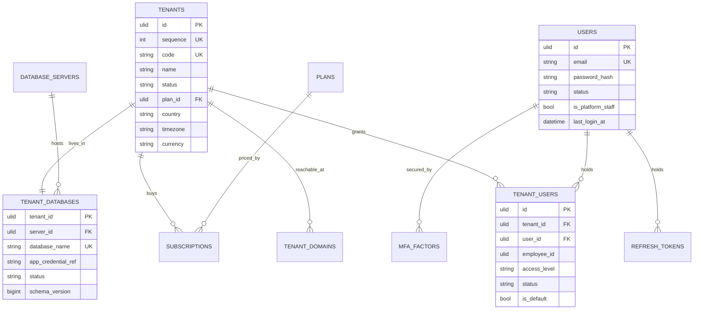
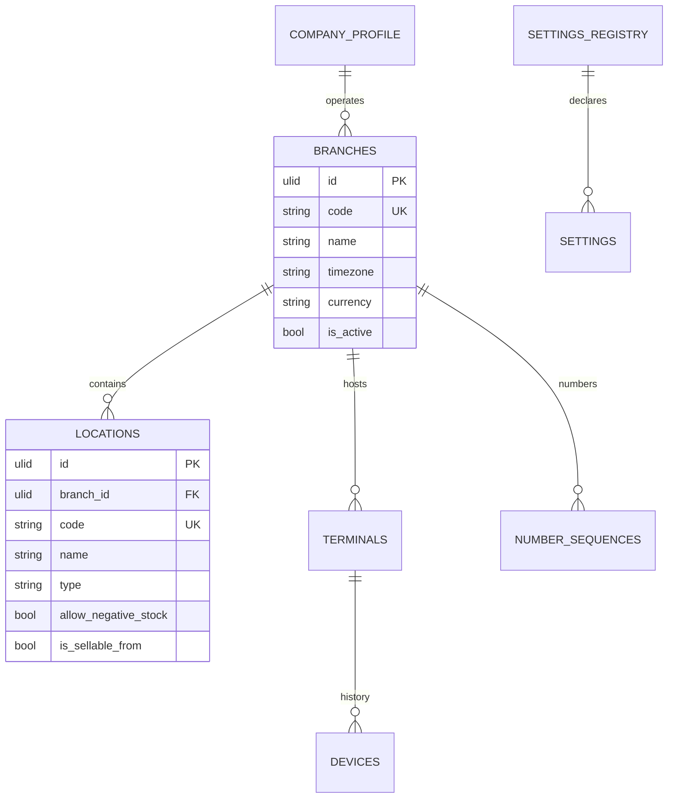
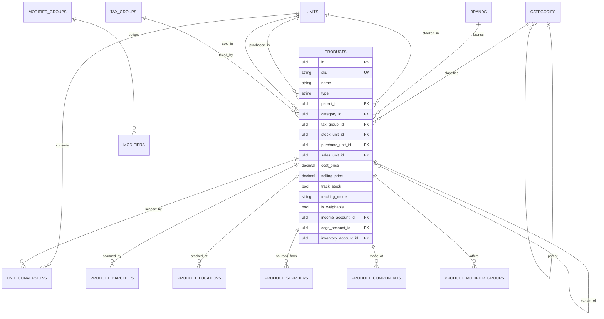
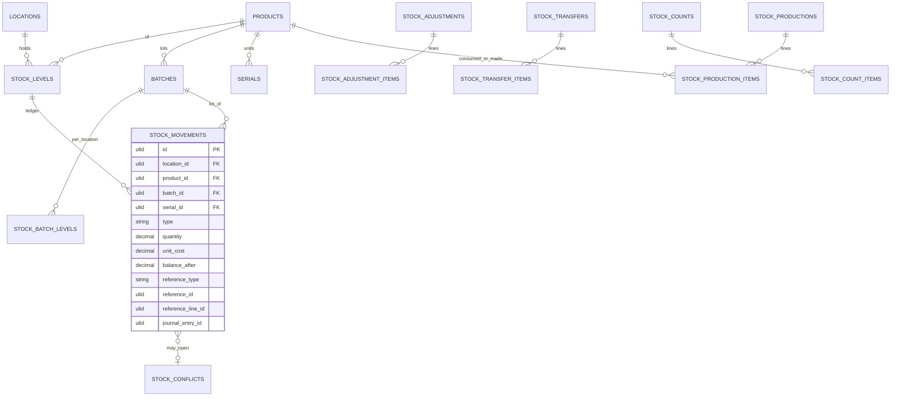
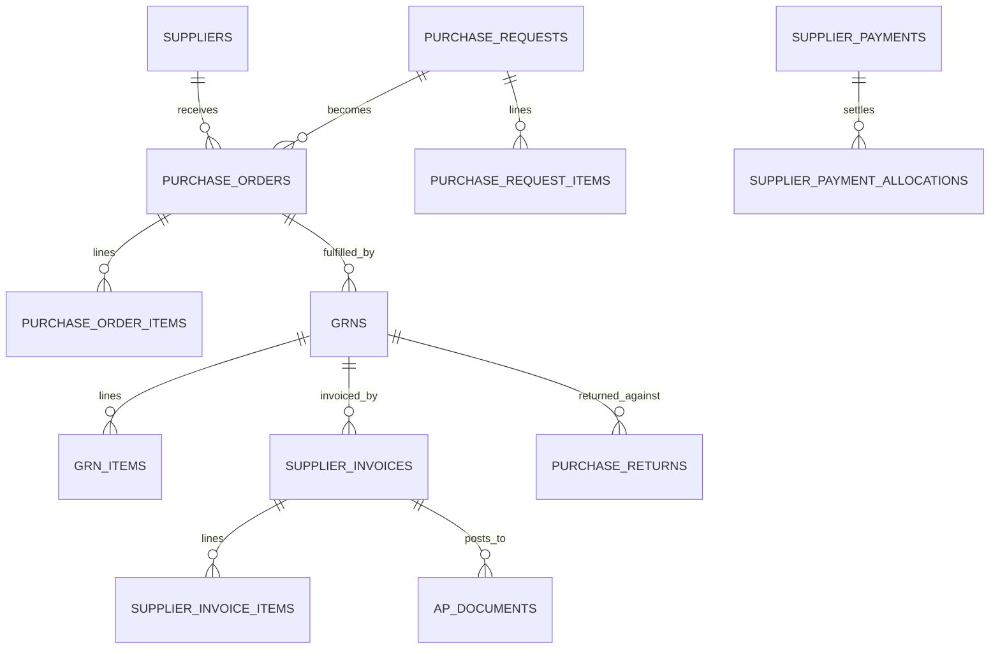
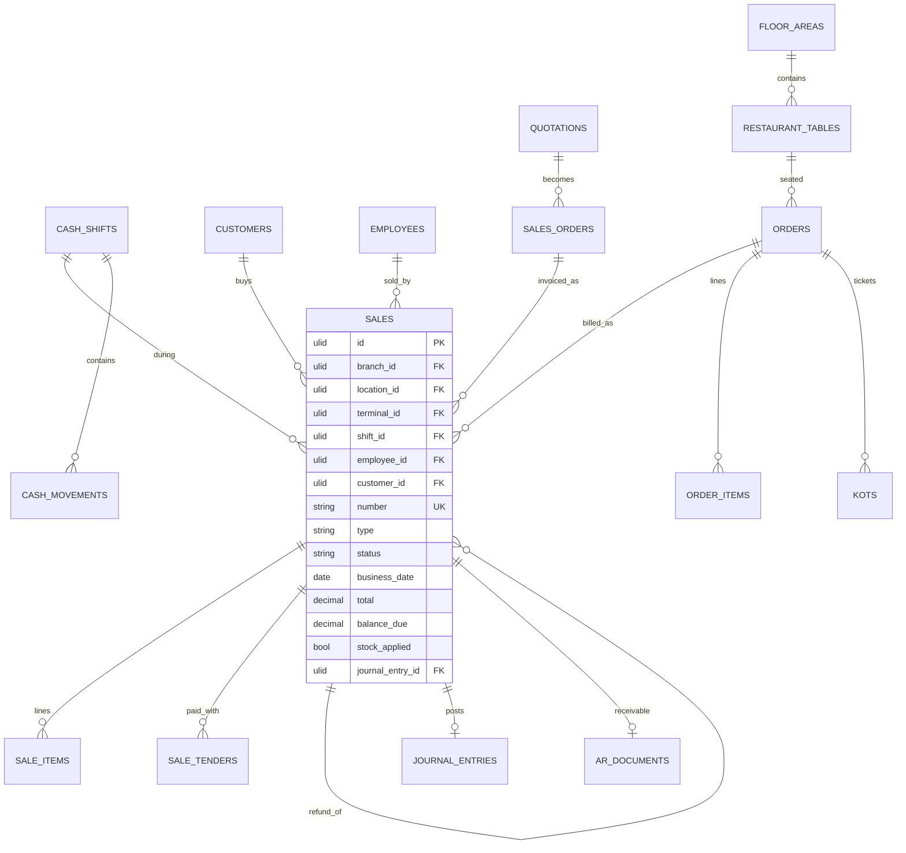
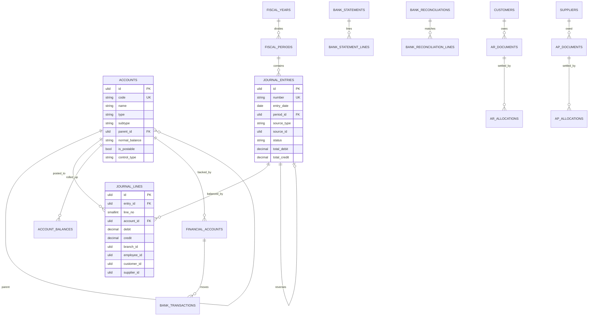
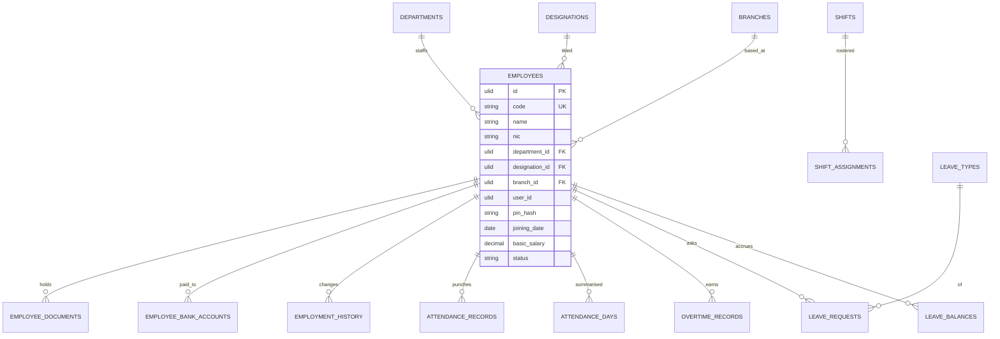
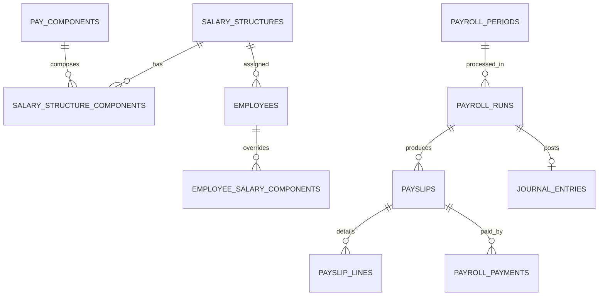

# FlexiPOS — Database Structure (master DB + one database per tenant)

| | |
|---|---|
| Status | **DRAFT v0.5** — companion to [architecture.md](architecture.md) v0.5. Supersedes the v0.3 database-per-service design in full |
| Date | 2026-10-06 |
| Decision source | [`Refference/ARCH.md`](../Refference/ARCH.md) (product owner, authoritative) §2, §3, §8, §23 · ERP scope from [`Refference/ERP.md`](../Refference/ERP.md) §31 · gaps closed: [gap-analysis-erp.md](gap-analysis-erp.md) Q-1 … Q-6, G-1 … G-18 · unit model: owner decisions U-1 … U-3 of 2026-10-06 ([decisions/T-006-unit-of-measure.md](decisions/T-006-unit-of-measure.md)) |
| Engine | MySQL 8.4 LTS (Docker dev, VPS, cloud). XAMPP mode uses MariaDB 10.4 with the notes in §14. InnoDB, `utf8mb4_0900_ai_ci`; id columns `ascii_bin` |
| Change log | **v0.5** (FP-243): the **unit of measure** becomes the second dimension of the rule §7 already states for currency. `products.unit_id` renamed `stock_unit_id` and declared the base; a symmetric `sales_unit_id` added; the `[UOM]` column set defined in §3.1 and applied to **seventeen** tables — the sixteen that already existed plus the new `stock_production_items`; conversion declared to happen **once, at the document line**, with the factor **snapshotted** on the line and no `unit_id` below the document layer; one factor-resolution ladder with a `dimension` guard; the `stock_movements` idempotency key rebuilt on `reference_line_id` plus generated batch/serial keys; prices carry a unit (owner U-1); weighable goods and a `barcode_rules` parser (U-2); repack as a real `stock_productions` document (U-3), which retires the dead `production_in`/`production_out` movement types; the weighted-average formula, the price-variance basis and three nightly quantity invariants written down; every bare `DECIMAL` given an explicit precision. Three new tables, ≈190 → ≈193 per tenant. **v0.4**: thirteen service schemas replaced by **one master database + one database per tenant**; `tenant_id` **removed from every tenant table**; cross-module foreign keys allowed and encouraged; projections, `*_refs` tables, inbox events and saga tables deleted; ERP domains added (double-entry accounting, AR/AP, cash & bank, expenses, HR, payroll, commission, warehouses, batch/serial, workflow engine); identity split between master login and tenant employee; tenant→database mapping, provisioning and per-tenant migration runner designed. v0.3 column design carried over wherever it still fits |

**Contents**
1 [What changed and why](#1-what-changed-and-why) ·
2 [Topology and naming](#2-topology-and-naming) ·
3 [Conventions](#3-conventions) ·
4 [Master database](#4-master-database) ·
5 [Identity split](#5-identity-split-master-login-vs-tenant-employee) ·
6 [Tenant database](#6-tenant-database) ·
7 [Accounting posting rules](#7-accounting-posting-rules) ·
8 [Tenant provisioning](#8-tenant-provisioning) ·
9 [Per-tenant migrations](#9-per-tenant-migrations-and-schema-versioning) ·
10 [Capacity per MySQL server](#10-capacity-how-many-tenants-fit-on-one-mysql-server) ·
11 [Index and partition strategy](#11-index-and-partition-strategy) ·
12 [Write paths](#12-write-paths) ·
13 [Backup, restore, export, move](#13-backup-restore-export-and-move) ·
14 [Local, CI and MariaDB notes](#14-local-ci-and-mariadb-notes) ·
15 [Deleted from v0.3](#15-deleted-from-v03) ·
16 [Open questions](#16-open-questions)

---

## 1. What changed and why

v0.3 split the data into thirteen schemas, one per service, with no foreign keys between them. Every schema carried `tenant_id` on every table, every cross-service reference was a bare id plus an event-fed projection table, and the accounting module — had it existed — would have had to rebuild a general ledger from an event stream because it could not join sales, purchases, payroll and inventory.

The product owner has decided (`Refference/ARCH.md`) on **master database + one database per tenant**. That decision resolves gap-analysis questions Q-1 to Q-6 at once:

| v0.3 | v0.4 | Consequence |
|---|---|---|
| 13 schemas, one per service | 1 master DB + 1 DB per tenant | the database, not a column, is the tenancy boundary |
| `tenant_id` on every table, first column of every index | **no `tenant_id` in tenant tables at all** | shorter keys, smaller indexes, no class of "forgot the tenant scope" bug, no accidental cross-tenant read |
| no cross-service FKs | foreign keys across modules are normal | referential integrity is the database's job again |
| projections (`product_refs`, `tenant_refs`, …) rebuilt from events | **deleted** — join the real table | ~20 tables and a whole drift-detection job disappear |
| snapshot endpoints, inbox events, saga steps for the online sale | **deleted** — one local transaction | the online sale is one `BEGIN … COMMIT` |
| accounting impossible without event replay | ledger joins the subledgers directly | double-entry accounting becomes tractable (§7) |
| one migration run per schema | **one migration run per tenant database** | the single biggest new operational cost — designed in §9, not later |

What is **kept** from v0.3 because it still fits: ULID primary keys; the money, quantity and rate types; soft deletes and audit timestamps; the append-only **stock ledger**; **snapshot columns** on financial documents (a five-year-old receipt must still reprint exactly, so `sale_items.product_name`, `unit_price` and `tax_breakdown` stay even though the product row is now one join away); the offline **sync inbox** and **POS replica**; the custom-field mechanism; and the index/partition thinking — revised in §11, because per-tenant databases change the arithmetic (partitions are files, and files are the scarce resource now).

What is **new** because ERP is in scope: finance with double-entry accounting, AR/AP, cash & bank and reconciliation; expenses; HR with attendance and leave; payroll; a commission engine; warehouses as locations distinct from branches; batch, serial and expiry tracking; and one workflow/approval engine driving expenses, purchase orders, leave, payroll and discounts.

---

## 2. Topology and naming

```text
                       MASTER DATABASE  (flexipos_master)
             who you are · which tenants you may open · where their database lives
                                        │
             ┌──────────────────────────┼──────────────────────────┐
             ▼                          ▼                          ▼
      db-01:3306                 db-01:3306                 db-02:3306
      flx_t_000001               flx_t_000002               flx_t_000917
      "ABC Pharmacy"             "XYZ Grocery"              enterprise tenant, dedicated server
```

| Thing | Rule | Example |
|---|---|---|
| Master database | one per platform installation | `flexipos_master` |
| Tenant identifier | `tenants.code`, immutable, human-visible, used in activation codes and support | `TEN000123` |
| Tenant database name | `flx_t_` + zero-padded `tenants.sequence` (6 digits, widens at 1 M) | `flx_t_000123` |
| Tenant app DB user | `flx_t000123_app` — DML only (`SELECT, INSERT, UPDATE, DELETE, EXECUTE`) on its own database | |
| Tenant migrate DB user | `flx_t000123_mig` — the above plus `CREATE, ALTER, DROP, INDEX, REFERENCES, CREATE VIEW, TRIGGER` on its own database | used only by `tenant:migrate` |
| Provisioner DB user | one per **server**, `CREATE`/`DROP DATABASE`, `CREATE USER`, `GRANT`; never used to serve a request | `flx_provisioner` |
| Laravel connection names | `master` (always configured) and `tenant` (built at runtime per request) | `DB::connection('master')`, `DB::connection('tenant')` |

Rules that follow from the topology, and that the code must enforce:

1. **The frontend never names a database.** It sends a tenant code; the backend verifies the authenticated user may open it, reads the mapping from master, and builds the connection server-side (`Refference/ARCH.md` §5, golden rule).
2. **No query ever joins across databases.** Cross-database SQL (`flx_t_000001.sales JOIN flexipos_master.users`) is forbidden and blocked by the per-tenant grant: the app user has rights on exactly one schema and nothing else. Master-side facts needed inside a tenant request (the acting user's e-mail, plan limits) travel in the request context, not in SQL.
3. **The master holds exactly three references into tenant data** — `tenant_users.employee_id`, `tenant_usage_metrics` counters, and `tenant_backups` — and all three are plain ULIDs/numbers with no foreign key, reconciled by a nightly checker (§4.9).
4. **Persistent PDO connections stay off.** With one DB user per tenant, a pooled connection is bound to one tenant and cannot be reused, so persistence only inflates `max_connections`. See §10.

---

## 3. Conventions

### 3.1 Column sets (tags used in the tables below)

| Tag | Columns | Notes |
|---|---|---|
| `[ID]` | `id CHAR(26) PK` | ULID, `ascii_bin`. Generated on the POS for entities created offline, on the server otherwise. Still globally unique, so an exported row keeps its identity |
| `[TS]` | `created_at DATETIME(3)`, `updated_at DATETIME(3)` | UTC |
| `[SOFT]` | `deleted_at DATETIME(3) NULL` | soft delete |
| `[BY]` | `created_by CHAR(26) NULL`, `updated_by CHAR(26) NULL` | **employee id**, FK to `employees` (was a bare column in v0.3) |
| `[CF]` | `custom_fields JSON NULL` | validated against `custom_field_definitions` in the same database |
| `[SYNC]` | `origin ENUM('online','offline')`, `terminal_id CHAR(26) NULL`, `device_id CHAR(26) NULL`, `client_seq BIGINT NULL`, `client_created_at DATETIME(3) NULL`, `sync_status ENUM('synced','conflict','review')`, `synced_at DATETIME(3) NULL` | only on entities the POS can create offline |
| `[BR]` | `branch_id CHAR(26) NOT NULL` FK `branches` | on every branch-scoped business row |
| `[GL]` | `journal_entry_id CHAR(26) NULL` FK `journal_entries` | on documents that post to the ledger; null until posted |
| `[UOM]` | `unit_id CHAR(26) NOT NULL` FK `units`, `quantity DECIMAL(18,4)` **in `unit_id`**, `unit_factor DECIMAL(18,6)` **snapshotted at entry**, `base_quantity DECIMAL(18,4)` = `ROUND(quantity × unit_factor, 4)` | on every **document line** that carries a quantity. `unit_code VARCHAR(50)` is added as well on the three **print-bearing** lines, which are exactly `sale_items`, `quotation_items` and `order_items` (D-66) — a receipt, a quotation and a kitchen ticket are the three things a customer or a cook reads. It generalises the snapshot `sale_items` already carries, so a reprint shows the unit that was sold. This is the quantity twin of the document-currency rule §7 already states for money — see §6.5 |

**There is no `[TENANT]` tag.** Nothing in a tenant database carries `tenant_id`. If a table needs to know which tenant it belongs to, it is in the wrong database.

**`[UOM]` degenerates on master data, and `unit_id` is not always `NOT NULL`.** **Seventeen** tables carry the tag: the sixteen listed through §6.3 to §6.7 plus `stock_production_items` (§6.5). Three of them are definitions rather than document lines and take only the part that means something there — `price_list_items` takes `unit_id` alone (the unit the `price` is *per*; its `min_qty` is a base threshold in the product's stock unit), `product_barcodes` takes `unit_id` plus a pack `quantity`, and `modifiers` takes `linked_unit_id` plus `linked_quantity`. A fourth, `product_components`, takes the whole quad but snapshots the factor when the bill-of-materials row is written rather than when it is consumed, so re-sizing a case does not silently re-scale every recipe that mentions it.

**Three tables hold a nullable `unit_id`**, and each null means something specific rather than "not filled in yet":

| Table | `unit_id` | What `NULL` means |
|---|---|---|
| `price_list_items` | NULL allowed | *priced per stock unit, derive by factor* — the fallback at the bottom of the price ladder (§6.4) |
| `product_barcodes` | NULL allowed | this barcode names no unit of its own, so it scans as the product's **stock unit** — multiplied by its own `quantity`, which may still be a pack of 6 |
| `supplier_invoice_items` | NULL allowed **only where `product_id` is null** | a non-stock line — freight, a service charge — which has no product and therefore no stock unit to convert into |

`modifiers.linked_unit_id` is nullable for the same reason `linked_product_id` is: a modifier that depletes no stock has neither. Everywhere else `unit_id` is `NOT NULL`. The constraint the design actually asserts is **"a line with a product has a unit"**, not "every line has a unit", and §14 records the exemption list the static test needs.

### 3.2 Types

Money `DECIMAL(18,4)` · quantity `DECIMAL(18,4)` · **unit conversion factor `DECIMAL(18,6)`** · rate/percentage `DECIMAL(9,4)` · exchange rate `DECIMAL(18,8)` · codes `VARCHAR(50)` · names `VARCHAR(150)` · enumerations `VARCHAR(30)` with application enums (written `enum(...)` below) · `JSON` with application schemas · business dates `DATE` in the branch timezone · all `DATETIME(3)` in UTC.

**One precision authority each, and a fixed rounding order.** Every stored quantity is `DECIMAL(18,4)`; every conversion factor is `DECIMAL(18,6)`; `units.precision` is **display and input rounding only, never storage** (`CHECK (precision BETWEEN 0 AND 4)`). The order is fixed and identical in the PHP and the TypeScript engine: **round the entered `quantity` to `units.precision` first, then compute `base_quantity`.** Rounding in the other order lets the till and the server disagree in the fourth decimal, which is a receipt that does not match the ledger.

**A bare `DECIMAL` is a bug, not a shorthand.** In MySQL `DECIMAL` with no precision is `DECIMAL(10,0)` — an integer — so a bare quantity column truncates 0.5 kg to zero. The convention above is what a column *should* be, not what the engine will infer, so every column below states its precision explicitly and §14 records the static test that forbids `decimal()` without precision in a tenant migration.

### 3.3 Rules

- **Foreign keys everywhere inside a database.** `RESTRICT` for anything financial or referenced by a document; `CASCADE` only for pure children (`sale_items` under `sales`, `journal_lines` under `journal_entries`). Deliberate exception: append-only ledgers (`stock_movements`, `customer_ledger`, `journal_lines`) reference documents by `reference_type` + `reference_id` polymorphically and therefore carry **no** FK on that pair.
- Financial rows are **immutable after posting**. A correction is a new row (a reversal plus a new entry), never an `UPDATE`.
- Unique keys no longer start with `tenant_id`: `products.sku` is simply unique, `sales.number` is simply unique.
- **A unique key over a nullable column does not constrain the null rows.** MySQL and MariaDB treat NULLs as *distinct* in a unique index, so if `NULL` is a **meaningful value** in that column — "global", "none", "per stock unit" — the key silently permits unlimited duplicates of exactly the row that matters. Where that happens, the column is paired with a **stored generated sentinel column** and the key is built on the sentinel:
  ```sql
  <name>_key CHAR(26) GENERATED ALWAYS AS (COALESCE(<nullable_column>, '-')) STORED
  ```
  **The sentinel is chosen per type, and `'-'` is only correct for a ULID column.** A ULID is always 26 characters and the sentinel is one, so for `CHAR(26)` identifier columns the two can never collide. That argument does not survive its first non-identifier site: `journal_entries.source_purpose VARCHAR(30) NULL` is one of FP-180's eleven, and `'-'` is a legal value there. For a free-text or enumerated column the sentinel must be a value the domain cannot produce — the empty string where the column is otherwise `NOT NULL`-by-convention, or a reserved token the application rejects on write — and whichever it is must be stated in the row, not inherited from here. **Applied at three sites and on four columns so far, and it is the same bug every time:** `stock_movements.batch_key` and `serial_key` (§6.5), `price_list_items.unit_key` (§6.4), `unit_conversions.product_key` (§6.3). **Those are the sites that were found, not the sites that exist:** FP-180 lists **eleven further unique keys in §6 that this rule reaches and that do not yet carry it**, two of them correctness rather than hygiene — duplicate company-wide document numbers, and the ledger's own double-post guard. A reader of this section should not conclude the schema is clean; it is now merely findable. The mirror case is also used once, deliberately: where the null rows *should* escape the key, the generated column is `NULL` for them on purpose — `barcode_rules.active_prefix` (§6.3). Stored generated columns are indexable on both engines (§14), so none of this needs an engine branch.
- Snapshot columns stay on documents. A document must reprint identically after the master data behind it changes.
- Plugin tables live in the tenant database, prefixed `plg_<plugin>_`, and may hold foreign keys to core tables but must never alter them.
- Every tenant database has the system tables of §6.21; the master has its own set in §4.10.

---

## 4. Master database

Small and slow-changing: ~30 tables, a few hundred thousand rows at 1 000 tenants. One database, one connection (`master`), backed up far more often than any tenant.

### 4.1 Tenancy and identity



| Table | Columns / notes |
|---|---|
| tenants | `[ID]` `[TS]` `[SOFT]`, sequence INT UNSIGNED AUTO-assigned unique (drives the database name), code VARCHAR(30) unique, slug VARCHAR(63) unique, name, legal_name, status enum(pending, provisioning, trial, active, past_due, suspended, read_only, closed, archived), plan_id FK plans, country CHAR(2), timezone, currency CHAR(3), locale, business_type enum(retail, restaurant, both), industry, contact_name, contact_email, contact_phone, trial_ends_at, activated_at, suspended_at, suspension_reason, closed_at, data_region VARCHAR(20), notes. Index (status), (plan_id) |
| tenant_domains | `[ID]` `[TS]`, tenant_id FK, host VARCHAR(191) unique, type enum(subdomain, custom), is_primary, verified_at, tls_status. Resolves a request to a tenant before login when the deployment is host-based |
| users | `[ID]` `[TS]` `[SOFT]`, name, email VARCHAR(191) **globally unique**, email_verified_at, phone, password_hash (Argon2id), status enum(invited, active, disabled, locked), is_platform_staff BOOL, platform_role enum(super_admin, support, billing, readonly) NULL, locale, timezone, avatar_path, failed_attempts, locked_until, must_change_password, password_changed_at, last_login_at, last_login_ip VARBINARY(16). One row per human who logs in, tenant customer or platform staff alike, so there is one login endpoint, one token issuer and one MFA path |
| tenant_users | `[ID]` `[TS]` `[SOFT]`, tenant_id FK, user_id FK, **employee_id CHAR(26) NULL** (the `employees.id` inside the tenant database — the one deliberate cross-database reference, no FK possible), access_level enum(owner, admin, member) (coarse, used only before the tenant DB is open; real permissions live in the tenant DB), status enum(invited, active, suspended), is_default BOOL, invited_by FK users NULL, invited_at, accepted_at, last_accessed_at; unique (tenant_id, user_id), unique (tenant_id, employee_id) where not null. Index (user_id, status) |
| mfa_factors | `[ID]` `[TS]`, user_id FK, type enum(totp, recovery_codes, webauthn), secret TEXT (encrypted at rest with the app key), confirmed_at, last_used_at |
| refresh_tokens | `[ID]` `[TS]`, principal_type enum(user, terminal, service), principal_id CHAR(26), tenant_id FK NULL (tenant-scoped tokens), token_hash CHAR(64) unique, family_id (rotation chain), expires_at, used_at, revoked_at, ip VARBINARY(16), user_agent. Index (principal_type, principal_id) |
| signing_keys | kid VARCHAR(40) PK, algorithm, public_key TEXT, private_key_ref VARCHAR(255) (secret reference, never the key), status enum(active, retiring, retired), created_at, retired_at |
| service_clients | name VARCHAR(50) PK, secret_hash, allowed_audiences JSON, status. Internal machine-to-machine callers (print agent relay, analytics feeder) |
| login_history | id BIGINT AUTO PK, user_id NULL, tenant_id NULL, email, principal_type, success BOOL, failure_reason, ip VARBINARY(16), user_agent, device_id, created_at. Index (email, created_at), (user_id, created_at). 180-day retention |
| security_events | id BIGINT AUTO PK, type enum(lockout, password_reset, mfa_enrolled, mfa_failed, token_reuse, impersonation, grant_changed, credential_rotated), user_id NULL, tenant_id NULL, actor_id NULL, detail JSON, ip, created_at |

Terminal activation needs no master directory table: an activation code is issued as `TEN000123-XXXX-XXXX`, so the tenant is resolvable from the code itself, and every terminal token thereafter carries a signed `tenant_id`.

### 4.2 Plans, subscriptions, billing

| Table | Columns / notes |
|---|---|
| plans | `[ID]` `[TS]` `[SOFT]`, code unique, name, description, price DECIMAL(18,4), currency, billing_cycle enum(monthly, quarterly, yearly), trial_days, is_public, is_active, sort_order |
| plan_features | plan_id FK, feature_key VARCHAR(60) FK feature_flags, value JSON (boolean, number or config); PK (plan_id, feature_key) |
| plan_limits | plan_id FK, limit_key enum(branches, locations, terminals, users, employees, products, monthly_sales, storage_mb, api_calls_per_day), value INT; PK (plan_id, limit_key) |
| subscriptions | `[ID]` `[TS]`, tenant_id FK, plan_id FK, status enum(trial, active, past_due, paused, cancelled, expired), quantity INT (seats/terminals), unit_price, currency, starts_at, current_period_start, current_period_end, trial_ends_at, cancel_at, cancelled_at, cancellation_reason, external_ref VARCHAR(100) (gateway subscription id). Index (tenant_id, status), (current_period_end) |
| billing_invoices | `[ID]` `[TS]`, tenant_id FK, subscription_id FK NULL, number unique, status enum(draft, open, paid, void, uncollectible), issue_date, due_date, currency, subtotal, tax_total, total, amount_paid, amount_due, pdf_path, external_ref. Index (tenant_id, status, due_date) |
| billing_invoice_lines | `[ID]`, invoice_id FK CASCADE, description, period_start, period_end, quantity, unit_price, amount, tax_rate, tax_amount, metric_key NULL (usage-based lines) |
| billing_payments | `[ID]` `[TS]`, tenant_id FK, invoice_id FK NULL, amount, currency, method enum(card, bank_transfer, cash, credit), status enum(pending, succeeded, failed, refunded), gateway, gateway_ref, paid_at, failure_reason |
| licences | `[ID]` `[TS]`, tenant_id FK, type enum(platform, plugin, module), subject VARCHAR(100) (plugin name or module key), licence_key CHAR(64) unique, seats INT NULL, terminals INT NULL, valid_from, valid_until, status enum(active, expired, revoked, suspended), issued_by FK users, signature TEXT (detached signature so an offline installation can verify the licence), revoked_at, revoked_reason. Index (tenant_id, status), (valid_until) |
| feature_flags | key VARCHAR(60) PK, description, default_enabled BOOL, owner_module VARCHAR(40), is_plugin_flag BOOL |
| tenant_feature_flags | tenant_id FK, flag_key FK, enabled BOOL, reason, set_by FK users, `[TS]`; PK (tenant_id, flag_key). Overrides the plan |
| tenant_usage_metrics | tenant_id FK, metric_date DATE, sales_count, sales_value, active_terminals, active_users, employees, products, database_bytes, table_count, api_calls, storage_bytes, collected_at; PK (tenant_id, metric_date). Written nightly by a collector that connects to each tenant database once, so plan-limit enforcement and platform analytics never fan out queries at request time (`Refference/ARCH.md` §17) |

### 4.3 Plugin licensing and enablement

Master decides **whether** a plugin may run; the tenant database holds the plugin's settings and data (`Refference/ARCH.md` §12).

| Table | Columns / notes |
|---|---|
| plugins | `[ID]` `[TS]` `[SOFT]`, name VARCHAR(100) unique, display_name, type enum(module, integration, theme, report, vertical), author, description, visibility enum(official, private, third_party), status enum(uploaded, validated, published, deprecated, withdrawn), latest_version_id, signature_key_id, requires_licence BOOL |
| plugin_versions | `[ID]` `[TS]`, plugin_id FK, version VARCHAR(20), core_constraint VARCHAR(40), manifest JSON, package_path, checksum CHAR(64), signature TEXT, migration_count INT, status enum(available, deprecated, yanked), released_at; unique (plugin_id, version) |
| plugin_dependencies | plugin_version_id FK, depends_on_plugin VARCHAR(100), version_constraint; PK (plugin_version_id, depends_on_plugin) |
| plugin_tenant_access | plugin_id FK, tenant_id FK, granted_by FK users, `[TS]`; PK (plugin_id, tenant_id). Private plugins only |
| tenant_plugins | `[ID]` `[TS]`, tenant_id FK, plugin_id FK, plugin_version_id FK, status enum(installing, enabled, disabled, updating, error), **schema_version BIGINT** (how far this plugin's per-tenant migrations have run inside that tenant database), licence_id FK licences NULL, installed_at, enabled_at, disabled_at, installed_by FK users, failure_count, tripped_at, last_error; unique (tenant_id, plugin_id) |

### 4.4 The mapping — `database_servers` and `tenant_databases`

This is the heart of the architecture. Everything else can be rebuilt; a wrong or lost mapping row means a tenant's data is unreachable.

| Table | Columns / notes |
|---|---|
| database_servers | `[ID]` `[TS]`, code VARCHAR(30) unique (`db-01`), name, **host VARCHAR(191)**, **port SMALLINT UNSIGNED DEFAULT 3306**, read_host NULL, read_port NULL (replica for reporting), engine enum(mysql, mariadb), engine_version, tls_mode enum(disabled, preferred, required, verify_ca), tls_ca_ref VARCHAR(255) NULL, provisioner_credential_ref VARCHAR(255), region VARCHAR(20), tier enum(shared, dedicated), **max_tenants SMALLINT** (capacity cap, §10), tenant_count SMALLINT (maintained by provisioning, verified nightly), max_connections SMALLINT (mirror of the server setting, for placement arithmetic), status enum(active, draining, read_only, maintenance, retired), accepts_new_tenants BOOL, notes |
| **tenant_databases** | **tenant_id CHAR(26) PK** FK tenants, server_id FK database_servers, read_server_id FK NULL (override when this tenant reports off a different replica), **database_identifier** VARCHAR(30) unique (`TEN000123`, mirrors `tenants.code`), **database_name** VARCHAR(64), **app_username** VARCHAR(32), **app_credential_ref** VARCHAR(255), **migrate_username** VARCHAR(32), **migrate_credential_ref** VARCHAR(255), credential_version INT, credential_rotated_at, charset, collation, **status** enum(provisioning, active, migrating, read_only, suspended, moving, restoring, archived, failed), status_reason, **schema_version BIGINT**, target_schema_version BIGINT, last_migrated_at, last_migration_error TEXT NULL, profile enum(standard, large) (drives partitioning, §11), size_bytes BIGINT, table_count SMALLINT, row_estimate BIGINT, measured_at, provisioned_at, last_opened_at, archived_at, `[TS]`; unique (server_id, database_name), index (status), **index (schema_version)**, index (server_id, status) |

**Credentials are never stored in plain text and never stored as ciphertext next to the mapping unless there is nowhere better.** The mapping holds a *reference*, resolved at connect time by a `SecretResolver` with one driver per scheme:

| Scheme | Resolves to | Where it is used |
|---|---|---|
| `vault://kv/flexipos/tenant/000123/app` | HashiCorp Vault KV v2, versioned | cloud (stage 2) |
| `awssm://flexipos/tenant/000123/app` · `azkv://flexipos-tenant-000123-app` | AWS Secrets Manager / Azure Key Vault | cloud |
| `file:///run/secrets/tenant_000123_app` | Docker/Compose secret or systemd credential, file mode 0400 | VPS (stage 0/1) — **the default for this project today** |
| `env://TENANT_000123_APP_PASSWORD` | process environment | local XAMPP development only, refused when `APP_ENV=production` |
| `enc://<ulid>` | row in `tenant_credential_blobs` (see below) | fallback when no secret store exists |

| Table | Columns / notes |
|---|---|
| tenant_credential_blobs | `[ID]` `[TS]`, tenant_id FK, role enum(app, migrate), ciphertext BLOB (AES-256-GCM via Laravel's encrypter), key_id VARCHAR(40) (which key encrypted it), version INT, rotated_at; unique (tenant_id, role, version). **Only used by the `enc://` driver.** The encryption key lives in `DB_CREDENTIAL_KEY`, which is deliberately **not** `APP_KEY` and is supplied to the process from outside the database — a dump of the master database must not be enough to open a tenant database |

Resolution and caching:

- `TenantConnectionResolver` reads `tenant_databases` + `database_servers` (single joined query, cached in Redis for 300 s under key **`tenant:conn:<tenant_id>`**), resolves the secret, and calls `config()->set('database.connections.tenant', …)` + `DB::purge('tenant')`. **The cache key is the tenant id alone** (FP-158): `credential_version` is a *value* inside the cached mapping, not part of the key, because the version is only known after the mapping has been read — a key that contained it could never be constructed for the lookup that is meant to produce it.
- **The resolved secret is cached against the version it belongs to, not for the process lifetime** (FP-158): the in-memory entry is keyed `<tenant_id>:<credential_version>`, so the rotation two bullets down invalidates it by construction — a worker that still holds version 7 and then reads a mapping at version 8 resolves the secret again instead of reusing a password the server no longer accepts. Secrets are never written to Redis, and a connection failure on an authentication error drops the entry and retries the resolve exactly once.
- Any write to `tenant_databases` bumps `credential_version` or `updated_at` and publishes `tenant.mapping.changed`, which evicts the cache on every node.
- Status gates the connection: `active` → read/write; `read_only` and `archived` → connection forced `read-only` and writes rejected at the repository layer; `migrating`, `provisioning`, `moving`, `restoring`, `suspended`, `failed` → HTTP 503 for that tenant with `Retry-After`, everyone else unaffected.
- Rotation: generate a new password → write the new secret version → `ALTER USER … IDENTIFIED BY` → bump `credential_version` → evict caches. Old connections finish their request; new ones use the new secret. Failure at any step leaves the old secret valid, so rotation is safe to retry.

### 4.5 Schema versioning catalogue

| Table | Columns / notes |
|---|---|
| schema_versions | version BIGINT PK (monotonic ordinal, assigned in CI in migration order), migration VARCHAR(191) unique (the Laravel migration file name), release VARCHAR(20) (app version that introduced it), phase enum(expand, backfill, contract), checksum CHAR(64) (of the migration file, so a rewritten migration is detected), is_destructive BOOL, requires_offline BOOL, estimated_seconds INT, notes, released_at. Seeded from the migration directory by `schema:publish` in CI, committed as a fixture, and compared against the directory on every boot |

`app_required_schema_version` is a constant in the application. On boot and on every tenant connection the host asserts `tenant_databases.schema_version >= app_required_schema_version`; a tenant behind that line is refused with 503 rather than allowed to run queries against columns that do not exist yet.

### 4.6 Migration runs

| Table | Columns / notes |
|---|---|
| tenant_migration_runs | `[ID]` `[TS]`, target_version BIGINT, initiated_by FK users NULL, mode enum(all, canary, selected, retry), selector JSON (tenant ids, server ids, filters), concurrency SMALLINT, status enum(planned, running, paused, completed, completed_with_failures, aborted), total, pending, running, done, failed, skipped, started_at, finished_at, aborted_reason |
| tenant_migration_jobs | `[ID]`, run_id FK CASCADE, tenant_id FK, server_id FK, from_version BIGINT, to_version BIGINT, status enum(pending, claimed, running, done, failed, skipped, cancelled), attempts SMALLINT, claimed_by VARCHAR(64) (worker id), claimed_at, lock_expires_at, started_at, finished_at, duration_ms, error_class, error_message TEXT, error_migration VARCHAR(191), log_path; unique (run_id, tenant_id), index (run_id, status), index (status, lock_expires_at) |
| tenant_backfill_jobs | `[ID]` `[TS]`, key VARCHAR(100) (backfill name), tenant_id FK, status enum(pending, running, done, failed), cursor VARCHAR(64) (last id processed), processed BIGINT, total BIGINT, chunk_size INT, attempts, last_error, finished_at; unique (key, tenant_id) |

### 4.7 Provisioning

| Table | Columns / notes |
|---|---|
| tenant_provisioning_runs | `[ID]` `[TS]`, tenant_id FK, type enum(create, restore, clone, move, deprovision), source_tenant_id NULL, target_server_id FK NULL, status enum(running, completed, failed, rolled_back), current_step, started_at, finished_at, error TEXT, initiated_by FK users |
| tenant_provisioning_steps | `[ID]`, run_id FK CASCADE, step VARCHAR(40), sequence SMALLINT, status enum(pending, running, done, failed, skipped, compensated), attempts, started_at, finished_at, output JSON, error TEXT; unique (run_id, step) |

### 4.8 Backup catalogue

| Table | Columns / notes |
|---|---|
| tenant_backups | `[ID]` `[TS]`, tenant_id FK, type enum(nightly, pre_migration, pre_move, on_demand, export, final), trigger_ref VARCHAR(64) NULL (migration run id, provisioning run id), schema_version BIGINT, started_at, finished_at, status enum(running, succeeded, failed, expired, deleted), size_bytes, location VARCHAR(500) (path or object-store URI), checksum CHAR(64), encrypted BOOL, retention_until DATE, restore_tested_at NULL, notes; index (tenant_id, created_at), (retention_until) |

### 4.9 Platform settings, audit and consistency

| Table | Columns / notes |
|---|---|
| platform_settings | key VARCHAR(120) PK, value JSON, type, description, is_secret BOOL, updated_by FK users, updated_at |
| platform_audit_logs | id BIGINT AUTO PK, actor_type enum(user, service, system), actor_id NULL, actor_email, tenant_id NULL, action VARCHAR(80) (`tenant.created`, `mapping.updated`, `credential.rotated`, `plan.changed`, `impersonation.started`, `plugin.enabled`, `migration.run`), subject_type, subject_id, before JSON, after JSON, ip, user_agent, request_id, created_at. Index (tenant_id, created_at), (action, created_at). **Never pruned below 7 years** — it is the record of who changed a tenant's database mapping |
| consistency_checks | `[ID]` `[TS]`, check VARCHAR(60) (`tenant_users.employee_id`, `tenant_count`, `schema_version_drift`, `orphan_database`, `unmapped_database`), tenant_id NULL, status enum(ok, warn, fail), detail JSON, checked_at. Written nightly. `orphan_database` = a database on a server with no mapping row; `unmapped_database` = a mapping row pointing at a database that does not exist — both are pages-someone incidents |

### 4.10 Master system tables

`migrations` (Laravel, for the master schema itself), `jobs`, `job_batches`, `failed_jobs`, `cache`/`cache_locks` (only if Redis is unavailable), `password_reset_tokens`, `personal_access_tokens` (platform API).

**Master table count: 34.**

---

## 5. Identity split (master login vs tenant employee)

This is settled here, because it is the one place where the master/tenant line runs through a single business concept.

| Concept | Lives in | Why |
|---|---|---|
| Login identity: e-mail, password hash, MFA, account status, last login | **master** `users` | one person, one login, across every tenant they may access (`Refference/ARCH.md` §6). Password reset, lockout and MFA are platform functions |
| Which tenants a person may open, and at what coarse level | **master** `tenant_users` | it must be answerable *before* any tenant database is opened |
| Employees: name, NIC, department, designation, joining date, salary, bank details, documents | **tenant** `employees` | business data. Payroll, commission, attendance and leave all key off the employee |
| Roles, permissions, role assignments, branch scoping | **tenant** `roles`, `permissions`, `employee_roles` | permission sets are business-specific and differ per tenant; a platform-level role table would force every tenant into one vocabulary |
| Cashier / waiter PIN | **tenant** `employees.pin_hash` | a till must verify a PIN **offline**, so the hash has to reach the POS replica; it can only come from the tenant database |
| Terminal credentials | **tenant** `terminal_credentials` | a terminal belongs to a branch, which is business data. The activation code carries the tenant code so the first contact still resolves |

Three consequences the design must honour:

1. **A cashier or waiter may have no master login at all.** `employees.user_id` is nullable. Such a person exists only in the tenant database, signs in to the till with a PIN, appears on the roster and the payslip, and can never reach the web application. Creating a login for them is a separate, explicit act that inserts a `users` row and a `tenant_users` row and back-fills `employees.user_id`.
2. **Payroll and commission attach to `employee_id`, never `user_id`.** Every financial and HR table below references `employees`. `sales.employee_id` and `sale_items.employee_id` exist from day one (gap analysis §6, item 1) so commission by product category is computable without a backfill.
3. **The link is checked, not enforced.** `employees.user_id` → master `users.id` and `tenant_users.employee_id` → tenant `employees.id` are cross-database references with no foreign key. They are written together in an application-level two-step (tenant row first, then master row, with a compensating delete), and the nightly `consistency_checks` job reports dangling pairs in both directions.

Login and tenant resolution:

```text
POST /auth/login  {email, password}
  master: users → verify password, status, MFA
  master: tenant_users JOIN tenants → the tenant list (id, code, name, status, is_default)
  issue PLATFORM token  {sub: user_id, scope: platform, tenants: [...]}      ← opens no tenant DB

POST /auth/tenant   {tenant_code}                       (or implied by tenant_domains host)
  master: tenant_users(user_id, tenant_id).status = active AND tenants.status in (trial, active, past_due)
  master: tenant_databases.status = active AND schema_version >= app_required_schema_version
  resolve connection, open tenant DB
  tenant: employees WHERE id = tenant_users.employee_id → roles, permissions, branches, perm_hash
  issue TENANT token  {sub: user_id, tenant: tenant_id, employee: employee_id, branch: branch_id, perm_hash}

POS terminal
  activation code TEN000123-XXXX-XXXX → tenant resolved from the code
  tenant: terminal_credentials → terminal token {tenant, terminal_id, branch_id}
  offline: employees.pin_hash arrives in pos_replica; the till verifies the PIN locally
```

`perm_hash` in the token is a hash of the employee's effective permission set plus `employees.perm_version`; bumping `perm_version` in the tenant database invalidates every issued token for that employee at the next request without a master round-trip.

---

## 6. Tenant database

One per shop. **No `tenant_id` anywhere.** Foreign keys across module boundaries are normal. ≈193 tables at full ERP scope (≈98 after Phase 2, before finance and HR land) — see §10 for what that count costs on a shared server.

| § | Domain (= Laravel module) | Tables |
|---|---|---|
| 6.1 | Organisation and locations | 9 |
| 6.2 | Access control | 8 |
| 6.3 | Catalog | 14 |
| 6.4 | Pricing and tax | 9 |
| 6.5 | Inventory | 15 |
| 6.6 | Purchasing | 14 |
| 6.7 | Sales and POS (incl. restaurant) | 15 |
| 6.8 | Payments | 6 |
| 6.9 | Customers and CRM | 8 |
| 6.10 | Finance (GL, AR, AP, cash & bank) | 19 |
| 6.11 | Expenses | 5 |
| 6.12 | HR | 15 |
| 6.13 | Payroll | 10 |
| 6.14 | Commission | 7 |
| 6.15 | Workflow and approvals | 5 |
| 6.16 | Notifications | 6 |
| 6.17 | Printing | 6 |
| 6.18 | Offline sync | 5 |
| 6.19 | Reporting | 6 |
| 6.20 | Plugins (tenant side) | 3 + plugin-owned |
| 6.21 | System | 8 |

### 6.1 Organisation and locations



| Table | Columns / notes |
|---|---|
| **company_profile** | single row (`id` fixed `'COMPANY'`): name, legal_name, registration_no, tax_registration_no, address JSON, phone, email, website, logo_path, currency CHAR(3), timezone, locale, fiscal_year_start_month TINYINT, date_format, number_format, decimal_places, rounding_rule, business_type, `[TS]`. The tenant-level attributes that used to hang off the `tenants` row now that `tenant_id` is gone. Mirrored from master at provisioning, then owned by the tenant |
| branches | `[ID]` `[TS]` `[SOFT]` `[BY]` `[CF]`, code VARCHAR(10) unique, name, address JSON, phone, email, timezone, currency, tax_registration_no, business_type, opening_date, default_location_id FK locations NULL, cost_centre_account_id FK accounts NULL, is_active, sort_order |
| **locations** | `[ID]` `[TS]` `[SOFT]` `[BY]`, branch_id FK **NULL** (a central warehouse belongs to no branch), code unique, name, type enum(**branch_store**, **warehouse**, transit, consignment, damaged, virtual), address JSON, manager_employee_id FK employees NULL, allow_negative_stock BOOL, is_sellable_from BOOL, is_purchasable_to BOOL, is_active, sort_order. **Stock is keyed by `location_id`, not `branch_id`** (closes gap G-7). Every branch gets one `branch_store` location at provisioning, so single-shop tenants never see the distinction |
| terminals | `[ID]` `[TS]` `[SOFT]`, branch_id FK, location_id FK (what it sells from), code VARCHAR(10), name, status enum(pending, active, inactive, revoked), activation_code, activation_expires_at, current_device_id FK devices NULL, invoice_prefix VARCHAR(20), default_price_list_id FK NULL, last_seen_at, last_sync_at, offline_since, app_version, agent_version, settings JSON; unique (branch_id, code) |
| devices | `[ID]` `[TS]`, terminal_id FK, fingerprint CHAR(64), platform, browser, os, screen, registered_at, last_seen_at, revoked_at, revoked_by FK employees NULL |
| settings | `[ID]` `[TS]`, scope_type enum(company, branch, terminal, employee), scope_id CHAR(26) NULL, key VARCHAR(120) FK settings_registry, value JSON, updated_by FK employees NULL; unique (scope_type, scope_id, key). Effective value = terminal → branch → company → registry default |
| settings_registry | key VARCHAR(120) PK, module VARCHAR(40), type, default_value JSON, validation JSON, sync_to_pos BOOL, is_secret BOOL, plugin_name NULL. Declared by modules and plugins at boot |
| custom_field_definitions | `[ID]` `[TS]` `[SOFT]`, entity_type enum(product, customer, supplier, sale, purchase_order, order, employee, expense), key, label, type enum(text, number, date, boolean, dropdown, multi_select, currency, barcode), options JSON, is_required, default_value JSON, validation JSON, is_indexed, show_in_pos, sort_order, plugin_name NULL; unique (entity_type, key) |
| number_sequences | `[ID]`, branch_id FK NULL, document_type enum(sale, refund, quotation, sales_order, purchase_request, purchase_order, grn, purchase_return, supplier_invoice, supplier_payment, customer_payment, stock_adjustment, stock_transfer, stock_count, **stock_production**, expense, journal_entry, payslip, commission_payout), prefix, next_number BIGINT, padding TINYINT, suffix, reset_period enum(never, yearly, monthly, daily), last_reset_at, `[TS]`; unique (branch_id, document_type). Allocated with `UPDATE … SET next_number = LAST_INSERT_ID(next_number + 1)` inside the document transaction |

### 6.2 Access control

| Table | Columns / notes |
|---|---|
| permissions | key VARCHAR(80) PK, module VARCHAR(40), plugin_name NULL, group VARCHAR(40), description, is_branch_scoped BOOL. Seeded at provisioning from the application's registry; plugin rows added when a plugin is enabled |
| roles | `[ID]` `[TS]` `[SOFT]`, key unique, name, description, is_system BOOL (cannot be deleted), plugin_name NULL, sort_order |
| role_permissions | role_id FK CASCADE, permission_key FK; PK (role_id, permission_key) |
| employee_roles | `[ID]`, employee_id FK, role_id FK, branch_id FK NULL (null = all branches), granted_by FK employees NULL, granted_at; unique (employee_id, role_id, branch_id) |
| employee_permissions | employee_id FK CASCADE, permission_key FK, branch_id FK NULL, allowed BOOL; PK (employee_id, permission_key, branch_id). Per-person grant or explicit deny on top of roles |
| employee_branches | employee_id FK CASCADE, branch_id FK, is_default BOOL, `[TS]`; PK (employee_id, branch_id) |
| terminal_credentials | terminal_id CHAR(26) PK FK terminals, secret_hash, device_fingerprint CHAR(64) NULL, status enum(active, revoked), activated_at, activated_by FK employees NULL, revoked_at, revoked_by, rotated_at |
| access_log | id BIGINT AUTO PK, employee_id FK NULL, terminal_id FK NULL, type enum(pin_login, pin_failed, terminal_login, permission_denied, override_used), permission_key NULL, branch_id NULL, detail JSON, ip, created_at. Index (employee_id, created_at). 180-day retention. Distinct from master `login_history`, which records web logins |

### 6.3 Catalog



| Table | Columns / notes |
|---|---|
| categories | `[ID]` `[TS]` `[SOFT]`, parent_id FK NULL, code unique, name, path VARCHAR(500) (materialised for reporting roll-ups), depth, image_path, kitchen_station_id FK NULL, colour, income_account_id FK accounts NULL, sort_order, is_active |
| brands | `[ID]` `[TS]` `[SOFT]`, code, name unique, logo_path, is_active |
| units | `[ID]` `[TS]`, code unique, name, **dimension enum(count, mass, volume, length, area) NOT NULL**, precision TINYINT with `CHECK (precision BETWEEN 0 AND 4)` (**display and input rounding only, never storage** — §3.2), base_unit_id FK NULL, factor DECIMAL(18,6), is_active. `dimension` is what refuses a kilogram-to-litre conversion, which the v0.4 shape accepted silently |
| unit_conversions | `[ID]`, product_id FK NULL (null = global), from_unit_id FK, to_unit_id FK, factor DECIMAL(18,6), **product_key CHAR(26) GENERATED ALWAYS AS (COALESCE(product_id, '-')) STORED**; **unique (product_key, from_unit_id, to_unit_id)** — the sentinel pattern of §3.3, because `product_id IS NULL` *is* the global rule and the v0.4 key let a tenant hold two contradictory global factors for one unit pair. Buy in cases, sell in units. **Resolution is not a query against this table from wherever a quantity is needed** — it is step 1 and 2 of the one ladder below, through `UnitResolver`, and both units must share a `dimension` |
| products | `[ID]` `[TS]` `[SOFT]` `[BY]` `[CF]`, type enum(simple, variant_parent, variant, service, bundle, composite), parent_id FK NULL, sku VARCHAR(50) unique, name, short_name VARCHAR(40), description, category_id FK, brand_id FK NULL, **stock_unit_id FK units NOT NULL** (the base — every stored quantity for this product is in this unit), **purchase_unit_id FK NULL**, **sales_unit_id FK NULL** (both are **UI defaults for a document line, never authorities**), tax_group_id FK, purchase_tax_group_id FK NULL, kitchen_station_id FK NULL, cost_price, selling_price, min_selling_price, msrp (**all four per stock unit**), **track_stock** BOOL, **tracking_mode** enum(none, quantity, batch, serial) (closes G-8), **is_weighable BOOL**, **price_mode enum(per_unit, per_weight, open_price)**, **plu_code VARCHAR(10) NULL unique** (the scale's own item number, **not** the SKU), shelf_life_days INT NULL, is_sellable, is_purchasable, is_active, allow_price_override, allow_discount, weight, dimensions JSON, variant_options JSON, variant_values JSON, image_path, sort_order, **income_account_id / cogs_account_id / inventory_account_id** FK accounts NULL (override the category and company defaults for posting, §7), version BIGINT. Indexes (category_id), (brand_id), (is_active, is_sellable), (parent_id), (plu_code), FULLTEXT (name, short_name, sku) |
| product_barcodes | `[ID]` `[UOM]`, product_id FK CASCADE, barcode VARCHAR(64) unique, unit_id FK NULL, **quantity DECIMAL(18,4) DEFAULT 1** (the pack size this barcode means), is_primary |
| **barcode_rules** | `[ID]` `[TS]`, code unique, name, **kind enum(embedded_weight, embedded_price, plu, gs1_128, isbn, internal)**, **prefix VARCHAR(4) NOT NULL**, **length TINYINT NOT NULL**, plu_offset / plu_length / value_offset / value_length / **value_decimals** all TINYINT **NULL** (each applies only to the `kind` that reads it — an `isbn` rule has no value window), check_digit_scheme enum(none, ean13, gs1_mod10) NOT NULL, lookup enum(plu, sku, barcode) NOT NULL, unit_id FK units NULL, priority SMALLINT NOT NULL, is_active BOOL NOT NULL, **active_prefix VARCHAR(4) GENERATED ALWAYS AS (IF(is_active, prefix, NULL)) STORED**; **unique (active_prefix, length)**. **`prefix NOT NULL` is what makes that key bite**, and it is the whole reason the nullability above is spelled out: if an active rule could hold a NULL prefix, `active_prefix` would be NULL for it and two live rules could share one `length` — the mirror key would constrain nothing, which is the defect it exists to prevent. Neither MySQL 8.4 nor MariaDB 10.4 has a partial or filtered unique index, so "unique among active rows" is expressed as a generated column that is `NULL` when the row is inactive — the **mirror** of the §3.3 pattern, using NULL-distinctness on purpose so any number of retired rules may share a prefix while only one live rule may claim it. Without it the parse depends on row order, which is the worst kind of intermittent bug: it changes when someone adds a rule (D-64). **~5–20 rows per tenant** — a scale family, not a product attribute |
| product_locations | product_id FK, location_id FK, is_available BOOL, **reorder_level, reorder_qty, max_level — all `DECIMAL(18,4)` in the product's stock unit**, bin_location VARCHAR(40), `[TS]`; PK (product_id, location_id) |
| product_branches | product_id FK, branch_id FK, is_available BOOL, selling_price NULL (branch override), `[TS]`; PK (product_id, branch_id) |
| product_suppliers | `[ID]`, product_id FK, supplier_id FK, supplier_sku, lead_time_days, **min_order_qty DECIMAL(18,4) in the product's stock unit**, last_cost, is_preferred; unique (product_id, supplier_id). Feeds purchase suggestions and the price-history report. `min_order_qty` is **base** even though a buyer types it in the unit the supplier quotes — usually cases — so the conversion happens at entry, like every other conversion in this design. These three reorder columns and `product_locations`' are the quantities a reorder engine multiplies, which makes them the places a 24× error would be invisible until the lorry arrived |
| product_components | `[ID]` `[UOM]`, parent_product_id FK, component_product_id FK, wastage_percent, is_optional, sort_order; unique (parent_product_id, component_product_id). One table serves **bundles, kits, composites and restaurant recipes** (closes G-13), and a repack bill of materials needs no new table (§6.5). `products.type` decides whether selling the parent depletes components (composite/recipe) or the components sell as a set (bundle). The recipe is written in the unit the chef thinks in; `base_quantity` is what depletes stock |
| modifier_groups | `[ID]` `[TS]` `[SOFT]`, name, min_select, max_select, is_required, sort_order |
| modifiers | `[ID]` `[UOM]`, group_id FK CASCADE, name, price_delta, cost_delta, linked_product_id FK NULL (depletes stock), **linked_quantity DECIMAL(18,4) NULL**, **linked_unit_id FK units NULL**, kitchen_note, sort_order, is_active. "Depletes stock" with no quantity and no unit was unimplementable; this is the shape `product_components` already proves. Cheap insurance on a **replicated** table — adding the two columns later changes the POS replica payload and forces a resync of every terminal. **The depletion posting rule is deliberately unspecified here** and belongs to the restaurant workstream |
| product_modifier_groups | product_id FK, group_id FK, sort_order; PK (product_id, group_id) |

#### The base unit

**`products.stock_unit_id` is the base unit, and the rename is the fix.** v0.4 called this column `unit_id` and never said in prose what it meant, so the meaning drifted: four line tables carried a unit, nothing else did, and nothing declared what unit the rest were in. A name that carries the meaning cannot drift. Every quantity stored anywhere in this database for a product is in that product's stock unit unless it sits on a document line that says otherwise.

`purchase_unit_id` and `sales_unit_id` are symmetric and both nullable, and both are **UI defaults for a document line, never authorities**. A goods receipt defaults to the purchase unit and a till line to the sales unit, and either can be changed on the line — a pharmacy receives a carton, a box or a strip of the same product from the same supplier in the same week. Reading a stored quantity and multiplying by `purchase_unit_id`'s factor because "that is how we buy it" is exactly the bug this model exists to prevent.

**`stock_unit_id` is immutable once a movement exists** for that product — the working rule, with **§16 Q-10 open and the owner asked to confirm it**. The service layer refuses the change; there is no restatement document, because the honest alternative is a document that re-expresses every historical movement and nobody will build it. On this rule, changing the stock unit of a product with history is a new product; if the owner answers Q-10 the other way, somebody must design and audit that restatement document.

**The rename costs nothing today, and §9.4 is not being waived.** Read precisely, §9.4's add/dual-write/drop prohibition is about renaming a **table**; for a **column** its expand step lists `rename` among the operations `ALGORITHM=INSTANT` can do, and expand/backfill/contract is what would govern this one. Neither applies, because nothing is implemented. The only migrations in the repository are the framework's own, so `stock_unit_id` is the column's first and only name. The same work after launch would be this rename **plus** the column sweep across the sixteen tables that already exist (seventeen once `stock_production_items` does), a unique-index rebuild on an append-only ledger holding roughly 1.5 million rows per tenant per year (§11), and a resync of every terminal because the price table is replicated — all of it once **per tenant database** (§9).

#### Factor resolution: one ladder, one caller

`UnitResolver` is the only code that converts. It resolves `(product, from_unit)` to a factor into the product's stock unit in this order, mirroring the price ladder of §6.4:

1. **product-scoped** `unit_conversions` (`product_id = :product`) — this product's case holds 24;
2. **global** `unit_conversions` (`product_id IS NULL`) — a case holds 12 here unless told otherwise;
3. the **`units.base_unit_id` / `units.factor` chain** — gram to kilogram, the dimension's own arithmetic;
4. **`1`** when the line unit *is* the stock unit;
5. **reject.** There is no sixth step. An unresolvable unit is a validation error on the document, never a silent `1` — a silent `1` sells a case for the price of a single and takes one unit out of stock.

Two guards on top of the ladder:

- **Cross-dimension conversion is refused.** `units.dimension` exists for this. The v0.4 shape would accept a `unit_conversions` row from kilogram to litre and apply it, which is how a shop ends up selling 12 litres of rice.
- **Every factor to base is ≥ 1**, and it is **`UnitResolver`'s output that is validated, not `unit_conversions`.** The stock unit is the atom: the smallest thing the shop sells, counts or holds. That keeps ledger arithmetic integral and keeps `base_quantity` from being a repeating decimal. The enforcement point matters: ladder **step 3** resolves from the `units.base_unit_id`/`factor` chain, which is master data with no product in it, so a perfectly legitimate `units` row — gram inside kilogram, factor 0.001 — returns 0.001 for any product stocked in kilograms, and **no validation on `unit_conversions` could ever see it**. U-2 makes this the normal path rather than a curiosity, because mass is the dimension where the chain does the work. This is an **assumption the owner is being asked to confirm** (§16 Q-9), not a settled rule, because a trade that stocks in metres and sells in centimetres would need the opposite.

#### Weighable goods (owner decision U-2)

`products.type` is **not** extended. That enum is the bundle/variant/composite axis, and a `weighable` member there would make weighable mutually exclusive with `variant`, which kills three grades of rice as three variants of one parent. Weighability is a separate axis: `is_weighable`, `price_mode` and `plu_code`.

**Barcode resolution order**, and it is an order rather than a strategy:

1. **Exact `product_barcodes` lookup first.** The existing hot single-column unique index, unchanged, serves ~99 % of scans and nothing about it changes.
2. **On a miss**, match `barcode_rules` by `prefix` + `length` in `priority` order, **in memory, from the replica**. No SQL prefix scan, no `LIKE 'xx%'` on a growing table, and the till keeps working offline — which is the point, because a scale label is scanned at the busiest terminal in the shop.
3. `kind = embedded_weight` yields a `quantity` and a `unit_id` for the line; `kind = embedded_price` fixes `line_total` from the label and **back-computes** the quantity at the resolved unit price (`quantity = line_total / unit_price`), and the line records `price_from_label = true` so a report can find the labels a scale mis-priced — back-computing a quantity from a price is the one place in the design where money determines quantity instead of the other way round, and it needs to be findable.

One rule serves four thousand PLUs. Per-product prefix columns would mean four thousand copies of one fact and no way to onboard a second scale with a different prefix, which is why this is a rules table and not three columns on `products`.

Label printing needs nothing new: `printers.type = label` and `print_templates.type = label` already exist (§6.17).

### 6.4 Pricing and tax

| Table | Columns / notes |
|---|---|
| tax_authorities | `[ID]` `[TS]`, code unique, name, country CHAR(2), registration_no, filing_frequency enum(monthly, quarterly, yearly), payable_account_id FK accounts, receivable_account_id FK accounts NULL. Closes G-14's "tax authority" |
| taxes | `[ID]` `[TS]` `[SOFT]`, authority_id FK, code unique, name, tax_code VARCHAR(20) (the code printed on invoices), type enum(percentage, fixed), is_compound, applies_to enum(sale, purchase, both), is_recoverable BOOL, is_withholding BOOL, is_active |
| **tax_rates** | `[ID]` `[TS]`, tax_id FK, rate DECIMAL(9,4), **effective_from DATE**, effective_to DATE NULL, note; unique (tax_id, effective_from). **Rates are effective-dated** so an invoice reprinted years later resolves the rate that applied on its document date (closes G-14). Documents also snapshot the resolved rate in `tax_breakdown` |
| tax_groups | `[ID]` `[TS]`, code unique, name, is_inclusive BOOL, is_default, is_active |
| tax_group_taxes | tax_group_id FK CASCADE, tax_id FK, sequence TINYINT; PK (tax_group_id, tax_id) |
| price_lists | `[ID]` `[TS]` `[SOFT]`, code unique, name, type enum(standard, customer_group, promotion, branch), currency, priority SMALLINT, starts_at, ends_at, is_active |
| price_list_items | `[ID]` `[UOM]`, price_list_id FK CASCADE, product_id FK, **unit_id CHAR(26) NULL FK units** (the unit this `price` is *per*; **`NULL` = priced per stock unit, derive by factor**), **min_qty DECIMAL(18,4) DEFAULT 1** (a volume break on **base** quantity), price, discount_percent NULL, **unit_key CHAR(26) GENERATED ALWAYS AS (COALESCE(unit_id, '-')) STORED**; **unique (price_list_id, product_id, unit_key, min_qty)** — the sentinel pattern of §3.3, and on this table it is not optional: see below |
| price_list_assignments | `[ID]`, price_list_id FK, scope_type enum(branch, customer_group, customer), scope_id CHAR(26), priority; unique (scope_type, scope_id, price_list_id) |
| discounts | `[ID]` `[TS]` `[SOFT]` `[BY]`, code unique, name, type enum(percentage, fixed, buy_x_get_y), value, scope enum(item, bill), applies_to JSON (products, categories, brands), min_amount, max_discount, requires_approval BOOL, approval_threshold, workflow_definition_id FK NULL, starts_at, ends_at, usage_limit, used_count, is_active, sales_discount_account_id FK accounts NULL |

Price resolution (server `pricing.quote` and the POS engine use the same order): customer price list → customer-group list → active promotion lists by priority → branch list → `product_branches.selling_price` → `products.selling_price`.

**The six steps keep their shape; each one is now unit-qualified.** Within each of the first four steps the lookup is tried twice — first `unit_id = :line_unit`, then `unit_id IS NULL` — and the first hit wins. **`min_qty` needs the same treatment, for the same reason `unit_key` does:** a 48-base line qualifies for the rows at `min_qty = 1` *and* `min_qty = 24`, so "first hit wins" decides nothing by itself. The rule is **the greatest `min_qty ≤ base_quantity`**, and at equal `min_qty` the unit-matched row beats the `NULL` fallback. A `NULL` row means *priced per stock unit*, so the price is derived: `unit_price = stock_unit_price × unit_factor`. The last two steps are per stock unit by definition and always derive: **`products.selling_price`, `min_selling_price`, `msrp`, `cost_price` and `product_branches.selling_price` are all per stock unit.** That is one sentence and zero columns, and it is the sentence v0.4 never contained.

**Why prices carry their own unit (owner decision U-1).** Derivation alone cannot express what shops actually charge:

- the **case discount is near-universal** — a case of 24 at 179 when a single is 7.50, because the shop wants the case moved;
- **pharmacy inverts it** — a loose tablet is priced *above* one tenth of a strip, because breaking the strip is a service;
- derivation is **self-contradictory under rounding**: 24 × 7.50 = 180, the shop prices the case at 179, and no rounding rule reconciles those two numbers for the same product at the same moment;
- the unique key on `price_list_items` is on a **till-replicated** table, and changing a unique key after launch forces a full resync of every terminal in the field.

**And `min_qty` alone cannot cover it**, which is the tempting cheap answer. `min_qty` is a volume break on *base* quantity, so `min_qty = 24` charges the case price to a customer who picks 24 loose singles off the shelf — and the case discount exists precisely to stop that. Buying a sealed case and assembling 24 singles are different transactions with different handling costs, and only the unit distinguishes them.

Derivation survives as a **declared fallback at the bottom of the ladder**, not as the mechanism: a tenant who never prices a case still gets a correct case price, and a tenant who does gets the number they typed.

**"First hit wins" is only a rule if the lookup cannot return two rows, and the obvious key does not deliver that.** `unique (price_list_id, product_id, unit_id, min_qty)` over a **nullable** `unit_id` enforces nothing on the null rows, because MySQL counts NULLs as distinct — so two rows both meaning *priced per stock unit* for one list, product and break would both be accepted, and which one priced a sale would depend on row order. That is the **identical** defect §6.5 calls the worse of the two in the old ledger key, and it would have landed in a table the POS **replicates to every terminal**, whose unique key cannot be changed after launch without a full resync of every till in the field. Since that resync is the whole reason U-1 was decided now rather than deferred, an unenforceable key would have cost the decision its justification. Hence `unit_key` and the §3.3 pattern — which, note, **does not touch the replica payload**: the column is derived from `unit_id`, which the till already receives, so the till needs nothing new and the fix costs no resync. That is the point of doing it now. Same class, same fix, one section earlier: `unit_conversions` (§6.3), where `product_id IS NULL` means *global* and ladder step 2 now depends on there being exactly one such row.

### 6.5 Inventory



| Table | Columns / notes |
|---|---|
| stock_levels | `[ID]` `[TS]`, location_id FK, product_id FK, **quantity_on_hand, quantity_reserved, quantity_incoming (all `DECIMAL(18,4)`, all in the product's stock unit)**, **total_value — the accumulator and the authority**, updated by the three rules of §6.5 (inbound, outbound and value-only) and **not restated here** (D-76), **avg_cost (per stock unit) derived from it** as `total_value / on_hand`, last_movement_at, last_counted_at; unique (location_id, product_id). Only ever updated inside the same transaction as a movement, under `SELECT … FOR UPDATE` |
| **stock_movements** (append-only) | `[ID]` `[SYNC]` `[GL]`, location_id FK, product_id FK, batch_id FK NULL, serial_id FK NULL, type enum(opening, sale, sale_refund, sale_void, grn, grn_return, purchase_return, adjustment, count, transfer_out, transfer_in, wastage, expiry, production_in, production_out, correction, reservation, reservation_release), **quantity DECIMAL(18,4) signed — always in the product's stock unit, never in a document unit**, unit_cost (per stock unit), value signed, balance_after, reference_type VARCHAR(40), reference_id CHAR(26), **reference_line_id CHAR(26) NOT NULL**, **batch_key**, **serial_key** (generated, below), employee_id FK NULL, notes, created_at; **the idempotency key of §6.5** — declared there once, with its columns, its per-type `reference_line_id` table and the two bugs it fixes, and deliberately **not** restated here, because this document stated it two ways three lines of scroll apart until review round 2 (FP-181); indexes (location_id, product_id, created_at), (reference_type, reference_id), (created_at), (batch_id), (product_id) |
| batches | `[ID]` `[TS]`, product_id FK, batch_no VARCHAR(60), mfg_date DATE NULL, **expiry_date DATE NULL**, supplier_id FK NULL, grn_item_id FK NULL, unit_cost, initial_quantity, status enum(active, quarantined, expired, recalled, depleted), notes; unique (product_id, batch_no), index (expiry_date, status) — drives the expiring-stock report and FEFO picking |
| stock_batch_levels | location_id FK, product_id FK, batch_id FK, quantity_on_hand, quantity_reserved, `[TS]`; PK (location_id, batch_id). Kept in step with `stock_levels` in the same transaction; the sum over batches must equal the level, checked nightly |
| serials | `[ID]` `[TS]`, product_id FK, serial_no VARCHAR(80), batch_id FK NULL, location_id FK NULL, status enum(in_stock, reserved, sold, returned, in_repair, scrapped, transferred), grn_item_id FK NULL, sale_item_id FK NULL, sold_at, warranty_until DATE NULL, notes; unique (product_id, serial_no), index (status, location_id) |
| stock_reservations | `[ID]` `[TS]`, location_id FK, product_id FK, batch_id FK NULL, quantity, reference_type enum(sales_order, quotation, transfer, order), reference_id, expires_at, status enum(active, consumed, released, expired); index (reference_type, reference_id), (expires_at, status) |
| stock_adjustments / stock_adjustment_items | header `[ID]` `[TS]` `[BY]` `[GL]`, number unique, location_id FK, type enum(increase, decrease, wastage, opening, revaluation), reason_code, reason, status enum(draft, pending_approval, approved, posted, cancelled), workflow_instance_id FK NULL, total_value, posted_at, posted_by · item `[ID]` `[UOM]`, adjustment_id FK CASCADE, product_id FK, batch_id FK NULL, serial_id FK NULL, **quantity and base_quantity both signed**, **unit_cost per line unit** (the price entered on an increase; a **decrease** is valued at `avg_cost`, §6.5), value, notes |
| stock_counts / stock_count_items | header `[ID]` `[TS]` `[BY]`, number unique, location_id FK, type enum(full, cycle, spot), scope JSON (categories, bins), status enum(draft, counting, review, posted, cancelled), frozen_at, posted_at, adjustment_id FK NULL (the adjustment it generated) · item `[ID]` `[UOM]`, count_id FK CASCADE, product_id FK, batch_id FK NULL, **counted_quantity** (the `[UOM]` `quantity`, in `unit_id` — the unit the human actually counted in), **system_qty, difference, variance_value: base only**, **unit_cost per stock unit** — because the movement prices the base `difference` and not the count, so `variance_value = difference × unit_cost` (§6.5 note 8), counted_by FK employees NULL, counted_at, recount_of_item_id FK NULL. A storekeeper counts **sacks**, and the variance posts straight to the general ledger (§7.5), so a unitless count sheet is a journal entry built on a guess |
| stock_transfers / stock_transfer_items | header `[ID]` `[TS]` `[BY]` `[GL]`, number unique, from_location_id FK, to_location_id FK, status enum(draft, pending_approval, approved, in_transit, partially_received, received, cancelled), workflow_instance_id FK NULL, shipped_at, shipped_by, received_at, received_by, carrier, tracking_ref, notes · item `[ID]` `[UOM]`, transfer_id FK CASCADE, product_id FK, batch_id FK NULL, **qty_sent / qty_received in `unit_id`** for display, **base_qty_sent / base_qty_received** the authority (the `[UOM]` `quantity`/`base_quantity` pair, twice, because a transfer records two events), qty_variance **in base**, **unit_cost per stock unit** (the sending cost, which the receiving movement re-adds — §6.5 note 9), variance_reason. Goods in transit hit the `transit` location so they are never invisible — a v0.4 intention **not yet backed by any movement**; see §6.5 note 9 and FP-253 |
| **stock_productions** | `[ID]` `[TS]` `[BY]` `[GL]`, number unique, location_id FK, **type enum(repack, assemble, disassemble, recipe)**, production_date, status enum(draft, posted, cancelled), source_product_id FK products NULL (the bill-of-materials parent it came from), input_value, output_value, wastage_value, posted_at, posted_by FK employees NULL, notes; index (location_id, production_date), (status) |
| **stock_production_items** | `[ID]` `[UOM]`, production_id FK CASCADE, **role enum(input, output, byproduct, wastage)**, product_id FK, batch_id FK NULL (inputs **pick** a batch, outputs **create** one), expected_quantity DECIMAL(18,4) NULL, **unit_cost per stock unit** (`avg_cost` on an input, the apportioned share on an output — but the **movement reads `value`**, not this column, §6.5 note 10), cost_share_percent DECIMAL(9,4) NULL, value, batch_no / expiry_date / mfg_date (outputs only — they create the `batches` row), notes; index (production_id, role) |
| stock_conflicts | `[ID]` `[TS]`, location_id FK, product_id FK, movement_id FK, reference_type, reference_id, terminal_id FK NULL, expected_qty, resulting_qty, status enum(open, resolved, ignored), resolution, resolved_by FK employees NULL, resolved_at, notes. Raised when an offline sale lands and drives stock negative at a location that forbids it |

#### Units stop at the document line

**Conversion happens exactly once, when a document line is written, and nowhere else. Below the document layer there are no units.**

This is the second dimension of a rule §7 already states for money — *amounts are in the document currency with `base_debit`/`base_credit` in the company currency at the document's rate* — and v0.4 simply never applied it to quantity. The shapes line up exactly:

| | Money (v0.4, already designed) | Quantity (v0.5, this section) |
|---|---|---|
| What the user entered | `currency` on the header | `unit_id` on the line |
| The rate it was converted at | `exchange_rate DECIMAL(18,8)`, snapshotted | `unit_factor DECIMAL(18,6)`, snapshotted |
| The converted value everything downstream reads | `base_debit` / `base_credit` | `base_quantity` |
| Where the rate came from | `exchange_rates` | `unit_conversions` + the `units` chain |
| What the ledger stores | company currency | the product's stock unit |

Therefore **`stock_movements`, `stock_levels`, `stock_batch_levels`, `batches`, `stock_reservations`, `purchase_price_history` and `journal_lines` carry no `unit_id` column, ever.** Their quantities are base by definition. A reader who needs to know what the clerk typed follows `reference_line_id` back to the line, which carries the unit, the factor and the original number — the same way a reader who needs the invoice currency reads the document, not the ledger. **One qualification, because the key now admits several movements per line:** for a movement against the line's own product that back-reference gives exactly what was typed; for a **derived** movement — a component of a composite, a depleting modifier — it gives the **parent's** unit and quantity, and the component's own factor comes from the `product_components` or `modifiers` row that generated it, snapshotted when that row was written (D-62). The movement is still in base either way; it is the provenance that has two hops rather than one.

This one rule is what stops the design growing twenty unit-bearing tables and twenty places to get the conversion wrong. The tempting fix for v0.4's defect — four line tables carried a unit, nothing else did, and no sentence anywhere said what unit the rest were in — is to add `unit_id` wherever a quantity appears, which puts a conversion in every write path in the product and a second one in every report. The boundary is the opposite answer: the unit goes on the one row where a human typed a number, and the conversion happens there, once. **A static test asserts the absence** (§14), because a boundary that is only described is a boundary that grows a column in the third sprint.

#### The factor is snapshotted, not resolved

Every line stores the `unit_factor` it actually used. Re-sizing a case from 24 to 12 next year changes new documents and **cannot retro-change last year's goods receipt**, its landed cost, or the average cost that was computed from it.

**A line that reverses or continues another line inherits that line's factor.** The snapshot protects
the original document; on its own it does not protect the document that *undoes* it. Where a line
carries a reference to an earlier line — `purchase_return_items.grn_item_id`,
`sale_items.refund_of_item_id`, `grn_items.order_item_id`, `supplier_invoice_items.grn_item_id` — it
**inherits the referenced line's `unit_factor`** when it uses the same `unit_id`, and otherwise
converts **base to base**. It never re-resolves through the ladder.

Walk it through with this document's own numbers. A receipt line takes in 10 cases at factor 24, so
240 base. Someone edits `unit_conversions` to 12 next month. Returning those same 10 physical cases
would re-resolve to 12 and remove **120 base** — leaving 120 units on hand that no document can
remove, with no error and **nothing able to see it**: check 1 compares the level against the ledger
and both are wrong together, and check 3 covers receipts only. The same applies to a refund against a
sale line.

This is not a new rule, it is the rest of the one above — and **D-58 already derives it for the
hardest case**: a transfer line carries *one* `unit_id` and *one* `unit_factor`, so the receiving
event necessarily converts at the sending event's snapshot, and a factor edited in between cannot
make a transfer gain or lose stock. The easy case was simply never asked.

Two more things follow that are easy to miss:

- **The snapshot is the effective-dating that `tax_rates` needed a whole table for** (§6.4). A rate that lives on the line needs no `effective_from`, no `effective_to` and no resolution-by-document-date, because the line *is* the date-stamped fact. The same trick is available here for free and is the reason `unit_conversions` needs no effective dating.
- **It is a hard dependency of any read model.** A projection is rebuilt by replaying source rows; if the factor were resolved at read time, every rebuild would silently re-quantify history against today's case size. Snapshotting is what makes a rebuild deterministic — which matters a great deal more now that the owner has set a CQRS direction (2026-10-06) whose architecture revision is still owed.

#### The ledger idempotency key

v0.4's key was `(reference_type, reference_id, product_id, batch_id, type)`. It is replaced:

```sql
+ reference_line_id CHAR(26) NOT NULL                                         -- the row that caused the movement, per the table below
+ batch_key  CHAR(26) GENERATED ALWAYS AS (COALESCE(batch_id,  '-')) STORED
+ serial_key CHAR(26) GENERATED ALWAYS AS (COALESCE(serial_id, '-')) STORED
  unique (reference_line_id, product_id, type, batch_key, serial_key)
```

`reference_type` leaves the key — a ULID is globally unique, so the document type adds nothing to it — and `(reference_type, reference_id)` stays as a plain non-unique index for "show me this document's movements". `batch_id` demotes to an ordinary indexed column, because `batch_key` now carries it into the key.

**`product_id` stays in the key, and the reason is this document's own schema.** A line does not always move one product. Three ordinary cases in these pages write several movements from a single line, all with the same `type` and, for quantity-tracked goods, the same `'-'` in both generated columns:

| Case | Where | What it writes |
|---|---|---|
| **Composite, kit or recipe** | `product_components` (§6.3) — `products.type` decides that selling the parent depletes its components | one `sale` movement **per component**, from one `sale_items` line |
| **A depleting modifier** | `modifiers.linked_product_id` + `linked_quantity`/`linked_unit_id`, added by this task so "depletes stock" is implementable | one more `sale` movement, against another product, from the same line |
| **Opening stock** | a `stock_adjustments` header of `type = opening` with one `stock_adjustment_items` row per product | one `opening` movement per item line |

Without `product_id` the first two **cannot be saved at all** — unique violation on every restaurant recipe and every kit — and that is the same failure the first of the two bugs below describes, reintroduced one column short. It is one column in an index on a table that is currently empty, and it costs neither of the two fixes: two receipt lines of one product still have two distinct line ULIDs, and `batch_key` is still `NOT NULL`.

**A line writes at most one movement per `(product_id, batch_id, serial_id, type)`.** The same component or modifier appearing twice on one line is **aggregated into one movement**, not written twice — which is what makes the key a statement about the world rather than a constraint the writer has to dodge.

**This fixes two bugs, and the second is worse than the first.**

1. **It could not express the owner's own scenario.** A goods receipt of 2 cases **plus** 3 loose singles of one product is two lines → two `grn` movements with an identical old key → **unique constraint violation**, and the receipt cannot be saved at all. Receiving one product in two units on one document is not an edge case; it is the thing the product owner asked about.
2. **It enforced nothing where it was needed most.** `batch_id` is nullable and MySQL treats NULLs as distinct in a unique index, so for `tracking_mode = quantity` — most products in most shops — the old key permitted **unlimited duplicates**. Replay protection was weakest exactly where it is most used, and a retried offline sync would have doubled stock out silently. The generated `COALESCE` columns are the fix: `'-'` is a real value, so the uniqueness is real.

**THE MOVEMENT TABLE — the one normative statement of the eighteen types.** Every other mention of
the set in this document cites this table and does not restate it: the `stock_movements` row declares
the enum, §11 names the key, the formula above names the branches, and the invariants below count by
pointing here. It is one table because the set had **four** homes until QA run 7, two of them
grouping the types differently, and both correctness defects of that round were in the newer one
(FP-186) — the same lesson as the ledger key one round earlier, which is that a fact stated twice is
a fact that will disagree with itself. Long reasoning lives in the notes beneath, so the cells stay
scannable; **★ marks a row that was ruled rather than read off** an existing sentence.

| `type` | `reference_line_id` is | `reference_type` | Branch | **Quantity moved** | Inventory cost → multiplier | Note |
|---|---|---|---|---|---|---|
| `opening` | `stock_adjustment_items.id` | `stock_adjustment` | inbound | `base_quantity` | entered `unit_cost`, per **line** unit → `line.quantity` | ★1 |
| `sale` | `sale_items.id` | `sale` | outbound | `base_quantity` | `avg_cost`, per **stock** unit → `base_quantity` | 2 |
| `sale_refund`, `sale_void` | `sale_items.id` | `sale` | **inbound** | `base_quantity` | the refunded line's `unit_cost` snapshot, per **stock** unit → `base_quantity` | 3 |
| `grn` | `grn_items.id` | `grn` | inbound | **`base_quantity + base_free`** ★ — the **only** row where `base_free` exists | `landed_cost`, per **line** unit → `line.quantity` | 4 |
| `grn_return` | **no document defines it** | — | — | — | — | 5 |
| `purchase_return` | `purchase_return_items.id` | `purchase_return` | outbound | `base_quantity` | `avg_cost`, per **stock** unit → `base_quantity` | ★6 |
| `adjustment` | `stock_adjustment_items.id` | `stock_adjustment` | **the sign decides** | `base_quantity`, signed | increase: entered `unit_cost` per **line** unit → `line.quantity` · decrease: `avg_cost` → `base_quantity` | ★7 |
| `count` | `stock_count_items.id` | `stock_count` | **the sign of `difference` decides** | **`difference`**, signed — **not** `base_quantity`, which is the total counted | `unit_cost` per **stock** unit → **`difference`**, which is already base | ★8 |
| `wastage`, `expiry` | `stock_adjustment_items.id` | `stock_adjustment` | outbound | `base_quantity` | `avg_cost`, per **stock** unit → `base_quantity` | 2 |
| `transfer_out` | `stock_transfer_items.id` | `stock_transfer` | outbound | **`base_qty_sent`** — there is no `base_quantity` on this row | `avg_cost`, per **stock** unit → `base_quantity` | 9 |
| `transfer_in` | `stock_transfer_items.id` | `stock_transfer` | **inbound** | **`base_qty_received`** — likewise | the sending movement's cost per **stock** unit → **`base_qty_received`** | ★9 |
| `production_in` | `stock_production_items.id`, role `output` / `byproduct` | `stock_production` | **inbound** | `base_quantity` | **the line's `value`, read and not multiplied** | ★10 |
| `production_out` | `stock_production_items.id`, role `input` | `stock_production` | outbound | `base_quantity` | **the line's `value`, read and not multiplied** | ★10 |
| `correction` | the **correcting** `stock_adjustment_items.id` | `stock_adjustment` | **value-only**, or the sign decides where it carries a quantity | **zero** on a value-only correction; `base_quantity`, signed, where it carries one | the signed `value` itself — no multiplier | ★11 |
| `reservation`, `reservation_release` | `stock_reservations.id` | `sales_order` · `quotation` · `transfer` · `order` | **neither** | **`stock_reservations.quantity`, applied to `quantity_reserved` and never to `quantity_on_hand`** ★ | none — they carry no value at all | 12 |

**The ★ rows are all one question, the one D-71 answered first for the reservation pair: _what is the
thing that happened once, and what was it worth?_** For a reservation it is the reservation, not the
order line; for a correction it is the correction, not the error; for an opening load it is the item
line, not the header.

1. **`opening` is line-level, not header-level.** An opening load is a `stock_adjustments` header of
   `type = opening` with one item row **per product**, so 500 products through one header are 500
   movements and the header's ULID would permit one. Its `unit_cost` is a price a human typed against
   a line in that line's unit, which is why it takes the quoted-price multiplier.
2. **One movement per product moved by the line**, per the key's own rule above: a composite's
   components and a depleting modifier each produce their own movement from one `sale_items` row.
3. **A refund or void re-adds exactly what the sale removed** — §7.1 requires the exact mirror, and
   the snapshot on the refunded line is what makes that exact years later. Where
   `refund_of_item_id` is **null** — a goodwill return with no original line — there is no snapshot,
   and the movement takes the location's current `avg_cost` instead.
4. See §6.6: `landed_cost` is per line unit, and `money_in` multiplies the **line** quantity by it.
5. `grn_return` has no table able to be its `reference_type`; recorded as still-dead schema in §15.
6. ★ A return to the supplier **leaves at `avg_cost` like every other outbound movement**, not at the
   cost the original receipt came in at. The two differ once the average has moved, and the
   difference is a purchase price variance, which §7.2 already has an account for. The alternative —
   leaving at the receipt's cost — would make the stock ledger value one outbound movement
   differently from all the others.
7. ★ `adjustment` is a **signed** type, so the sign of the item line selects the branch. An increase
   is a quantity somebody is adding at a cost they typed; a decrease is stock leaving, and what it
   cost is not a matter of opinion — it is `avg_cost`.
8. ★ **`count` prices the `difference`, not the count.** A count line's `[UOM]` quantity is
   `counted_quantity` — *the total counted* — while the movement's quantity is `difference`. Worked:
   factor 24, system 48 singles, a storekeeper counts 3 cases = 72 base, so the movement is
   `72 − 48 = `**`24`** base units and pricing `line.quantity` would value **72** — three times the
   movement. `difference` and `variance_value` are already base-only on that row, so `unit_cost` is
   per **stock** unit here and `variance_value = difference × unit_cost` closes. **This is the one
   item table in §6 whose `[UOM]` quantity is not the quantity that moves**, which is exactly why it
   was the row that broke — twice: on the money side in QA run 7 and on the quantity side in review
   round 3, because the formula had stopped choosing the cost and was still choosing the quantity.
   The **Quantity moved** column exists so that neither side can be chosen anywhere but here: a
   level holding 48 that receives `base_quantity` = 72 from a count that found 72 closes at **120**,
   and invariant 1 cannot see it, because the movement row carries the same wrong number.
9. ★ **`transfer_in` adds the value of what *arrived*** — `base_qty_received`, at the cost the
   sending movement used — so a **complete** intra-account transfer is value-neutral **by
   construction** rather than by two multiplications happening to agree. **What happens to the value
   of a *short* receipt is unresolved, and this note deliberately does not answer it.** An earlier
   draft said the shortfall "stays at the `transit` location", which the schema cannot express: the
   table gives one `transfer_out` and one `transfer_in` per line and nothing credits transit, and a
   two-hop shape (source → transit, transit → destination) needs **two** of each per line, which
   **collide on the idempotency key — it has no location column.** The two candidate shapes are
   therefore (a) add a location to the key, or (b) give the transit legs their own movement types.
   Both are inventory design, not unit-of-measure design: the question is identical at factor 1, so
   nothing in this task bears on the answer. **It goes to FP-253**, which already carries the sibling
   question — whether `qty_variance` is a *final* or a *pending* shortfall — and those are one
   question seen from two ends. **The value treatment follows that decision**, so nobody should
   implement a guess from here. Note that the `stock_transfers` row (§6.5) carries the same unbacked
   claim from v0.4, that goods in transit "hit the `transit` location so they are never invisible";
   FP-253 has to reconcile that sentence too. Meanwhile D-73 keeps the shortfall visible in
   `qty_variance`, which is a quantity statement and needs no value rule to be true — and **the
   workaround that exists today is that a shortfall which later arrives is its own transfer
   document**: a new header, a new line, a new ULID, which the key already separates. Said here so
   that the first person to meet a short transfer uses it rather than building the two-hop shape
   this note has just declined.
10. ★ **Both production branches read the line's `value` and multiply nothing.** §6.5's apportionment
    puts the rounding residue **in the last output line's `value`**, so recomputing
    `unit_cost × base_quantity` would differ from it by that residue and
    `SUM(output value) + wastage_value = input_value` would hold on the journal side only. Reading
    the column makes the stock ledger and the journal the same number — the same move that fixed
    `money_in`. Role `wastage` writes **no movement at all**: the quantity already left on the
    input's `production_out`, and wastage is what did not come back, so a movement would remove it
    twice and break invariant 1.
11. ★ §3.3 says a correction is a new row and never an `UPDATE`, which positively invites several
    corrections against one original, and keying on the original would permit exactly one.
    `stock_adjustments.type` has no `correction` member, so the **movement type** is what marks one;
    the **document** is a `revaluation` where the correction carries no quantity — a zero-quantity
    write-off is neither an `increase` nor a `decrease` — and an ordinary `increase`/`decrease`
    adjustment where it does.
12. The two reservation types move `stock_levels.quantity_reserved` and no value; D-71 explains why
    `reference_line_id` is the reservation's own id, and invariant 1 below excludes them by name.

**The rule the branch column generalises, along D-57's own line:** `money_in` multiplies the **line**
quantity only where the cost is **a price somebody quoted** — a receipt's `landed_cost`, an
adjustment's typed `unit_cost`. Where the cost is **a copy of an average, or a value already
computed**, it is already per stock unit and `money_in` multiplies `base_quantity` (or simply reads
the value), the same shape as the outbound half, **because the movement is returning, relocating or
re-expressing value that was already measured.**

That is not a tidiness argument. Three types break without it:

- **A refund understates inventory by the factor.** A sale of 1 case at `avg_cost` 200 with a factor
  of 24 removes 24 × 200 = **4 800**; §7.1 says a refund posts the exact mirror, so the ledger adds
  4 800 back. On the line-quantity reading the movement adds 1 × 200 = **200**, understating inventory
  by **4 600 on every multi-unit refund, permanently** — and D-72's reconciliation breaks on the
  second transaction any shop performs.
- **An intra-account transfer stops being value-neutral.** §7.5 posts **no journal entry** when both
  locations share an inventory account, so the stock ledger has to be neutral *on its own*. Moving 10
  cases of 24 at 200 removes 48 000 and, on the line-quantity reading, adds back 2 000 — **95.8 % of
  the value moved simply disappears, with nothing posted to notice.**
- **A production run stops obeying its own invariant.** §6.5 asserts value in equals value out; note
  10 above is what makes that true of the stock ledger and not only of the journal.


Rejected alternatives, both considered and both worse:

- **Add `unit_id` to the key.** It still collides when two lines of the same product in the same unit arrive from two purchase orders on one receipt, and it does nothing about the NULL hole.
- **A `split_no` counter on the movement.** It needs a deterministic allocation order to be idempotent across a replay, which is precisely what a line ULID already gives for free.

**MariaDB 10.4 parity holds.** Stored generated columns in an index already have precedent in this design: §14 records that indexed custom fields use stored generated columns there, because MariaDB 10.4 has no functional indexes. This key uses the same mechanism, so it works on both engines with no branch.

#### Valuation, and the formula

**Valuation** is weighted average per (location, product). `stock_levels.total_value` is **maintained** at every movement and `avg_cost` is **derived** from it (D-76) — not the other way round, which is the whole of the paragraph below. Batches carry `unit_cost` for traceability and expiry, not for valuation; FIFO/FEFO *picking* uses batches, FIFO *costing* is out of scope for 1.0 (§16 Q-3).

The formula was never written down. It is, **in base units**:

```text
qty_moved      = THE MOVEMENT TABLE's "Quantity moved" column, for this type
inventory_cost = THE MOVEMENT TABLE's cost column AND its multiplier, for this type
                 -- Nothing in this block chooses either. The table is the only place they
                 -- are decided, for the QUANTITY exactly as for the cost: `difference` on a
                 -- count, `base_qty_sent`/`base_qty_received` on a transfer, zero on a
                 -- value-only correction. `line.base_quantity` is NOT the generic answer,
                 -- and on two of those rows it does not exist at all.
base_free      = ROUND(line.free_quantity × line.unit_factor, 4)
                 -- (†) ONE definition, and it applies to exactly ONE row: `grn`, where the
                 -- table folds it into the quantity moved. `free_quantity` is a goods-receipt
                 -- column and nothing else has it — and in SQL a NULL addend would make the
                 -- whole `on_hand` update NULL.

-- EVERY branch works on MAGNITUDES. Where `qty_moved` is signed (an adjustment, a count's
-- `difference`) the SIGN selects the branch first, then the branch runs on |qty_moved|.
-- Without that, a decrease would add to on_hand.

-- INBOUND: money in is exactly what §7.2 debits the inventory account
money_in      = ROUND(inventory_cost × the table's multiplier, 4)
                -- a QUOTED price   -> line.quantity, PAID quantity only  (a receipt, an opening load)
                -- per STOCK unit   -> base_quantity, or the table's own   (a refund, a transfer in,
                --                     column where it names one            a count's `difference`)
                -- an already-computed VALUE -> read it, multiply nothing  (a production output)
total_value  += money_in                            -- ALWAYS, including from a negative balance
on_hand      += |qty_moved|                         -- the TABLE's column, already base

-- OUTBOUND: money out is exactly what §7.1 credits the inventory account
line_cost     = ROUND(|qty_moved| × avg_cost, 4)       -- or the line's `value`, where the table
                                                       -- names one (a production input)
total_value  -= line_cost
on_hand      -= |qty_moved|

-- VALUE ONLY: a revaluation, or the zero-stock write-off below (NOT a "residue" — see below).
-- Quantity does not move; `value` is signed and is exactly what §7.5 posts.
total_value  += value
on_hand        unchanged

-- DERIVED from the pair above, never accumulated on its own
avg_cost      = on_hand > 0 ? total_value / on_hand
                            : avg_cost              -- held at its last value; see below
```


**`money_in` is computed from the money, not from a per-base cost — and that is not a nicety.**
`inventory_cost / unit_factor` is a rounded quotient, so re-multiplying it by the base quantity need
not return what was spent: one case of a **three**-per-case product at a landed 100 gives
`cost_per_base` 33.3333, and 3 × 33.3333 = **99.9999** against a general-ledger debit of 100.0000.
Taking the money straight from `quantity × inventory_cost` makes the inbound half an identity, the
way the outbound half already is. **The unit factor touches only the quantity side**, which is also
where it belongs: money is money whatever unit it was quoted in.

**The free quantity moves `on_hand` and not `money_in`, and that is the whole of it.** Money in is
what was paid; quantity in is what arrived. Adding `base_free` to `money_in` as well would book cost
that nobody was charged.

**Worked, with this document's own numbers**, because a sentence about this is not checkable and a
table is. Ten cases received at a landed 4 800 each, two cases free, 24 singles to a case, from zero
stock. `money_in` = 10 × 4 800 = **48 000**, which is exactly what §7.2 debits inventory (nobody
invoices the free cases); the table's quantity moved for `grn` is `base_quantity + base_free` = 240 + 48, so `on_hand` closes at **288**:

| | `avg_cost` (derived) | `on_hand` | `total_value` | GL inventory debit | Difference |
|---|---|---|---|---|---|
| **Free units added to `money_in` too** (12 × 4 800) | 57 600 / 288 = **200.00** | 288 | **57 600** | 48 000 | **+9 600 on one receipt** |
| **Free units in `on_hand` only** — the rule above | 48 000 / 288 = **166.6667** | 288 | **48 000** | 48 000 | **0** |

The second line ties — which is the test, not a preference: `total_value` is the balance-sheet figure
and it has to equal the account the receipt debited. It keeps tying with stock already on hand,
because `total_value` is always *prior value plus what was actually spent*: 100 on hand at 150 plus
this receipt is 63 000 over 388 units, so `avg_cost` derives as 162.3711, and 15 000 + 48 000 = 63 000.

**And it ties only if `total_value` is the accumulator and `avg_cost` is derived from it, not the
other way round.** Measured on the same receipt: `avg_cost` stored at `DECIMAL(18,4)` is
166.6667, and 288 × 166.6667 = **48 000.0096** — a 0.96-cent residue against the ledger's 48 000, from
rounding the average rather than from anything being wrong. That is the money-axis twin of the
quantity residue two sections below, and here it is avoidable: **`total_value` is maintained as
`prior total + money in`, and `avg_cost = total_value / on_hand` is derived from it** for display and
for the outbound cost snapshot. Then the reconciliation holds by construction rather than by luck:
**every inbound movement adds exactly what §7.2 debits inventory and every outbound movement
subtracts exactly the `line_cost` §7.1 credits it**, so the pair cannot drift from the account at all.
The only place the rounded average leaks is the cost of goods on a sale — where `line_cost` is both
the amount credited to inventory and the amount debited to cost of goods, so the two move as one
number and the rounding has nowhere to hide (D-76). `stock_levels` already
describes `total_value` as maintained; this says which of the two is the authority, and the paragraph
below says what that then means at and below zero stock.

**So the two readings are named by what they do to the balance sheet, which is the only thing that
separates them.** Free units at **zero cost** lowers `avg_cost` and ties to the ledger. Free units at
**full cost** leaves `avg_cost` untouched and **overstates inventory** by the value of the bonus,
permanently and on every receipt — so it is not a second option a tenant might prefer, it is a defect,
and it is the one this paragraph specified until QA worked the arithmetic (D-74). What is genuinely
still open is **presentation, not valuation**: whether the benefit should also be *disclosed* — as a
purchase discount received — rather than absorbed silently into the cost of what is on hand. That
changes no column and no total, and it is a finance question for the owner.

**The cost it averages is the one the general ledger debits.** On a goods receipt that is
`grn_items.landed_cost` — supplier price **plus** the apportioned `other_charges` — because §7.2 posts
**Dr Inventory at landed cost**, and `stock_levels.total_value` is the balance-sheet figure that must
agree with that account. Averaging `unit_cost` instead would value the stock ledger at supplier price
and the ledger account at landed cost, diverging by the freight on **every receipt, permanently**,
with nothing to reconcile them. Inbound movements with no apportionment — an adjustment, a production
output — have only `unit_cost`, and that is their inventory cost. **`grn_items.landed_cost` is per
line unit**, exactly like `unit_cost` beside it, which is why `money_in` multiplies it by the **line**
quantity and the unit factor never touches it (D-57 ruled on `unit_cost` across four tables and did
not reach the column that actually values inventory; D-72 closes that).

**The reconciliation is stated, not assumed:** `SUM(stock_levels.total_value)` over a location's
products equals the balance of the inventory account those products resolve to (§7), per
`inventory_account_id` where products override it. That equality is the point of valuing both sides
from one number, and it is the obvious nightly check for FP-250 to add once the ledger exists.

**It is still a weighted average** — where on-hand is positive, the accumulate-then-divide above is
*identically* `(prior value + money in) / (prior quantity + quantity in)`. What changed is which of
the two columns is written and which is computed, and that turns out to decide the awkward cases.

**The guard is on the derivation, not on the accumulator — and it sat on the accumulator until QA
run 4.** This design explicitly allows negative on-hand: §12.2 accepts an offline sale that drives
stock below zero, because the sale already happened. Two rules follow, and they are different rules:

- **`total_value` accumulates unconditionally, including through a negative balance.** Resetting it
  to zero on the way back up discards a real liability. Worked, from on-hand −5 with `total_value`
  −500, receiving 10 at 100 — the inventory account stands at −500 and the receipt debits 1 000, so
  it closes at **500**:

  | | `total_value` | `on_hand` | `avg_cost` | GL inventory | Difference |
  |---|---|---|---|---|---|
  | **Prior reset to 0 when on-hand ≤ 0** | 1 000 | 5 | **200.00** | 500 | **+500, permanently** |
  | **Accumulated through the negative** | **500** | 5 | **100.00** | 500 | **0** |

  The reset gets the total **and** the unit cost wrong — 200 where every unit cost 100 — and it
  contradicts D-72's "holds by construction", which is the claim D-76 exists to earn.
- **`avg_cost` is derived only where on-hand is positive.** At or below zero there is nothing to
  divide by, so it **holds its last value** — and where there is no last value, it falls back to
  **`products.cost_price`**, which this design already declares per stock unit (§6.4). That case is
  ordinary, not exotic: the first movement on a (location, product) is outbound whenever an offline
  sale lands at a location that allows negative stock, or a sale syncs before the opening load. An
  oversell still has to be costed at something, and those two in that order are the only defensible
  numbers available. That is what the original guard was
  reaching for, and it belongs here — on the number that cannot be computed — rather than on the
  number that must not be discarded.

**When on-hand returns to exactly zero, whatever `total_value` still holds is written off — and it is
not "residue".** Rounding is the smaller of its two sources and the less interesting. Worked:
receive 10 at 100, sell 15 costed at the held 100 (`total_value` −500, on-hand −5), then receive 5 at
**200** — `total_value` is **500** at zero on-hand. That 500 is the **unrecovered cost of an
under-costed oversell**: five units left at 100 and were replaced at 200, and the shop never charged
for the difference. The posting to inventory gain/loss is exactly right — it recognises a real loss —
but the word "residue" was wrong and it is a dangerous kind of wrong, for two reasons:

- **An implementer reading "residue" writes `if (abs(total_value) < 0.01)` and strands the rest.** The
  write-off is on `on_hand = 0`, **never** on the size of the balance. There is no tolerance test.
- **The amount can be material, and a material automatic posting needs the approval path**, which
  every other value-moving adjustment in this design has (`stock_adjustments.workflow_instance_id`,
  §6.15). Above a configured threshold the write-off raises an adjustment for approval rather than
  posting itself; below it, it posts.

Two more things that rule needs, and that it did not have:

- **It is a movement, like everything else that touches a level.** `stock_levels` is only ever updated
  in the same transaction as a movement, so the write-off is a **value-only movement** of
  `type = correction`, `quantity = 0`, `value = −total_value`, raised by a `stock_adjustments` row of
  **`type = revaluation`** whose item line is its `reference_line_id`. A zero-quantity write-off is
  neither an `increase` nor a `decrease`, so `revaluation` is the only member that fits — and note 11
  of the movement table is the one place that question is answered, because this paragraph and that
  table answered it differently until review round 2. It posts through §7.5's inventory-gain/inventory-loss accounts, so it moves **both**
  sides by the same amount and returns the level and the account to zero together.
- **`revaluation` is the same mechanism, and had the same gap.** `stock_adjustments.type` carries
  `revaluation`, which changes value and no quantity, and no movement type named it either. It is a
  value-only `correction` movement too. That also explains the odd pairing noticed twice in this
  document: **`stock_adjustments.type = revaluation` is the document, `stock_movements.type =
  correction` is the movement**, which is why neither enum has a member matching the other.

**On-hand crossing straight past zero into negative triggers no write-off, and must not.** A negative
balance with a negative `total_value` is a **legitimate** state — an offline oversell that the design
accepts on purpose (§12.2) — and the receipt that follows closes both sides out exactly, as the table
above shows. The write-off fires **only at exactly zero on-hand**, where there is provably nothing
left for the balance to be the value *of*. Said explicitly because adding a guard here is precisely how
BUG-14 happened: a reset that looked like tidiness and was the destruction of a real balance.

**This is the most dangerous arithmetic in the feature, and `money_in` from money moves *where* the danger is rather than removing it.** **The quantity side is where the factor lives, and every line there must use base.** `on_hand` is the sharpest: add `line.quantity` to it instead of the table's quantity moved and ten cases of 24 received at a landed 4 800 put 48 000 against **10** units instead of 288, `avg_cost` derives as 4 800 instead of 166.6667, and the balance sheet overstates inventory 24-fold — with no error, no warning and nothing to notice until a stock-take. The outbound `|base_quantity|` in `line_cost` is the same error mirrored, and the movement table's multiplier column is a third place to get it wrong. **Every quantity in this arithmetic is base; the only thing ever in a line unit is a price.** `unit_cost` on a **purchase** line is per **line unit** — it is what the supplier charges for a case — while `avg_cost` on a level is per **stock unit**, and the factor is the only thing between them. The one deliberate exception is a **cost snapshot on an outbound line** (`sale_items.unit_cost`, `stock_production_items.unit_cost`): those are copies of `avg_cost` and are therefore already per stock unit, so they multiply by `base_quantity`, not by `quantity`. Stated here because the two readings of one column name are exactly how a 24× error gets written by someone who read only half the design.

#### `stock_levels.quantity_incoming`

v0.4 declared the column and never said who writes it. The rule, zero new columns: `quantity_incoming` = `SUM(base_quantity − received_base_quantity)` over **open purchase order lines** for that `(purchase_orders.location_id, product_id)`, maintained when a purchase order is approved, received against, or closed. Both sides of that subtraction are base, which is the whole point of `received_base_quantity` existing (§6.6).

#### Repack and break-bulk (owner decision U-3)

`stock_movements.type` has shipped `production_in` and `production_out` since v0.3 with **no table able to be their `reference_type`** — dead schema at the centre of the inventory module. `stock_productions` + `stock_production_items` give them a document.

- **One table with a `role` column, not separate input and output tables.** Disassembly has many outputs plus a remainder — a 25 kg sack becomes 24 one-kilogram bags plus dust — and one table makes "value in = value out" a single aggregate with a `GROUP BY role` instead of a join between two tables that must be kept consistent.
- **Yield is a report, not a column.** `expected_quantity` on an output line is what lets variance flag theft or a mis-set machine; `yield_percent` derives from the posted lines whenever anyone asks. A repack bill of materials is `product_components`, which already exists and already carries a unit.
- **Cost apportionment.** Inputs consume at the location's `avg_cost`, so `input_value = SUM(input base_quantity × avg_cost)`. That value is apportioned to outputs by `cost_share_percent`, which defaults to **relative sales value** (a chicken breast is worth more than a wing, and splitting cost by weight would price the breast at a loss) and falls back to **base-quantity-proportional** for a pure repack, where every output is the same good in a smaller bag. **The last output line absorbs the rounding residual**, so `SUM(output value) + wastage_value = input_value` exactly: a one-cent leak per repack is a trial balance that does not tie, which is a week of someone's life. **The item rows are the authority and the three header values are derived from them** (D-77) — `input_value` = `SUM(value)` over role `input`, `output_value` over `output` and `byproduct`, `wastage_value` over `wastage`. That direction is forced by the residual rule: the residue is absorbed on a *line*, so the lines are what get computed and the header can only be their sum. It is also the house pattern — `account_balances` rebuilds from `journal_lines`, and this document now says the same thing about `total_value` and `avg_cost` (D-76). An identity between a summary and its detail needs a stated direction, or it gets answered twice.
- **Posting.** Value-neutral when every product involved resolves to the same inventory account → **no journal entry at all**, exactly the existing intra-account `stock_transfer` rule (§7.5). With per-product `inventory_account_id` overrides, or any `wastage` line, the entry is Dr output inventory + Dr wastage expense · Cr input inventory, with `source_type = stock_production` and `source_purpose = production`.

#### Three nightly quantity invariants

The only quantity invariant v0.4 had is **structurally blind**: `SUM(stock_batch_levels) = stock_levels` compares two unitless numbers that were written from the same already-converted value inside one transaction, so a conversion bug satisfies it perfectly. It is kept — it catches a real class of bug, the two rows drifting apart — but it cannot see a unit error, and this paragraph exists so that nobody later deletes the three below as redundant.

| # | Check, per night | Catches |
|---|---|---|
| 1 | `stock_levels.quantity_on_hand` = `SUM(stock_movements.quantity)` per (location, product), **summing every `type` except `reservation` and `reservation_release`** | the maintained level drifting from the append-only ledger it is derived from — the one comparison between a cache and its source |
| 2 | `stock_movements.balance_after` equals the running sum of `quantity` in `created_at`/`id` order (**sampled**, not every row) | movements written out of order, or a level updated without a movement |
| 3 | `SUM(grn_items.base_quantity + base_free)` = `SUM(stock_movements.quantity)` per posted goods receipt per product, where `base_free` is the single definition (†) in the formula above — **not restated here**, because this expression had three homes until QA run 7 and is the expression that produced both BUG-10 and the NULL defect in this very check | **a conversion applied twice, or not at all** — the only check of the three that spans the document boundary, and therefore the only one that can see a unit bug |

**One asymmetry with the currency axis that the snapshot does not remove.** `base_quantity` is `ROUND(quantity × unit_factor, 4)` from a `DECIMAL(18,6)` factor, so a line can shed up to 1e-4 of a base unit. On the money axis double entry forces residue to surface — the entry would not balance — and §7.1 gives it a Rounding account to land in. **Quantity has no balancing constraint and no such account: the residue is accepted and lands nowhere.** Worse, all three invariants above compare a number against a copy of itself computed by the same expression, so they are **structurally blind to residue** in exactly the way the batch-sum check is blind to conversion — the blindness this document is otherwise careful to name, so it is named here too. The residue is **zero** under Q-9's proposed answer, because an integral factor ≥ 1 times a quantity rounded to 4 places needs no rounding at all. That is one more reason the tight answer to Q-9 is the cheap one.

Check 3 is the one that matters for this feature: it compares what the document says it received with what the ledger says arrived, across the exact boundary where conversion happens.

**Why check 1 names an exclusion.** Every type in **the movement table** above moves `quantity_on_hand` except the two reservation types — cited rather than counted, because a count in prose is a fourth home for the table's content and "sixteen of the eighteen" goes stale the first time the enum changes. Those two do not — they move `stock_levels.quantity_reserved`, which is a different column, and physical stock has not moved at all. Summing them into an on-hand check would make it fire on every reservation, and a check that fires on correct data is switched off within a month. So the exclusion is **written into the check** rather than left to be inferred, and it is the one place in this design where `stock_movements.quantity` is not an on-hand delta.

That also settles what the new idempotency key means for a reservation, which would otherwise collide the second time one line is reserved: for `reservation` and `reservation_release`, **`reference_line_id` is the `stock_reservations.id`**, not the ordering line's. Reserve, release and reserve again is three reservation rows with three ULIDs, so the key separates them; a release carries its own reservation's id with `type = reservation_release`. That is still "the line that caused the movement" — for a reservation, the reservation *is* the line (D-71).

### 6.6 Purchasing



| Table | Columns / notes |
|---|---|
| suppliers | `[ID]` `[TS]` `[SOFT]` `[BY]` `[CF]`, code unique, name, legal_name, contact_name, phone, email, address JSON, tax_no, currency, payment_terms_days, credit_limit, opening_balance, payable_account_id FK accounts NULL, default_expense_account_id FK NULL, bank_details JSON, is_active, notes |
| purchase_requests / purchase_request_items | header `[ID]` `[TS]` `[BY]`, number unique, branch_id FK, location_id FK, requested_by FK employees, required_date, status enum(draft, pending_approval, approved, rejected, converted, cancelled), workflow_instance_id FK NULL, notes · item `[ID]` `[UOM]`, request_id FK CASCADE, product_id FK, estimated_cost, supplier_id FK NULL, purchase_order_item_id FK NULL. Closes G-9 |
| purchase_orders / purchase_order_items | header `[ID]` `[TS]` `[BY]` `[CF]`, number unique, supplier_id FK, branch_id FK, location_id FK (delivery target), request_id FK NULL, order_date, expected_date, status enum(draft, pending_approval, approved, sent, partially_received, received, closed, cancelled), workflow_instance_id FK NULL, currency, exchange_rate, subtotal, discount_total, tax_total, shipping, total, received_value, terms, notes · item `[ID]` `[UOM]`, order_id FK CASCADE, product_id FK, description, **received_quantity** (in the order's `unit_id`, for display on a document the supplier sees) and **received_base_quantity DECIMAL(18,4)** (the authority), unit_cost, discount_percent, tax_group_id FK, tax_amount, line_total, expected_date. The `partially_received → received` transition compares **base to base**: receipts against one order line arrive in whatever unit the lorry brought, so comparing `received_quantity` with `quantity` closes an order that is half empty |
| grns / grn_items | header `[ID]` `[TS]` `[BY]` `[GL]`, number unique, supplier_id FK, order_id FK NULL (direct receipts allowed), location_id FK, received_date, status enum(draft, posted, cancelled), supplier_dn_no, currency, exchange_rate, subtotal, tax_total, other_charges, total, posted_at, posted_by, notes · item `[ID]` `[UOM]`, grn_id FK CASCADE, order_item_id FK NULL, product_id FK, **free_quantity DECIMAL(18,4) NOT NULL DEFAULT 0** (in the line's `unit_id`, converted with the **same** snapshotted `unit_factor`; `NOT NULL DEFAULT 0` because nightly check 3 and the posting rule both add it, and `base + ROUND(NULL × f, 4)` is NULL, which would make the check fail on every line that carries no bonus — most of them). **Free units enter stock at zero cost**, so they lower `avg_cost` and leave `total_value` tied to the inventory account (§6.5, D-74), unit_cost **per line unit**, **landed_cost per line unit** (unit cost after apportioning `other_charges`; it is **this** column the average cost and the ledger are both built from, §6.5 and §7.2, so storing a line *total* here is the 24× error one column over from the one D-57 exists to prevent), tax_group_id FK, tax_amount, line_total, **batch_no, expiry_date, mfg_date** (create/find the `batches` row), serial_numbers JSON (create `serials` rows), notes. Posting writes `grn` movements **in base** for `base_quantity + base_free` (†, §6.5) — bonus goods are physical stock and must arrive in the ledger — adds `money_in` to `stock_levels.total_value` and the base quantity to `on_hand`, from which `avg_cost` derives (§6.5), and creates the journal entry of §7.2. Two lines of the same product in different units on one receipt is the ordinary case, not an edge case |
| purchase_returns / purchase_return_items | header `[ID]` `[TS]` `[BY]` `[GL]`, number unique, supplier_id FK, grn_id FK NULL, location_id FK, return_date, reason, status enum(draft, posted, cancelled), totals, debit_note_no · item `[ID]` `[UOM]`, return_id FK CASCADE, grn_item_id FK NULL, product_id FK, batch_id FK NULL, unit_cost, tax_amount, line_total. A return may be in a different unit from the receipt — a shop returns one broken bottle out of a received case — and where `grn_item_id` is set the line **inherits that receipt line's `unit_factor`** rather than re-resolving it (§6.5), so a factor edited after the receipt cannot make a return remove a different quantity than it put in. The original GRN is never modified |
| supplier_invoices / supplier_invoice_items | header `[ID]` `[TS]` `[BY]` `[GL]`, number unique (internal), supplier_invoice_no, supplier_id FK, invoice_date, due_date, status enum(draft, pending_approval, approved, posted, partially_paid, paid, disputed, cancelled), workflow_instance_id FK NULL, currency, exchange_rate, subtotal, tax_total, other_charges, total, amount_paid, balance_due, ap_document_id FK NULL, notes · item `[ID]` `[UOM]`, invoice_id FK CASCADE, grn_item_id FK NULL, product_id FK NULL, expense_account_id FK accounts NULL (non-stock lines), description, unit_cost, tax_group_id FK, tax_amount, line_total (`unit_id` is nullable in practice only for a non-stock line, which has no product and therefore no stock unit). **A distinct entity from the GRN** (closes G-9): goods can arrive before the invoice, and the price on the invoice may differ — the difference posts to purchase price variance |
| supplier_payments / supplier_payment_allocations | header `[ID]` `[TS]` `[BY]` `[GL]`, number unique, supplier_id FK, payment_date, financial_account_id FK (which cash/bank account paid), method enum(cash, bank_transfer, cheque, card, other), reference, currency, exchange_rate, amount, unallocated_amount, status enum(draft, posted, cancelled, bounced), cheque_no, cheque_date, notes · allocation `[ID]`, payment_id FK CASCADE, ap_document_id FK, amount, discount_taken, `[TS]`; unique (payment_id, ap_document_id) |
| purchase_price_history | id BIGINT AUTO PK, product_id FK, supplier_id FK, grn_item_id FK NULL, **unit_cost per stock unit**, currency, **quantity in base**, effective_date, source enum(grn, invoice, quote, manual), created_at; index (product_id, effective_date). Closes G-12's price-change report without scanning GRN lines. **Below the document layer, so no `unit_id`** (§6.5): both columns are normalised on write, which is also what makes the price-change report comparable across a supplier who switched from cases to cartons |

### 6.7 Sales and POS



| Table | Columns / notes |
|---|---|
| quotations / quotation_items | header `[ID]` `[TS]` `[BY]` `[CF]`, number unique, customer_id FK NULL, branch_id FK, employee_id FK, quote_date, valid_until, status enum(draft, sent, accepted, rejected, expired, converted), currency, totals, converted_to_order_id FK NULL, terms, notes · item `[ID]` `[UOM]`, quotation_id FK CASCADE, product_id FK, snapshots (including `unit_code` — a quotation is printed and must reprint identically), unit_price (per the line's `unit_id`), discount, tax, line_total. Closes G-10 |
| sales_orders / sales_order_items | header `[ID]` `[TS]` `[BY]` `[CF]`, number unique, customer_id FK, branch_id FK, location_id FK, quotation_id FK NULL, order_date, required_date, status enum(draft, confirmed, partially_delivered, delivered, invoiced, cancelled), currency, totals, advance_paid, notes · item `[ID]` `[UOM]`, order_id FK CASCADE, product_id FK, **delivered_quantity and invoiced_quantity in base**, unit_price (per the line's `unit_id`), discount, tax, line_total, reservation_id FK NULL. The asymmetry with `purchase_order_items.received_quantity` is deliberate: a purchase order is a document the **supplier** reads, so its progress is reported in the unit it was ordered in, while delivery and invoicing progress on a sales order is internal and accumulates from documents in several units, so it is kept in base and needs no second column |
| **sales** | `[ID]` `[TS]` `[SYNC]` `[CF]` `[GL]`, branch_id FK, location_id FK (stock source), terminal_id FK NULL, shift_id FK cash_shifts NULL, **employee_id FK employees** (the cashier/salesperson — commission and payroll key off this), sales_order_id FK NULL, order_id FK orders NULL (restaurant bill), customer_id FK NULL + snapshots customer_name, customer_phone, customer_tax_no, number VARCHAR(30) unique, type enum(sale, refund, exchange), reference_sale_id FK NULL, status enum(draft, held, pending_payment, completed, voided, refunded, partially_refunded, failed), business_date DATE, business_date_source enum(client, server, clamped), price_list_id FK NULL, currency, exchange_rate, subtotal, discount_total, tax_total, service_charge, rounding, total, paid_total, change_due, balance_due, bill_discount_id FK NULL, bill_discount_value, discount_reason, approval_request_id FK NULL, **stock_applied** BOOL, **cost_total** (COGS snapshot at completion, needed for P&L and profit-based commission), credit_checked BOOL, ar_document_id FK NULL, notes, voided_by FK employees NULL, void_reason, voided_at, completed_at, receipt_print_count. Indexes (branch_id, business_date), (customer_id, completed_at), (terminal_id, client_seq), (status), (shift_id), (employee_id, business_date), (journal_entry_id) |
| sale_items | `[ID]` `[UOM]`, sale_id FK CASCADE, line_no, product_id FK, **product_name, sku, unit_code, category_id, brand_id** (snapshots — a receipt reprints identically even after the product is renamed or recategorised; `unit_code` is the snapshot the `[UOM]` tag generalises to every print-bearing line), unit_price (per the line's `unit_id`), list_price, **unit_cost** (COGS at the moment of sale — a copy of `stock_levels.avg_cost`, therefore **per stock unit**, with `line_cost = base_quantity × unit_cost`), discount_id FK NULL, discount_percent, discount_amount, tax_group_id FK, tax_amount, **tax_breakdown JSON** (resolved rate per tax, snapshotted), **price_from_label BOOL** (the quantity on this line was back-computed from an embedded-price scale label, §6.3), line_total, line_cost, batch_id FK NULL, serial_id FK NULL, **employee_id FK NULL** (line-level salesperson for category-based commission), kitchen_station_id FK NULL, modifiers JSON, notes, **refunded_quantity in base** (a rollup accumulated from refund documents that may each use a different unit, so it follows D-59's rule rather than the line's own unit — D-70), refund_of_item_id FK NULL (**a refund line inherits the refunded line's `unit_factor`**, §6.5), price_overridden_by FK employees NULL, sort_order. Indexes (sale_id), (product_id), (employee_id) |
| sale_tenders | `[ID]`, sale_id FK CASCADE, payment_method_id FK, method_code, method_type enum(cash, card, digital, credit, voucher, bank, loyalty, other) (snapshots), amount signed, tendered, change_given, reference VARCHAR(100), gateway_transaction_id FK NULL, payment_id FK payments NULL, payment_status enum(pending, recorded, failed, refunded), paid_at. Index (sale_id), (method_type, paid_at) |
| cash_shifts | `[ID]` `[TS]` `[SYNC]`, branch_id FK, terminal_id FK, employee_id FK (opened by), number, status enum(open, closing, closed, reconciled), opened_at, closed_at, opening_cash, expected_cash, counted_cash, variance, totals_by_method JSON, sales_count, refunds_count, gross, discounts, tax, net, closed_by FK employees NULL, reconciled_by NULL, `[GL]`, notes; index (branch_id, opened_at), (terminal_id, status) |
| cash_movements | `[ID]` `[SYNC]`, shift_id FK CASCADE, type enum(cash_in, cash_out, float_in, float_out, drop, petty_cash, bank_deposit), amount, reason, reference, financial_account_id FK NULL (where a drop/deposit went), employee_id FK, approved_by FK NULL, created_at |
| approval_requests | `[ID]` `[TS]` `[SYNC]`, branch_id FK, terminal_id FK NULL, type enum(discount, refund, void, price_override, credit_limit, negative_stock, custom), reference_type, reference_id, requested_by FK employees, payload JSON, status enum(pending, approved, rejected, expired), decided_by FK employees NULL, decided_at, **decision_method enum(pin_local, remote)**, reason, plugin_name NULL. The **in-till, synchronous, offline-capable** override path — deliberately separate from the asynchronous multi-step `workflow_*` engine of §6.15, because a supervisor PIN at the till must work with no network |
| floor_areas | `[ID]` `[TS]` `[SOFT]`, branch_id FK, name, sort_order, layout JSON |
| restaurant_tables | `[ID]` `[TS]` `[SOFT]`, floor_area_id FK, code, name, seats, status enum(free, occupied, reserved, billed, cleaning), current_order_id FK NULL, position JSON, version |
| orders | `[ID]` `[TS]` `[SYNC]`, branch_id FK, table_id FK NULL, number, order_type enum(dine_in, takeaway, delivery), status enum(open, in_kitchen, ready, billed, closed, cancelled, merged), waiter_employee_id FK NULL, covers, customer_id FK NULL, opened_at, closed_at, merged_into_order_id FK NULL, split_group, notes |
| order_items (append-only) | `[ID]` `[SYNC]` `[UOM]`, order_id FK CASCADE, product_id FK, product_name, **unit_code** (a kitchen ticket prints "1.250 kg", not "1.250"), unit_price (per the line's `unit_id`), modifiers JSON, notes, status enum(pending, sent, preparing, ready, served, voided), kitchen_station_id FK NULL, kot_id FK NULL, course, seat_no, added_by FK employees, added_at, voided_by, void_reason, voided_at |
| kots | `[ID]` `[TS]` `[SYNC]`, branch_id FK, order_id FK, type enum(kot, bot), number, kitchen_station_id FK, status enum(created, printed, failed, acknowledged, reprinted), items_snapshot JSON, printed_at, print_job_id FK NULL |

Split bill: several `sales` sharing `order_id` and `split_group`. Merge: source order `merged`, items re-added referencing the source item in `modifiers.meta`, originals voided with reason `merged`. Exchange (closes G-10): one `sales` row of `type = exchange` with negative lines for the returned goods and positive lines for the replacements, so stock and the ledger both move once.

### 6.8 Payments

| Table | Columns / notes |
|---|---|
| payment_methods | `[ID]` `[TS]` `[SOFT]`, code unique, name, type enum(cash, card, digital, credit, voucher, bank, loyalty, other), **financial_account_id FK financial_accounts** (which cash/bank account this tender lands in — the bridge from POS to the ledger), is_active, opens_drawer, requires_reference, allows_change, allows_refund, allows_partial, rounding_rule, surcharge_percent, gateway VARCHAR(50) NULL, settings JSON, sort_order, version |
| payments | `[ID]` `[TS]` `[SYNC]` `[GL]`, number, type enum(sale, refund, credit_settlement, deposit, advance), sale_id FK NULL, customer_id FK NULL, branch_id FK, terminal_id FK NULL, shift_id FK NULL, employee_id FK, payment_method_id FK, financial_account_id FK, amount signed, tendered, change_given, currency, exchange_rate, reference, status enum(completed, pending, failed, reversed, bounced), gateway, gateway_transaction_id FK NULL, ar_document_id FK NULL, unallocated_amount, paid_at. The row `id` equals the POS tender ULID, so replay is idempotent. Indexes (sale_id), (shift_id, payment_method_id), (customer_id, paid_at) |
| payment_allocations | `[ID]`, payment_id FK CASCADE, ar_document_id FK, amount, discount_taken, `[TS]`; unique (payment_id, ar_document_id). Closes G-11's payment allocation |
| gateway_configs | `[ID]` `[TS]`, gateway VARCHAR(50), branch_id FK NULL, credentials TEXT (encrypted with the tenant app key), settings JSON, is_active; unique (gateway, branch_id) |
| gateway_transactions | `[ID]` `[TS]`, gateway, type enum(authorize, capture, void, refund, status), sale_id FK NULL, payment_id FK NULL, amount, currency, external_ref, status, request JSON (masked), response JSON (masked), idempotency_key VARCHAR(80) unique, attempts, next_retry_at, error. The **only** remaining place that needs retry/compensation machinery, because the gateway is the only party outside the database transaction |
| settlements | `[ID]` `[TS]`, gateway, settlement_date, financial_account_id FK, gross, fees, net, transaction_count, status enum(expected, received, reconciled, disputed), statement_ref, reconciled_at |

### 6.9 Customers and CRM

| Table | Columns / notes |
|---|---|
| customer_groups | `[ID]` `[TS]` `[SOFT]`, code, name, discount_percent, credit_allowed BOOL, default_credit_limit, default_payment_terms_days, is_default, loyalty_multiplier, version |
| customers | `[ID]` `[TS]` `[SOFT]` `[SYNC]` `[CF]` `[BY]`, group_id FK NULL, code unique (nullable), name, phone, email, address JSON, dob, gender, tax_no, company_name, currency, credit_allowed, credit_limit, **credit_balance** (maintained from `customer_ledger`), payment_terms_days, receivable_account_id FK accounts NULL, loyalty_points, loyalty_tier, opening_balance, status enum(active, blocked, inactive), blocked_reason, possible_duplicate_of FK NULL, merged_into_id FK NULL, first_sale_at, last_sale_at, lifetime_value, notes, client_updated_at, version. Indexes (phone), (email), (name), (group_id) |
| customer_addresses | `[ID]` `[TS]`, customer_id FK CASCADE, type enum(billing, delivery, other), label, address JSON, is_default, geo JSON |
| customer_ledger (append-only) | `[ID]`, customer_id FK, branch_id FK NULL, type enum(opening, credit_sale, payment, refund, credit_note, debit_note, adjustment, write_off), reference_type, reference_id, ar_document_id FK NULL, debit, credit, balance_after, currency, employee_id FK NULL, notes, created_at; **unique (reference_type, reference_id, type)** for idempotent replay; index (customer_id, created_at) |
| loyalty_programs | `[ID]` `[TS]`, name, earn_rule JSON (points per currency unit, per category), redeem_rule JSON (value per point, minimum, maximum share of a bill), tier_rules JSON, expiry_months, is_active |
| loyalty_transactions | `[ID]` `[SYNC]`, customer_id FK, program_id FK, sale_id FK NULL, type enum(earn, redeem, adjust, expire, transfer), points signed, value, balance_after, expires_at, employee_id FK NULL, notes, created_at; unique (sale_id, type) where sale_id not null |
| customer_notes | `[ID]` `[TS]` `[BY]`, customer_id FK CASCADE, note TEXT, pinned BOOL, follow_up_date NULL |
| customer_communications | `[ID]` `[TS]`, customer_id FK, channel enum(call, email, sms, whatsapp, visit, campaign), direction enum(in, out), subject, body, campaign_ref, employee_id FK NULL, occurred_at, delivery_id FK NULL |

### 6.10 Finance — general ledger, AR, AP, cash and bank

This is the domain that the v0.3 split made impractical and that one database makes ordinary: the ledger joins the subledgers.



| Table | Columns / notes |
|---|---|
| **accounts** (chart of accounts) | `[ID]` `[TS]` `[SOFT]` `[BY]`, code VARCHAR(20) unique, name, description, **type enum(asset, liability, equity, revenue, expense)**, subtype enum(current_asset, fixed_asset, inventory, receivable, cash, bank, current_liability, payable, tax, long_term_liability, capital, retained_earnings, sales, other_income, cogs, operating_expense, payroll_expense, other_expense), parent_id FK NULL, path VARCHAR(500), depth, **normal_balance enum(debit, credit)**, **is_postable BOOL** (only leaves take postings), is_system BOOL (cannot be deleted or recoded), **control_type enum(none, ar, ap, inventory, cash, bank, tax_payable, tax_receivable, grni, payroll_payable, retained_earnings)** (marks the account the application posts subledgers into; unique per control_type where it must be single), currency CHAR(3) NULL (null = company currency), is_active, sort_order, opening_balance, opening_balance_date. Seeded at provisioning with the structure of `Refference/ERP.md` §11 (1000 Assets / 2000 Liabilities / 3000 Equity / 4000 Revenue / 5000 COGS / 6000 Expenses) |
| account_mappings | `[ID]` `[TS]`, event_key VARCHAR(60) (`sale.revenue`, `sale.tax_output`, `sale.cogs`, `sale.inventory`, `sale.discount`, `sale.rounding`, `grn.inventory`, `grn.grni`, `invoice.ap`, `invoice.ppv`, `expense.default`, `payroll.gross`, `payroll.net_payable`, `payroll.epf_employee`, …), scope_type enum(company, branch, category, product, tax, payment_method, expense_category, pay_component), scope_id CHAR(26) NULL, account_id FK accounts, priority; unique (event_key, scope_type, scope_id). **Posting is configurable, not hard-coded** — the resolver walks product → category → branch → company |
| fiscal_years | `[ID]` `[TS]`, name, start_date, end_date, status enum(open, closing, closed), closed_at, closed_by FK employees NULL, retained_earnings_entry_id FK NULL; unique (start_date) |
| fiscal_periods | `[ID]`, fiscal_year_id FK CASCADE, sequence TINYINT, name, start_date, end_date, **status enum(open, soft_closed, closed)**, closed_at, closed_by FK NULL; unique (fiscal_year_id, sequence), unique (start_date). `soft_closed` blocks ordinary users but allows a finance role to post adjustments; `closed` blocks everyone |
| **journal_entries** | `[ID]` `[TS]` `[BY]`, number VARCHAR(30) unique, entry_date DATE, period_id FK fiscal_periods, branch_id FK NULL, **source_type enum(manual, opening, sale, sale_refund, sale_void, grn, purchase_return, supplier_invoice, supplier_payment, customer_payment, expense, expense_payment, payroll_run, payroll_payment, commission_payout, stock_adjustment, stock_transfer, stock_count, **stock_production**, cash_movement, bank_transaction, revaluation, period_close, year_close, reversal, plugin)**, source_id CHAR(26) NULL, source_purpose VARCHAR(30) NULL (`revenue`, `cogs`, …, when one document raises more than one entry), status enum(draft, posted, reversed), currency, exchange_rate, total_debit, total_credit, description, reversal_of_id FK NULL, reversed_by_id FK NULL, posted_at, posted_by FK employees NULL, is_auto BOOL, plugin_name NULL; **unique (source_type, source_id, source_purpose)** where source_id not null — the idempotency guarantee that a replayed or retried document cannot double-post; indexes (entry_date), (period_id, status), (source_type, source_id) |
| **journal_lines** | `[ID]`, entry_id FK CASCADE, line_no SMALLINT, account_id FK accounts, **debit DECIMAL(18,4) DEFAULT 0, credit DECIMAL(18,4) DEFAULT 0** with `CHECK (debit = 0 OR credit = 0)` and `CHECK (debit >= 0 AND credit >= 0)`, currency, exchange_rate, base_debit, base_credit, memo, **dimensions**: branch_id FK NULL, location_id FK NULL, department_id FK NULL, employee_id FK NULL, customer_id FK NULL, supplier_id FK NULL, product_id FK NULL, project_ref VARCHAR(40) NULL, tax_id FK NULL, tax_base DECIMAL(18,4) NULL; unique (entry_id, line_no), indexes (account_id, entry_id), (customer_id), (supplier_id), (employee_id). **`SUM(debit) = SUM(credit)` per entry** is asserted in the posting service, re-checked by a nightly job, and (on MySQL 8.4) additionally guarded by a trigger-free pattern: the entry is written with its totals and the line insert is a single statement, so a partial entry cannot exist |
| account_balances | account_id FK, period_id FK, branch_id FK NULL, opening_debit, opening_credit, period_debit, period_credit, closing_debit, closing_credit, updated_at; PK (account_id, period_id, branch_id). Incrementally maintained at posting time and fully rebuildable from `journal_lines` — the trial balance and P&L read this, not 50 M journal lines |
| currencies / exchange_rates | currencies: code CHAR(3) PK, name, symbol, decimals, is_active · exchange_rates: `[ID]`, from_currency, to_currency, rate DECIMAL(18,8), rate_date DATE, source enum(manual, api), `[TS]`; unique (from_currency, to_currency, rate_date) |
| **financial_accounts** (cash and bank) | `[ID]` `[TS]` `[SOFT]`, code unique, name, **type enum(cash_drawer, petty_cash, bank, credit_card, gateway, wallet, cheque_clearing, undeposited_funds)**, **account_id FK accounts** (the GL account it maps to, unique), branch_id FK NULL, currency, bank_name, account_no, iban, swift, branch_name, opening_balance, **current_balance** (maintained), last_reconciled_at, last_statement_balance, is_active, allow_negative BOOL, notes. Closes G-6 |
| bank_transactions | `[ID]` `[TS]` `[BY]` `[GL]`, financial_account_id FK, **type enum(deposit, withdrawal, transfer_in, transfer_out, bank_charge, interest, adjustment)**, transaction_date, amount signed, currency, exchange_rate, reference, counterparty, contra_financial_account_id FK NULL (transfers), payment_id FK NULL, supplier_payment_id FK NULL, expense_payment_id FK NULL, cash_movement_id FK NULL, description, status enum(pending, cleared, reconciled, bounced, cancelled), cleared_date, reconciliation_id FK NULL; index (financial_account_id, transaction_date), (status) |
| bank_statements / bank_statement_lines | header `[ID]` `[TS]`, financial_account_id FK, statement_date, period_start, period_end, opening_balance, closing_balance, imported_from enum(csv, ofx, api, manual), file_path, status enum(imported, reconciling, reconciled) · line `[ID]`, statement_id FK CASCADE, line_date, description, reference, amount signed, running_balance, match_status enum(unmatched, matched, ignored, manual), matched_transaction_id FK NULL, match_confidence, imported_hash CHAR(64); unique (statement_id, imported_hash) so re-importing a file cannot duplicate lines. Closes G-16 |
| bank_reconciliations / bank_reconciliation_lines | header `[ID]` `[TS]` `[BY]`, financial_account_id FK, statement_id FK NULL, period_start, period_end, statement_balance, book_balance, **difference** (must be 0 to complete), outstanding_deposits, outstanding_cheques, status enum(draft, in_progress, completed, reopened), completed_at, completed_by, notes · line `[ID]`, reconciliation_id FK CASCADE, bank_transaction_id FK NULL, statement_line_id FK NULL, amount, type enum(matched, outstanding_deposit, outstanding_cheque, bank_only, book_only), note |
| **ar_documents** | `[ID]` `[TS]` `[GL]`, number VARCHAR(30) unique, customer_id FK, branch_id FK, **type enum(invoice, credit_note, debit_note, opening_balance, advance)**, **source_type enum(sale, sales_order, manual, opening)**, source_id CHAR(26) NULL, document_date, **due_date**, currency, exchange_rate, amount, tax_amount, total, **amount_allocated**, **balance_due** (generated or maintained), status enum(open, partially_paid, paid, overdue, written_off, cancelled), days_overdue (computed nightly for the aging report), write_off_account_id FK NULL, notes; unique (source_type, source_id) where source_id not null; indexes (customer_id, status, due_date), (due_date, status). **The AR subledger.** A credit sale creates one row; aging, statements and overdue reports all read this table (closes G-11) |
| ar_allocations | `[ID]` `[TS]`, ar_document_id FK, payment_id FK NULL, credit_note_document_id FK NULL, amount, allocated_by FK employees NULL, allocated_at, reversed_at NULL; index (ar_document_id), (payment_id). A payment can settle several invoices; a credit note can settle an invoice |
| **ap_documents** | same shape as `ar_documents` against `suppliers`: type enum(invoice, debit_note, credit_note, opening_balance, advance), source_type enum(supplier_invoice, purchase_return, expense, manual, opening), source_id, document_date, due_date, amounts, status, days_overdue; unique (source_type, source_id). **The AP subledger** — supplier aging and outstanding-invoice reports read this (closes G-12) |
| ap_allocations | `[ID]` `[TS]`, ap_document_id FK, supplier_payment_id FK NULL, credit_note_document_id FK NULL, amount, allocated_by, allocated_at, reversed_at NULL |
| tax_returns | `[ID]` `[TS]` `[BY]` `[GL]`, tax_authority_id FK, period_start, period_end, status enum(draft, filed, paid, closed), output_tax, input_tax, adjustments, net_payable, filed_at, filed_by, reference, payment_id NULL, breakdown JSON. Freezes what was declared, so later edits to old invoices are visible as a discrepancy rather than silently changing a filed return |

### 6.11 Expenses

| Table | Columns / notes |
|---|---|
| expense_categories | `[ID]` `[TS]` `[SOFT]`, code unique, name, parent_id FK NULL, **account_id FK accounts** (the expense GL account), tax_group_id FK NULL, requires_receipt BOOL, requires_approval BOOL, approval_threshold DECIMAL(18,4) NULL, workflow_definition_id FK NULL, budget_monthly DECIMAL(18,4) NULL, is_active, sort_order. Seeded with the 15 categories of `Refference/ERP.md` §5 (rent, utilities, fuel, vehicle, telephone, internet, marketing, office, maintenance, travel, meals, salary-related, bank charges, tax, miscellaneous) |
| expenses | `[ID]` `[TS]` `[BY]` `[CF]` `[GL]`, number unique, category_id FK, branch_id FK, location_id FK NULL, expense_date, **employee_id FK NULL** (who incurred it, for reimbursements), supplier_id FK NULL, description, currency, exchange_rate, amount, tax_group_id FK NULL, tax_amount, total, is_billable BOOL, customer_id FK NULL (rebilled), **status enum(draft, submitted, pending_approval, approved, rejected, posted, partially_paid, paid, cancelled)**, workflow_instance_id FK NULL, ap_document_id FK NULL (when payable rather than paid on the spot), rejected_reason, submitted_at, approved_at, posted_at, notes; indexes (expense_date), (category_id, expense_date), (status), (employee_id) |
| expense_items | `[ID]`, expense_id FK CASCADE, description, account_id FK accounts NULL (split across accounts), amount, tax_group_id FK NULL, tax_amount, department_id FK NULL, project_ref. Optional — a simple expense has none |
| expense_attachments | `[ID]` `[TS]`, expense_id FK CASCADE, file_path, original_name, mime, size_bytes, checksum, uploaded_by FK employees, ocr_text TEXT NULL. Receipt image/PDF, required when the category says so |
| expense_payments | `[ID]` `[TS]` `[BY]` `[GL]`, expense_id FK, financial_account_id FK, payment_date, method enum(cash, bank_transfer, cheque, card, petty_cash, payroll), amount, reference, bank_transaction_id FK NULL, status enum(pending, paid, bounced, cancelled), notes |

The approval chain (employee → manager → finance → payment → accounting, `Refference/ERP.md` §5) is **not** hard-coded here: `expenses.workflow_instance_id` points at the generic engine of §6.15, and `expense_categories.workflow_definition_id` picks which chain applies.

### 6.12 HR



| Table | Columns / notes |
|---|---|
| departments | `[ID]` `[TS]` `[SOFT]`, code unique, name, parent_id FK NULL, manager_employee_id FK NULL, branch_id FK NULL, cost_centre_account_id FK accounts NULL, is_active |
| designations | `[ID]` `[TS]` `[SOFT]`, code unique, name, department_id FK NULL, level TINYINT, is_active |
| **employees** | `[ID]` `[TS]` `[SOFT]` `[BY]` `[CF]`, code VARCHAR(20) unique, **user_id CHAR(26) NULL** (master `users.id`; **no FK, cross-database** — null for a cashier with no web login), first_name, last_name, display_name, **nic VARCHAR(30)** / passport_no, dob, gender, marital_status, nationality, personal_email, work_email, phone, emergency_contact JSON, address JSON, photo_path, department_id FK NULL, designation_id FK NULL, branch_id FK, reports_to_employee_id FK NULL, **employment_type enum(permanent, contract, probation, part_time, casual, intern)**, joining_date, confirmation_date, probation_end_date, resignation_date, last_working_date, exit_reason, **status enum(active, probation, on_leave, suspended, resigned, terminated)**, **basic_salary DECIMAL(18,4)**, salary_structure_id FK NULL, pay_frequency enum(monthly, biweekly, weekly, daily, hourly), **pin_hash** (Argon2id, nullable — the till's offline PIN check reads this via `pos_replica`), pin_set_at, **perm_version INT**, is_sales_person BOOL, commission_plan_id FK NULL, default_location_id FK NULL, tax_id_no, epf_no, etf_no, notes. Indexes (status, branch_id), (department_id), (user_id), (reports_to_employee_id) |
| employee_documents | `[ID]` `[TS]` `[BY]`, employee_id FK CASCADE, type enum(contract, nic_copy, passport, cv, certificate, appraisal, warning, medical, other), title, file_path, issue_date, expiry_date NULL, is_confidential BOOL, notes; index (employee_id, type), (expiry_date) |
| employment_history | `[ID]` `[TS]` `[BY]`, employee_id FK, type enum(hire, promotion, transfer, salary_change, designation_change, department_change, suspension, resignation, termination, rehire), effective_date, from_value JSON, to_value JSON, reason, approved_by FK NULL. The audit trail HR and payroll disputes are settled with |
| employee_bank_accounts | `[ID]` `[TS]`, employee_id FK CASCADE, bank_name, branch_name, account_no, account_name, is_primary, share_percent DECIMAL(5,2) (salary split across accounts), is_active |
| shifts | `[ID]` `[TS]` `[SOFT]`, code unique, name, start_time TIME, end_time TIME, crosses_midnight BOOL, break_minutes SMALLINT, grace_minutes SMALLINT, half_day_hours DECIMAL(4,2), full_day_hours DECIMAL(4,2), overtime_after_minutes SMALLINT, branch_id FK NULL, is_active |
| shift_assignments | `[ID]` `[TS]`, employee_id FK, shift_id FK, effective_from DATE, effective_to DATE NULL, weekdays JSON (which days apply), branch_id FK NULL; index (employee_id, effective_from). A roster is a set of assignments, not a table of days |
| **attendance_records** (append-only punches) | `[ID]`, employee_id FK, branch_id FK, **type enum(clock_in, clock_out, break_start, break_end)**, punched_at DATETIME(3), business_date DATE, source enum(pos_terminal, web, mobile, biometric, manual, import), terminal_id FK NULL, device_ref VARCHAR(64) (biometric device id — the integration point of `Refference/ERP.md` §7), geo JSON NULL, photo_path NULL, is_manual BOOL, entered_by FK employees NULL, note, created_at; index (employee_id, business_date), (business_date, branch_id), unique (employee_id, type, punched_at) |
| **attendance_days** (derived, one row per employee per day) | `[ID]`, employee_id FK, business_date DATE, shift_id FK NULL, first_in DATETIME(3) NULL, last_out DATETIME(3) NULL, worked_minutes, break_minutes, **late_minutes**, **early_leave_minutes**, **overtime_minutes**, **status enum(present, absent, half_day, late, on_leave, holiday, weekend, no_pay)**, leave_request_id FK NULL, holiday_id FK NULL, is_locked BOOL (frozen once a payroll run consumes it), recalculated_at; unique (employee_id, business_date), index (business_date, status). Rebuilt from `attendance_records` by a nightly job and on demand; payroll reads **this**, never the raw punches |
| overtime_records | `[ID]` `[TS]` `[BY]`, employee_id FK, business_date, attendance_day_id FK NULL, minutes, rate_multiplier DECIMAL(5,2), type enum(normal, holiday, weekend, night), status enum(pending, approved, rejected, paid), workflow_instance_id FK NULL, approved_by FK NULL, approved_at, payslip_id FK NULL, note; unique (employee_id, business_date, type) |
| leave_types | `[ID]` `[TS]` `[SOFT]`, code unique, name, **is_paid BOOL**, annual_entitlement DECIMAL(5,2), accrual enum(none, monthly, yearly, on_join), carry_forward_max DECIMAL(5,2), requires_document BOOL, min_notice_days, max_consecutive_days, gender_restriction NULL, workflow_definition_id FK NULL, counts_as enum(working_day, calendar_day), is_active. Seeded: annual, casual, medical, no_pay, other (`Refference/ERP.md` §8) |
| leave_requests | `[ID]` `[TS]` `[BY]`, number, employee_id FK, leave_type_id FK, from_date, to_date, days DECIMAL(5,2), is_half_day BOOL, half_day_period enum(morning, afternoon) NULL, reason, document_path NULL, **status enum(draft, pending, approved, rejected, cancelled, withdrawn)**, workflow_instance_id FK NULL, approved_by FK NULL, approved_at, rejected_reason, covering_employee_id FK NULL; index (employee_id, from_date), (status, from_date) |
| leave_balances | `[ID]`, employee_id FK, leave_type_id FK, period_year SMALLINT, **entitled, carried_forward, accrued, taken, pending, adjusted, available** (all DECIMAL(5,2)), last_accrued_at, `[TS]`; unique (employee_id, leave_type_id, period_year). `available` is maintained transactionally when a request is approved or cancelled |
| holidays | `[ID]` `[TS]`, name, date DATE, type enum(public, bank, mercantile, company, optional), branch_id FK NULL (regional holidays), is_paid BOOL, year SMALLINT; unique (date, branch_id) |

### 6.13 Payroll



| Table | Columns / notes |
|---|---|
| pay_components | `[ID]` `[TS]` `[SOFT]`, code unique, name, **kind enum(earning, deduction, employer_contribution, informational)**, category enum(basic, allowance, overtime, commission, bonus, statutory, loan, advance, tax, no_pay, other), **calculation enum(fixed, percent_of_basic, percent_of_gross, formula, per_day, per_hour, from_attendance, from_commission, manual)**, formula VARCHAR(500) NULL, percent DECIMAL(9,4) NULL, is_taxable BOOL, is_epf_liable BOOL, affects_gross BOOL, **account_id FK accounts** (expense account for an earning, payable account for a deduction), employer_account_id FK NULL, sequence SMALLINT (evaluation order), is_statutory BOOL, is_active. Seeded for Sri Lanka: basic, transport allowance, attendance allowance, overtime, commission, EPF employee 8 %, EPF employer 12 %, ETF employer 3 %, PAYE, no-pay, salary advance |
| statutory_rates | `[ID]`, component_id FK pay_components, effective_from DATE, effective_to NULL, rate DECIMAL(9,4), ceiling DECIMAL(18,4) NULL, floor DECIMAL(18,4) NULL, brackets JSON NULL (progressive tax bands), country CHAR(2); unique (component_id, effective_from). Rates change by budget; payroll for an old period recomputes with the rate that applied then |
| salary_structures | `[ID]` `[TS]` `[SOFT]`, code unique, name, description, currency, pay_frequency, is_default, is_active |
| salary_structure_components | `[ID]`, structure_id FK CASCADE, component_id FK, amount DECIMAL(18,4) NULL, percent DECIMAL(9,4) NULL, sequence; unique (structure_id, component_id) |
| employee_salary_components | `[ID]` `[TS]` `[BY]`, employee_id FK, component_id FK, amount NULL, percent NULL, effective_from DATE, effective_to DATE NULL, reason; index (employee_id, component_id, effective_from). Per-person override on top of the structure |
| payroll_periods | `[ID]` `[TS]`, name (`September 2026`), period_start, period_end, pay_date, frequency, **status enum(draft, processing, approved, paid, closed)**, fiscal_period_id FK NULL, is_locked BOOL, locked_at; unique (period_start, frequency). **Locked once approved** (`Refference/ERP.md` §9) — reopening requires a finance permission and writes a `platform`-visible audit row |
| payroll_runs | `[ID]` `[TS]` `[BY]` `[GL]`, period_id FK, number unique, branch_id FK NULL (a run may cover one branch or all), type enum(regular, bonus, arrears, final_settlement, off_cycle), **status enum(draft, calculating, calculated, pending_approval, approved, posted, paid, cancelled)**, workflow_instance_id FK NULL, employee_count, gross_total, deduction_total, employer_contribution_total, net_total, calculated_at, approved_by FK NULL, approved_at, posted_at, paid_at, error TEXT NULL; index (period_id, status) |
| payslips | `[ID]` `[TS]`, run_id FK, employee_id FK, **snapshots**: employee_code, employee_name, designation_name, department_name, bank_account_no (a payslip must reprint after the employee changes department), period_start, period_end, pay_date, worked_days, paid_days, absent_days, no_pay_days, leave_days, overtime_minutes, **basic, gross, total_earnings, total_deductions, employer_contributions, net_pay**, currency, status enum(draft, approved, paid, held, cancelled), payment_status enum(unpaid, partially_paid, paid), held_reason, pdf_path, published_at; unique (run_id, employee_id), index (employee_id, period_start) |
| payslip_lines | `[ID]`, payslip_id FK CASCADE, component_id FK, component_code, component_name, kind, category, quantity DECIMAL(18,4) NULL (hours, days, units), rate NULL, amount, is_taxable, account_id FK accounts, source_type enum(structure, override, attendance, overtime, commission, loan, manual, statutory), source_id CHAR(26) NULL, sequence; index (payslip_id) |
| payroll_payments | `[ID]` `[TS]` `[BY]` `[GL]`, run_id FK, payslip_id FK NULL (null = a batch payment covering the run), financial_account_id FK, payment_date, method enum(bank_transfer, cash, cheque), amount, reference, bank_file_path NULL (generated bank upload), bank_transaction_id FK NULL, status enum(pending, paid, failed, reversed), failure_reason |

### 6.14 Commission

A rules engine, not hard-coded percentages (`Refference/ERP.md` §10; closes G-5).

| Table | Columns / notes |
|---|---|
| commission_plans | `[ID]` `[TS]` `[SOFT]`, code unique, name, description, **basis enum(sales_value, gross_profit, quantity, collection)** (collection = commission earned when the customer pays, not when the sale is made), frequency enum(monthly, quarterly, per_sale), payout_via enum(payroll, separate_payment), pay_component_id FK NULL (which payslip line it becomes), expense_account_id FK accounts NULL, payable_account_id FK accounts NULL, is_active, effective_from, effective_to NULL |
| commission_rules | `[ID]` `[TS]`, plan_id FK CASCADE, name, **scope_type enum(all, product, category, brand, branch, customer_group, employee, designation)**, scope_id CHAR(26) NULL, **type enum(percentage, fixed_per_unit, fixed_per_sale, tiered, target_based)**, rate DECIMAL(9,4) NULL, fixed_amount NULL, min_amount NULL, max_amount NULL (cap), condition JSON (extra predicates evaluated by the engine), priority SMALLINT, stacking enum(exclusive, additive), is_active; index (plan_id, scope_type, scope_id) |
| commission_tiers | `[ID]`, rule_id FK CASCADE, from_amount, to_amount NULL, rate DECIMAL(9,4), fixed_amount NULL, is_marginal BOOL (marginal vs. whole-amount tiering), sequence; unique (rule_id, sequence) |
| commission_targets | `[ID]` `[TS]`, plan_id FK, employee_id FK NULL, branch_id FK NULL, period_id FK commission_periods, target_amount, achieved_amount, achievement_percent, bonus_rate NULL; unique (plan_id, employee_id, period_id) |
| commission_periods | `[ID]` `[TS]`, name, period_start, period_end, **status enum(open, calculating, calculated, pending_approval, approved, paid, closed)**, workflow_instance_id FK NULL, payroll_period_id FK NULL, calculated_at, approved_by FK NULL, approved_at, total_amount; unique (period_start, period_end) |
| **commission_entries** | `[ID]` `[TS]`, period_id FK, plan_id FK, rule_id FK NULL, employee_id FK, **source_type enum(sale, sale_item, payment, manual, adjustment, reversal)**, source_id CHAR(26), sale_id FK NULL, sale_item_id FK NULL, product_id FK NULL, category_id FK NULL, branch_id FK NULL, base_amount (the value the rate applied to), profit_amount NULL, rate_applied, **amount**, currency, status enum(pending, approved, reversed, paid, excluded), reversal_of_id FK NULL, calculated_at, note; **unique (source_type, source_id, plan_id, rule_id)** so recalculation is idempotent; indexes (period_id, employee_id), (employee_id, status), (sale_id) |
| commission_payouts | `[ID]` `[TS]` `[BY]` `[GL]`, period_id FK, employee_id FK, number, entries_count, gross_amount, adjustments, net_amount, **payout_method enum(payroll, cash, bank_transfer)**, payslip_id FK NULL, payment_id FK NULL, financial_account_id FK NULL, status enum(draft, approved, paid, cancelled), paid_at; unique (period_id, employee_id) |

### 6.15 Workflow and approvals

One engine for expenses, purchase requests, purchase orders, supplier invoices, stock adjustments and transfers, leave, payroll runs, commission periods and large discounts (`Refference/ERP.md` §22; closes G-15).

| Table | Columns / notes |
|---|---|
| workflow_definitions | `[ID]` `[TS]` `[SOFT]` `[BY]`, key VARCHAR(60) unique, name, **entity_type enum(expense, purchase_request, purchase_order, supplier_invoice, stock_adjustment, stock_transfer, leave_request, overtime, payroll_run, commission_period, discount, sale_void, refund, custom)**, conditions JSON (`amount > 100000 AND branch_id IN (...)` compiled from a small predicate DSL), branch_ids JSON NULL, priority SMALLINT, on_reject enum(stop, return_to_requester), escalation_hours SMALLINT NULL, is_active, plugin_name NULL, version |
| workflow_steps | `[ID]`, definition_id FK CASCADE, sequence SMALLINT, name, **approver_type enum(role, employee, manager_of_requester, department_head, branch_manager, any_of, all_of)**, approver_ref JSON (role ids or employee ids), quorum enum(any, all, majority), can_edit BOOL, can_skip_if JSON NULL, sla_hours SMALLINT NULL, escalate_to JSON NULL; unique (definition_id, sequence) |
| workflow_instances | `[ID]` `[TS]`, definition_id FK, definition_version, entity_type, **entity_id CHAR(26)**, branch_id FK NULL, requested_by FK employees, amount DECIMAL(18,4) NULL (the value the conditions matched on, frozen), current_step SMALLINT, **status enum(pending, approved, rejected, cancelled, expired)**, started_at, completed_at, sla_due_at, context JSON (snapshot of the fields the rules read); index (entity_type, entity_id), (status, sla_due_at), (requested_by) |
| workflow_tasks | `[ID]` `[TS]`, instance_id FK CASCADE, step_sequence, assignee_employee_id FK NULL, assignee_role_id FK NULL, status enum(pending, approved, rejected, delegated, expired, skipped), decided_by FK employees NULL, decided_at, comment, delegated_to FK NULL, notified_at, reminded_at; index (assignee_employee_id, status), (instance_id, step_sequence) |
| workflow_events | id BIGINT AUTO PK, instance_id FK CASCADE, task_id FK NULL, event enum(started, assigned, approved, rejected, delegated, escalated, commented, cancelled, expired, completed), actor_employee_id NULL, comment, data JSON, created_at |

### 6.16 Notifications

| Table | Columns / notes |
|---|---|
| notification_templates | `[ID]` `[TS]`, key VARCHAR(80), channel enum(email, sms, in_app, whatsapp, push, webhook), locale, subject, body MEDIUMTEXT, variables JSON, is_active, plugin_name NULL; unique (key, channel, locale) |
| channel_configs | `[ID]` `[TS]`, channel, provider VARCHAR(50), credentials TEXT (encrypted), settings JSON, from_address, is_active, daily_limit, sent_today |
| notification_rules | `[ID]` `[TS]`, event_key VARCHAR(80) (`stock.low`, `ar.invoice_overdue`, `expense.approved`, `expense.rejected`, `leave.approved`, `payroll.completed`, `sale.large_discount`, `sale.large_refund`, `purchase.approved`, `batch.expiring`), condition JSON, channels JSON, recipient_type enum(employee, role, customer, supplier, webhook), recipient_ref JSON, template_key, is_active. Closes G-18 as configuration rather than code |
| notifications (in-app) | `[ID]` `[TS]`, recipient_employee_id FK, type, title, body, data JSON, priority enum(low, normal, high), read_at, action_url |
| deliveries | id BIGINT AUTO PK, channel, template_key, recipient VARCHAR(191), provider, status enum(queued, sent, delivered, failed, bounced), provider_ref, error, attempts, source_event_id CHAR(26), created_at, sent_at. Index (created_at), (status, created_at). 90-day retention |
| webhook_endpoints / webhook_deliveries | endpoint `[ID]` `[TS]`, url, secret TEXT (encrypted), events JSON, is_active, failure_count, disabled_at · delivery id BIGINT AUTO, endpoint_id FK, event_id CHAR(26), event_type, status, attempts, response_code, response_body, next_retry_at, created_at |

### 6.17 Printing

| Table | Columns / notes |
|---|---|
| kitchen_stations | `[ID]` `[TS]`, branch_id FK NULL, code, name, type enum(kitchen, bar, dessert, packing), is_active, version |
| printers | `[ID]` `[TS]` `[SOFT]`, branch_id FK, terminal_id FK NULL (the agent host), name, type enum(receipt, kitchen, bar, label, a4), connection enum(usb, network, bluetooth, os_driver), address, model, language enum(escpos, zpl, pdf), paper_width_mm, chars_per_line, status enum(online, offline, error, unknown), last_seen_at, last_error, settings JSON, version; unique (branch_id, name) |
| printer_routes | `[ID]` `[TS]`, branch_id FK, terminal_id FK NULL, document_type enum(receipt, kot, bot, label, report, drawer, invoice_a4, payslip), kitchen_station_id FK NULL, printer_id FK, copies TINYINT, is_active, priority, version; unique (branch_id, terminal_id, document_type, kitchen_station_id) |
| print_templates | `[ID]` `[TS]` `[SOFT]` `[BY]`, branch_id FK NULL, type enum(receipt, kot, bot, label, invoice_a4, shift_report, payslip, statement), name, engine enum(handlebars), content MEDIUMTEXT, version INT, is_default, plugin_name NULL, preview_data JSON; unique (branch_id, type, name) |
| print_jobs | `[ID]` `[TS]`, branch_id FK, terminal_id FK NULL, printer_id FK NULL, document_type, reference_type, reference_id, template_id FK NULL, status enum(queued, sent, printed, failed, cancelled), attempts, last_error, payload_hash CHAR(64), payload JSON NULL (relay jobs only), printed_at; index (branch_id, status, created_at). 30-day retention |
| agent_heartbeats | terminal_id CHAR(26) PK FK terminals, agent_version, os, printers JSON (status per printer), queue_depth, last_error, received_at |

### 6.18 Offline sync

Unchanged in shape from v0.3, minus `tenant_id`. The POS replica is **not** a cross-module projection — it is the offline copy the terminal needs, and it stays.

| Table | Columns / notes |
|---|---|
| sync_batches | `[ID]`, terminal_id FK, device_id FK NULL, item_count, accepted, rejected, conflicts, waiting, received_at, processed_at, duration_ms, status enum(received, processing, done, partial, failed) |
| **sync_inbox** | id BIGINT AUTO PK, branch_id FK, terminal_id FK, device_id NULL, batch_id FK, **item_id CHAR(26) unique**, entity_type enum(sale, order, order_item, kot, cash_shift, cash_movement, approval_request, customer, loyalty_transaction, attendance_record), client_seq BIGINT, client_created_at, received_at, processed_at, payload JSON, status enum(accepted, duplicate, rejected, conflict, waiting_dependency, failed), result JSON, error_code, error_detail, depends_on_item_id NULL, attempts; indexes (terminal_id, client_seq), (status, received_at). Payload nulled after 90 days |
| pos_replica | entity_type VARCHAR(40), entity_id CHAR(26), version BIGINT, branch_id FK NULL (branch-specific documents), payload JSON, deleted BOOL, updated_at; PK (entity_type, entity_id); index (version), (branch_id, version) |
| replica_version | single row (`id = 1`): last_version BIGINT, updated_at. Per-tenant monotonic counter, incremented under `SELECT … FOR UPDATE` whenever a replica document changes. With one database per tenant this is now a one-row table, not a keyed one |
| terminal_sync_state | terminal_id FK, entity_type, last_pulled_version, last_pushed_client_seq, last_full_sync_at, last_pull_at, last_push_at, pending_count, rejected_count; PK (terminal_id, entity_type) |

Replica entity types: product (+ barcodes, modifiers, components), category, brand, unit, **unit_conversion**, **barcode_rule**, tax, tax_group, tax_rate, price_list (+ items), discount, customer, customer_group, payment_method, setting (effective per branch/terminal), printer, printer_route, kitchen_station, print_template, **employee** (PIN hash, permission set, branch access), enabled_plugin, stock_snapshot (advisory), location.

**`unit_conversion` and `barcode_rule` are the highest-blast-radius items in this whole section.** v0.4 replicated `unit` and not `unit_conversions`, which means an offline till held the `units` chain and none of the per-product overrides — so a terminal that sold a case would silently fall back to the global factor, write the wrong quantity, and the sale would arrive at the server as a fact that is never rejected (§12.2). Stock would be wrong, the cost of goods on that sale would be wrong, and the ledger would be wrong **forever**, because a completed sale is never recomputed. A missing barcode rule has the same shape: a scale label scanned on an offline till either resolves to nothing or resolves to the wrong quantity. Both tables are tiny — tens of rows — and both must be in the first replica payload, not added later, because adding a replicated entity type after launch is a full resync of every terminal in the field.

### 6.19 Reporting

With one database, reporting is mostly **queries plus rollups**, not a parallel star schema. The v0.3 fact and dimension tables are gone; `account_balances` (§6.10) and `daily_summaries` are the only pre-aggregations, and both are rebuildable.

| Table | Columns / notes |
|---|---|
| report_definitions | key VARCHAR(80) PK, name, module VARCHAR(40), plugin_name NULL, category enum(sales, inventory, purchasing, finance, hr, payroll, commission, expense, crm, audit), params_schema JSON, permission_key FK permissions, sql_ref VARCHAR(120) (the query class), default_format, is_active |
| report_runs | `[ID]` `[TS]`, report_key FK, employee_id FK, params JSON, row_count, duration_ms, status enum(running, done, failed), error; index (report_key, created_at). Also the usage signal for which reports deserve an index |
| report_exports | `[ID]` `[TS]`, run_id FK NULL, report_key, employee_id FK, params JSON, format enum(csv, xlsx, pdf), status enum(queued, running, done, failed), file_path, size_bytes, expires_at |
| daily_summaries | `[ID]`, branch_id FK, terminal_id FK NULL, business_date DATE, sales_count, refunds_count, gross, discounts, tax, service_charge, net, cost, profit, by_payment_method JSON, by_category JSON, by_employee JSON, customers_served, average_basket, rebuilt_at, `[TS]`; unique (branch_id, terminal_id, business_date). Written at shift close and by a nightly job; always recomputable from `sales` |
| dashboards | `[ID]` `[TS]` `[BY]`, name, employee_id FK NULL (null = shared), role_id FK NULL, layout JSON, is_default |
| dashboard_widgets | `[ID]`, dashboard_id FK CASCADE, type, title, report_key NULL, params JSON, position JSON, refresh_seconds |

### 6.20 Plugins (tenant side)

Master says whether a plugin may run; here is what it stores.

| Table | Columns / notes |
|---|---|
| plugin_settings | plugin_name VARCHAR(100), key VARCHAR(120), value TEXT (encrypted when `is_secret`), is_secret BOOL, updated_by FK employees NULL, `[TS]`; PK (plugin_name, key) |
| plugin_migrations | plugin_name VARCHAR(100), migration VARCHAR(191), batch INT, ran_at; PK (plugin_name, migration). Per tenant database, so a plugin enabled for 40 tenants has 40 independent migration states — tracked in master on `tenant_plugins.schema_version` (§4.3) and run by the same runner as core (§9.6) |
| plugin_execution_logs | id BIGINT AUTO PK, plugin_name, point VARCHAR(60), mode enum(before, after, filter, override), duration_ms, status enum(ok, veto, error, timeout), error, request_id, created_at. 30-day retention |
| `plg_<plugin>_*` | plugin-owned tables. May hold foreign keys **into** core tables (`plg_loyalty_accounts.customer_id` → `customers.id`); core tables never reference them. Dropped when the plugin is uninstalled for that tenant, after an export |

### 6.21 System tables

| Table | Columns / notes |
|---|---|
| **schema_meta** | key VARCHAR(60) PK, value VARCHAR(255). Rows: `tenant_id` (the owning tenant's ULID — the only place a tenant id appears inside a tenant database, and it is metadata, not a column on business rows), `tenant_code`, `database_identifier`, `schema_version`, `provisioned_at`, `provisioned_from_template`, `app_version`, `last_migrated_at`, `checksum`. **The safety interlock**: before any write the application asserts `schema_meta.tenant_id` equals the tenant in the request context, so a mis-resolved mapping or a restored-into-the-wrong-place database fails loudly instead of writing one tenant's sale into another's ledger |
| audit_logs | id BIGINT AUTO PK, actor_type enum(employee, terminal, system, plugin, platform_staff), actor_id CHAR(26) NULL, actor_name (snapshot), branch_id FK NULL, module VARCHAR(40), action VARCHAR(80), subject_type, subject_id, before JSON, after JSON, changed_fields JSON, ip VARBINARY(16), user_agent, request_id CHAR(26), created_at; indexes (created_at), (subject_type, subject_id), (actor_id, created_at), (module, action, created_at). Mandatory coverage (`Refference/ERP.md` §24): price changes, discounts, refunds, voids, stock adjustments, payroll changes, journal entries, permission changes, plugin changes, deletions |
| security_events | id BIGINT AUTO PK, type enum(pin_bruteforce, permission_denied, override_used, after_hours_access, bulk_export, mass_delete, negative_stock_forced), employee_id NULL, terminal_id NULL, detail JSON, severity enum(info, warn, critical), ip, created_at |
| outbox_events | `[ID]`, type VARCHAR(80), version SMALLINT, branch_id FK NULL, aggregate_type, aggregate_id, payload JSON, occurred_at DATETIME(3), correlation_id, causation_id, actor JSON, status enum(pending, published, failed), published_at, attempts, last_error; index (status, occurred_at), (aggregate_type, aggregate_id). **Still needed** — not for module-to-module communication (that is now a function call inside a transaction) but for the outward edges: notifications, webhooks, the print relay, plugins and the platform analytics feed (`Refference/ARCH.md` §17). 30-day retention |
| idempotency_keys | key VARCHAR(80) PK, request_hash CHAR(64), response_code SMALLINT, response_body JSON, created_at. 24-hour retention. Public POST idempotency |
| jobs / job_batches / failed_jobs | Laravel queue tables. Per-tenant queues are **not** used — the queue is Redis and jobs carry the tenant id in their payload; these tables exist only for the database-queue fallback and for `failed_jobs` triage |
| migrations | Laravel's own, the authority for what has run in **this** database. `tenant_databases.schema_version` in master is a cached mirror of it (§9.2) |

---

## 7. Accounting posting rules

Every posting goes through one `PostingService` with one signature: given a source document, resolve accounts through `account_mappings`, build a balanced `journal_entries` + `journal_lines` set, and write it **in the same transaction as the document** when the document is created online. Offline and replayed documents post in a queued job; the unique key `(source_type, source_id, source_purpose)` makes both paths idempotent, so a retry can never double-post.

Rules that apply to all of them:

- A posting into a `closed` fiscal period is rejected; into a `soft_closed` period it needs the `finance.post_closed_period` permission.
- Nothing is edited after posting. A correction is `journal_entries.reversal_of_id` plus a new entry.
- `journal_lines` carry dimensions (branch, location, department, employee, customer, supplier, product) so P&L by branch, cost by department and profit by salesperson come out of the ledger rather than a separate cube.
- Amounts are in the document currency with `base_debit`/`base_credit` in the company currency at the document's rate.
- **Quantities obey the same rule on the other axis.** A document line is in its own `unit_id` with `base_quantity` in the product's stock unit at the line's own snapshotted `unit_factor` (§6.5). Everything the ledger and the stock ledger store is base, so `journal_lines` carries no unit and needs none — a posting that reads `quantity` instead of `base_quantity` is the same class of bug as one that reads `debit` instead of `base_debit`.

### 7.1 Sale

Cash sale, net 10 000, output VAT 15 % = 1 500, cost of goods 6 000, and a 500 bill discount already netted off. Two entries, `source_type = sale`, purposes `revenue` and `cogs`:

| Purpose | Dr | Cr | Account resolved from |
|---|---|---|---|
| revenue | Cash/undeposited funds **11 500** | | `payment_methods.financial_account_id` → `financial_accounts.account_id`, per tender |
| revenue | Sales discount **500** | | `account_mappings['sale.discount']`, or `discounts.sales_discount_account_id` |
| revenue | | Sales revenue **10 500** | product → category → company via `account_mappings['sale.revenue']` |
| revenue | | Output tax payable **1 500** | `tax_authorities.payable_account_id`, one line per tax in `tax_breakdown` |
| revenue | Rounding **≤0.05** | Rounding | `account_mappings['sale.rounding']` |
| cogs | COGS **6 000** | | product → category → company; amount = `SUM(sale_items.line_cost)` = `sales.cost_total` |
| cogs | | Inventory **6 000** | `accounts.control_type = 'inventory'`, per product override allowed |

Variants: a **credit sale** debits the AR control account instead of cash and additionally creates one `ar_documents` row (`source_type = sale`) and one `customer_ledger` row; a **split tender** produces one debit line per tender; a **refund** posts the exact mirror with `source_type = sale_refund` and its own entry, never a reversal of the original; a **service product** (`track_stock = false`) raises no `cogs` entry; a **loyalty redemption** debits the loyalty liability account instead of cash.

### 7.2 Goods receipt, supplier invoice, supplier payment

Three documents, three postings, because goods and paper arrive at different times.

| Document | Dr | Cr |
|---|---|---|
| **GRN** (`source_type = grn`) | Inventory (landed cost) | **GRNI** — goods received not invoiced (`control_type = 'grni'`) |
| **Supplier invoice** (`source_type = supplier_invoice`) | GRNI (the receipted value), Input tax recoverable, and **purchase price variance** Dr or Cr for the difference between invoice price and receipted cost; non-stock lines Dr their own expense account | Accounts payable (`control_type = 'ap'`) — plus one `ap_documents` row |
| **Supplier payment** (`source_type = supplier_payment`) | Accounts payable | Bank / cash (`financial_accounts.account_id`) — plus `ap_allocations` rows and a `bank_transactions` row |
| **Purchase return** | GRNI or AP | Inventory |

**Purchase price variance is computed per base unit, on both sides.** The invoice line and the receipt line can be in different units — goods arrive as 2 cases and the invoice bills 48 singles — so the comparison normalises first: `line_total / base_quantity` on the invoice line against `line_total / base_quantity` on the receipt line, and only then subtracts. Subtracting a per-case price from a per-single price books a 24× variance as a genuine one, which would be a large and entirely fictional number in the profit and loss account. Zero new columns; both sides already carry `base_quantity` (§6.6).

GRNI is what makes the three-way match (PO → GRN → invoice) visible: a non-zero GRNI balance at month end is either goods not yet invoiced or an invoice that never arrived, and the report is one query against `journal_lines` grouped by `supplier_id`.

### 7.3 Expense

| Stage | Posting |
|---|---|
| draft / submitted / pending approval | **no posting** — an unapproved expense is not a liability |
| approved and posted (`source_type = expense`) | Dr expense account (`expense_categories.account_id` or `expense_items.account_id` per split), Dr input tax recoverable · Cr AP (when it is a supplier bill, plus an `ap_documents` row) **or** Cr cash/bank directly (petty cash, card) |
| paid (`source_type = expense_payment`) | Dr AP · Cr bank/cash, plus `bank_transactions` |
| employee reimbursement | Cr an "employee reimbursements payable" account; the payroll run picks it up as a payslip line |

### 7.4 Payroll run

One entry per approved run (`source_type = payroll_run`), lines generated from `payslip_lines` grouped by `pay_components.account_id`, with `employee_id` and `department_id` on each line so salary cost by department needs no extra table:

| Dr | Cr |
|---|---|
| Salary and wages expense (sum of earning components) | |
| Employer EPF 12 % expense, ETF 3 % expense (employer_contribution components) | |
| Commission expense (when commission pays through payroll) | |
| | Net pay payable (sum of `payslips.net_pay`) |
| | EPF payable (employee 8 % + employer 12 %) |
| | ETF payable (3 %) |
| | PAYE tax payable |
| | Salary advance / loan recovery (contra to the advance asset account) |
| | Employee reimbursements payable (cleared) |

Then on payment (`source_type = payroll_payment`): Dr net pay payable · Cr bank, plus `bank_transactions` and `payroll_payments`. Statutory remittances are ordinary expense payments against the EPF/ETF/PAYE payable accounts. Approving the run **locks** the payroll period and the `attendance_days` rows it consumed (`attendance_days.is_locked = true`), so a later attendance correction cannot silently change a paid payslip.

### 7.5 The rest

| Source | Posting |
|---|---|
| stock adjustment / count variance | Dr or Cr inventory · contra to inventory-gain or inventory-loss (`account_mappings['adjustment.gain'\|'adjustment.loss']`); wastage goes to a wastage expense account. **The variance is `base_quantity`-derived**: a count entered in sacks is converted on the line before `difference` and `variance_value` exist at all (§6.5) |
| **stock production** (repack, assemble, disassemble, recipe) | **no entry** when every product involved resolves to the same inventory account — the value simply moves between products, exactly like the intra-account transfer rule below. With a per-product `inventory_account_id` override or any `wastage` line: Dr output inventory + Dr wastage expense · Cr input inventory, `source_type = stock_production`, `source_purpose = production`. `SUM(output value) + wastage_value = input_value` exactly, by putting the rounding residual on the last output line (§6.5) |
| stock transfer between locations | no entry when both locations share one inventory account; Dr receiving-location inventory · Cr sending-location inventory when they do not (branch-level inventory accounts) |
| customer payment | Dr bank/cash · Cr AR, plus `ar_allocations` and `customer_ledger` |
| cash movement / drawer drop | Dr bank or undeposited funds · Cr cash drawer |
| bank charge, interest | Dr bank charges expense / Cr interest income · contra bank |
| period close | no entry; `fiscal_periods.status = closed` |
| year close | one entry moving revenue and expense balances to retained earnings |

Financial reports and where they read from: **Trial balance** and **Balance sheet** → `account_balances`; **P&L** → `account_balances` filtered to revenue/expense, drillable to `journal_lines`; **General ledger** → `journal_lines` by account and date; **Cash flow** (indirect) → `account_balances` plus `bank_transactions`; **AR/AP aging** → `ar_documents`/`ap_documents` by `due_date`; **Customer statement** → `ar_documents` + `ar_allocations`; **Tax report** → `journal_lines` where `tax_id IS NOT NULL`, reconciled against `tax_returns`.

---

## 8. Tenant provisioning

`php artisan tenant:provision {--name=} {--plan=} {--owner-email=} {--server=} {--resume=<run_id>}`, driven by `tenant_provisioning_runs` / `tenant_provisioning_steps` so every step is recorded, retryable and resumable.

| # | Step | What it does | Compensation on failure |
|---|---|---|---|
| 1 | `reserve_identity` | insert `tenants` (status `provisioning`), allocate `sequence`, derive `code` and `database_name` | delete the tenant row |
| 2 | `select_server` | pick a `database_servers` row with `accepts_new_tenants`, `status = active`, `tenant_count < max_tenants`, matching `data_region`; lowest utilisation wins; `--server` overrides | none |
| 3 | `create_database` | with the provisioner credential: `CREATE DATABASE flx_t_000123 CHARACTER SET utf8mb4 COLLATE utf8mb4_0900_ai_ci` | `DROP DATABASE` (only if this step created it) |
| 4 | `create_users` | create `flx_t000123_app` (DML) and `flx_t000123_mig` (DML + DDL), random 40-char passwords, `GRANT … ON flx_t_000123.*`, `ALTER USER … WITH MAX_USER_CONNECTIONS n` | `DROP USER` |
| 5 | `store_credentials` | write both secrets through the `SecretResolver` driver; **the password never touches a log, an exception message or the master database in clear** | delete the secret versions |
| 6 | `write_mapping` | insert `tenant_databases` (status `provisioning`, `schema_version = 0`) | delete the mapping row |
| 7 | `import_template` | import `database/templates/tenant_schema_v<N>.sql` (the CI-built dump of the schema at version N) in one shot, then insert the matching rows into the tenant's `migrations` table and set `schema_version = N`. ~2 s instead of ~90 s of running 400 migrations | drop and recreate the database |
| 8 | `migrate_remainder` | run migrations `> N` through the normal runner (§9) | see §9 |
| 9 | `seed_core` | permissions, system roles (owner, manager, cashier, accountant, storekeeper), `settings_registry` defaults, `company_profile`, currencies, one branch + its `branch_store` location, number sequences, default tax group and taxes, default payment methods (cash, card, credit), print templates and routes, report definitions, leave types, pay components + statutory rates, **chart of accounts**, the current `fiscal_year` and its periods, default `account_mappings`, default `financial_accounts` (cash drawer, petty cash, undeposited funds, one bank) | none needed — the database is dropped on rollback |
| 10 | `create_owner` | insert `employees` for the owner (with `user_id`), grant the owner role; in master insert/attach `users` and `tenant_users` with `employee_id` | delete both sides |
| 11 | `verify` | assert `schema_meta.tenant_id` matches; assert table count == expected; assert the seeded account codes exist; run a smoke transaction (open a shift, post a 1.00 sale, reverse it) in a rolled-back transaction | mark `failed`, leave everything for inspection |
| 12 | `activate` | `tenant_databases.status = active`, `tenants.status = trial|active`, bump `database_servers.tenant_count`, emit `tenant.provisioned`, send the welcome e-mail | — |

The whole run is **idempotent by step**: re-running with `--resume` skips `done` steps and retries from the first non-`done` one. A run left `failed` for more than 24 hours is reported by the nightly consistency check as an `orphan_database` candidate.

Related lifecycles, same machinery:

| Operation | Steps |
|---|---|
| **Suspend** (non-payment) | `tenants.status = suspended`, `tenant_databases.status = read_only`, revoke INSERT/UPDATE/DELETE from the app user. The tenant can still log in and read and export |
| **Deprovision** | final export (`type = final` in `tenant_backups`, retained 90 days) → `status = archived` → after the retention window, `DROP DATABASE`, `DROP USER`, delete secrets, keep the `tenants` and `tenant_databases` rows with `archived_at` set so the identifier is never reused |
| **Move to another server** | `status = moving` → backup → restore on the target → verify row counts per table and `schema_meta` → repoint `server_id`, create users on the target, rotate credentials → `status = active` → drop the source after 7 days. Downtime = the dump/restore window; for large tenants, replicate then cut over |
| **Clone** (sandbox, support) | restore a backup into `flx_t_000123_sandbox` with a mapping row of status `read_only` and an anonymisation pass over customers and employees |

---

## 9. Per-tenant migrations and schema versioning

**The single biggest operational cost of this architecture.** One schema change now runs N times, can fail on tenant 47 of 300, and must be resumable, isolated and observable. Designed here, not later.

### 9.1 Versioning

- CI assigns every migration a monotonic `version` ordinal and records it in `schema_versions` (§4.5) with its checksum, phase and whether it is destructive. A migration file that changes after release fails CI on checksum mismatch — migrations are append-only.
- The application declares `APP_REQUIRED_SCHEMA_VERSION`. It refuses to open a tenant whose `schema_version` is below it (503, not a broken query) and warns when a tenant is far ahead (a rolled-back deploy).
- `tenant_databases.schema_version` is the **fast index**; the tenant's own `migrations` table is the **authority**. The runner writes both in the same step; a drift check compares them nightly.

### 9.2 Finding tenants that are behind

```sql
-- the one query the whole operation hangs on; index (schema_version) makes it trivial
SELECT td.tenant_id, t.code, td.server_id, td.schema_version
FROM tenant_databases td JOIN tenants t ON t.id = td.tenant_id
WHERE td.status IN ('active','read_only') AND td.schema_version < :target
ORDER BY td.schema_version, td.size_bytes;
```

`php artisan tenant:schema-status` prints the histogram (how many tenants at each version, per server, oldest laggard). A health check pages when any `active` tenant has been below `APP_REQUIRED_SCHEMA_VERSION` for more than one hour, and a weekly report lists tenants below the latest version for more than seven days.

### 9.3 The runner

```bash
php artisan tenant:migrate --all --to=412 --concurrency=4 --per-server=2 --canary=5 --backup=destructive
php artisan tenant:migrate --run=01J8… --retry-failed
php artisan tenant:migrate --tenant=TEN000123 --pretend
```

| Property | How |
|---|---|
| **Planning** | one `tenant_migration_runs` row plus one `tenant_migration_jobs` row per tenant, all `pending`, written before any work starts. The plan is inspectable and the run is resumable even if every worker dies |
| **Ordering** | canary tenants first (internal, demo, then the N smallest by `size_bytes`), then ascending size. A structural problem shows up on a 20 MB database, not a 40 GB one |
| **Claiming** | a worker claims with `UPDATE tenant_migration_jobs SET status='claimed', claimed_by=?, claimed_at=NOW(), lock_expires_at=NOW()+INTERVAL 30 MINUTE WHERE id=? AND status IN ('pending','failed') AND attempts < :max` — single statement, so two workers cannot claim one tenant. A crashed worker's claim expires and is re-offered |
| **Per-tenant lock** | in addition, `GET_LOCK('flexipos:migrate:flx_t_000123', 0)` on the tenant connection, so a manual `tenant:migrate --tenant=` can never collide with a running batch |
| **Failure isolation** | a failure records `error_class`, `error_message`, `error_migration` and the log path on that job, marks it `failed`, and **continues with the next tenant**. The run ends `completed_with_failures`; nobody's deploy is blocked by one broken tenant |
| **Resumability** | `done` jobs are skipped on re-run (they are also a no-op inside the tenant, because Laravel's `migrations` table is the authority). `--retry-failed` rebuilds the claim set from `failed` jobs |
| **Concurrency** | `--concurrency` caps total workers; `--per-server` caps workers per `database_servers` row, so a batch cannot saturate one MySQL box and take the tenants on it offline |
| **Backups** | `--backup=destructive` (default) takes a pre-migration dump for any tenant when the plan includes a migration with `is_destructive`, records it in `tenant_backups` with `trigger_ref = run_id`, and refuses to proceed for that tenant if the backup fails |
| **Maintenance window** | a job whose plan includes `requires_offline` sets `tenant_databases.status = 'migrating'` first (that tenant's API returns 503 with `Retry-After`; its POS terminals keep selling offline and sync afterwards) and restores `active` on success. Expand-only migrations never set it |
| **Dry run** | `--pretend` prints the SQL per tenant and touches nothing; `--tenant=` runs exactly one |
| **Observability** | progress is a query (`SELECT status, COUNT(*) FROM tenant_migration_jobs WHERE run_id = ?`); each job carries `duration_ms`; the run emits start/finish/failure notifications |
| **Abort** | `tenant:migrate --run=… --abort` marks unclaimed jobs `cancelled`; running jobs finish the tenant they are on (never killed mid-DDL) |

### 9.4 Expand / contract discipline

MySQL DDL on a live table is the risk, so the rule is three releases:

1. **Expand** (release *n*): add the nullable column, the new table, the new index. `ALGORITHM=INSTANT` where MySQL 8.4 allows it (add column at the end, add virtual column, rename); `ALGORITHM=INPLACE, LOCK=NONE` otherwise; anything that needs `LOCK=SHARED` or a table copy is flagged `requires_offline` and gets the maintenance window. Code in release *n* writes both shapes and reads the old one.
2. **Backfill** (between releases): `tenant:backfill <key>` with `tenant_backfill_jobs`, chunked by primary key with a stored cursor, throttled, resumable, and never inside the migration itself — a 30-minute `UPDATE` in a migration is how a migration run dies.
3. **Contract** (release *n+1*, after every tenant is at *n* and backfilled): drop the old column, add the `NOT NULL`, add the foreign key. The runner refuses a contract migration while any `active` tenant is below the expand version.

Rules of thumb baked into review: no `ALTER` on a table over 5 M rows without `is_destructive` + backup + window; add a foreign key only in a contract step, after the backfill proved the data is clean; never rename a table in one step (add, dual-write, drop).

### 9.5 Templates and CI

- CI regenerates `database/templates/tenant_schema_v<N>.sql` from a from-scratch migration run, and asserts that **from-scratch migrate == import template + remaining migrate** by comparing `SHOW CREATE TABLE` for every table. A drifting template is a build failure, so a new tenant can never be provisioned onto a schema no migration produces.
- CI runs the full migration set against a fixture tenant database at the **previous release's** schema, not only from scratch — the upgrade path is what breaks, not the fresh install.
- A `tenant:doctor` command diffs one tenant's live schema against the template and reports extra, missing or differently-typed columns (the symptom of a hand-patched production database).

### 9.6 Plugin migrations

Same runner, different scope: `tenant:migrate --plugin=loyalty` walks tenants where `tenant_plugins.status = enabled` for that plugin, runs the plugin's migrations against the tenant connection, records them in the tenant's `plugin_migrations` and mirrors the version to `tenant_plugins.schema_version` in master. Enabling a plugin for a tenant is itself a one-tenant run of this command. Disabling does **not** drop tables; uninstalling exports then drops them.

---

## 10. Capacity: how many tenants fit on one MySQL server

**Design for a few hundred tenants per server, not thousands.** Disk is not the limit; table count and metadata are.

The arithmetic, with ≈193 core tables plus ≈10 plugin tables per tenant (v0.5 adds three: `barcode_rules`, `stock_productions`, `stock_production_items`). The table below keeps its rounded model of **200 tables per tenant**, which three more tables does not move:

| Tenants on the server | Tables | `.ibd` files | Empty-schema disk (112 KB/table) | Open-file descriptors needed (≈2×) |
|---|---|---|---|---|
| 100 | 20 000 | 20 000 | ≈ 2.2 GB | ≈ 45 000 |
| **200 (soft cap)** | 40 000 | 40 000 | ≈ 4.5 GB | ≈ 85 000 |
| **300 (hard cap)** | 60 000 | 60 000 | ≈ 6.7 GB | ≈ 130 000 |
| 1 000 | 200 000 | 200 000 | ≈ 22 GB | ≈ 420 000 |

What actually degrades, in the order it bites:

1. **InnoDB data dictionary and table cache.** Each open table instance costs a few KB of memory and one or two file descriptors. `table_open_cache` and `table_definition_cache` must exceed the working set of concurrently-touched tables; below that, MySQL evicts and reopens tables on every request and throughput collapses. Budget `table_open_cache ≥ 8 000` at 200 tenants and raise `open_files_limit` to at least 3× the table count.
2. **Empty-file overhead.** A brand-new tenant occupies ≈ **22 MB** of nothing at 200 tables × 112 KB (7 pages × 16 KB) — the ≈ 2.2 GB in the table above is **a hundred** tenants, not one. Three hundred idle tenants is ≈ 6.7 GB of pure metadata before a single sale, which is the figure the caps are set from and is correct.
3. **`information_schema` and tooling.** Anything that scans the data dictionary — a schema diff, `mysqldump --all-databases`, a monitoring agent collecting per-table stats, Laravel's `schema:dump` — goes from seconds to minutes at tens of thousands of tables, and holds metadata locks while it does.
4. **Startup, crash recovery and upgrade.** InnoDB opens tablespaces at startup; a minor-version upgrade rebuilds the data dictionary. Both scale with table count and turn a two-minute restart into a twenty-minute one.
5. **Backup window.** Per-tenant logical dumps are the point of this architecture, but 300 sequential dumps must still finish inside the night.
6. **Connections.** With one DB user per tenant, a connection is bound to one tenant and cannot be pooled across tenants. `max_connections` must cover (PHP-FPM workers + queue workers) × distinct tenants concurrently in flight. Persistent PDO connections stay **off**; set `MAX_USER_CONNECTIONS` per tenant user so one busy tenant cannot exhaust the server.

Therefore:

- `database_servers.max_tenants` — **soft cap 200, hard cap 300** on a shared server; placement refuses a server at `tenant_count >= max_tenants` and alerts at 80 %.
- **What v0.5's three new tables cost:** +3 tables per tenant, ≈190 → ≈193 (+1.6 %). At the 300-tenant hard cap that is +900 `.ibd` files and ≈100 MB of empty-schema metadata, which moves the hard cap to ≈295 tenants. Not a reason to hesitate, and recorded only because every table added to §6 moves this ceiling and nobody should have to recompute it from scratch to find out by how much. The **200-tenant soft cap is the binding constraint anyway**, and it is set by the memory and file-descriptor budget of item 1 above, not by the table count alone.
- Large tenants move to `tier = dedicated` servers (`Refference/ARCH.md` §8), which is exactly the `move` lifecycle of §8.
- **Partitioning is off by default** (§11) because every partition is another file.
- The Phase 0/1 VPS (1 vCPU, 4 GB, `innodb_buffer_pool_size=256M`) supports roughly **10–20 pilot tenants**, not 200. The caps above assume a dedicated database host with ≥ 16 GB RAM and a buffer pool of 8 GB+.
- Growth path: more servers, not bigger ones. Adding a server is a row in `database_servers`; the mapping already carries host and port, so tenants land wherever there is room.

---

## 11. Index and partition strategy

What changed now that `tenant_id` is gone:

- Composite indexes lead with the **real** discriminator: `branch_id`, `location_id`, `business_date`, `status`, `entry_date`. Every index is 26 bytes per entry narrower and materially more selective, which is a genuine performance gain, not a rounding error.
- Unique keys are plain: `products.sku`, `products.plu_code`, `sales.number`, `accounts.code`, `employees.code`, `product_barcodes.barcode`.
- A tenant's tables are small in absolute terms (a busy shop does 300 000 sales a year, not 300 000 a day), so most tables never need more than a good index.

**`barcode_rules` is deliberately not a hot lookup.** A scan resolves against the unique index on `product_barcodes(barcode)` first and only falls through to the rules, which are matched in memory from the replica by prefix and length — so the scan path gains no SQL prefix scan, no `LIKE` on a growing table, and no dependency on the network (§6.3).

Hot lookups: `product_barcodes(barcode)`, `products` FULLTEXT `(name, short_name, sku)`, `customers(phone)`, `sales(number)`, `sales(branch_id, business_date)`, `stock_levels(location_id, product_id)`, `journal_lines(account_id, entry_id)`, `ar_documents(customer_id, status, due_date)`, `attendance_days(employee_id, business_date)`, `sync_inbox(item_id)`.

Idempotency uniques (the ones that make replay safe): **`stock_movements`** — **the idempotency key of §6.5**, whose columns live there and nowhere else (v0.5 — the old `(reference_type, reference_id, product_id, batch_id, type)` both rejected a legitimate two-unit receipt and, because `batch_id` is nullable, enforced nothing for quantity-tracked products) · `journal_entries(source_type, source_id, source_purpose)` · `customer_ledger(reference_type, reference_id, type)` · `commission_entries(source_type, source_id, plan_id, rule_id)` · `payments.id = the POS tender ULID` · `sync_inbox(item_id)` · `ar_documents(source_type, source_id)` · `bank_statement_lines(statement_id, imported_hash)`.

**Partitioning: off by default.** In v0.3, monthly RANGE partitions on six hot tables were free. Here, 6 tables × 24 months × 300 tenants = 43 200 extra files on one server, on top of 60 000 — which is precisely the pressure §10 warns about. So:

| Profile (`tenant_databases.profile`) | Strategy |
|---|---|
| **standard** (default, ~95 % of tenants) | no partitions. Retention instead: `sync_inbox` payload nulled at 90 days and rows dropped at 180; `outbox_events` 30 days; `audit_logs` archived to `audit_logs_archive_<year>` yearly and exported; `print_jobs` 30 days; `plugin_execution_logs` 30 days; `deliveries` 90 days. Deletion is chunked by a scheduled job, never one big `DELETE` |
| **large** (opt-in, set when `size_bytes` or row estimates cross a threshold, and for dedicated servers) | monthly RANGE partitions on `sales`, `sale_items`, `stock_movements`, `journal_lines`, `audit_logs`, `sync_inbox`; partitions past retention exported and dropped |

**One constraint on the `large` profile, which predates v0.5 and is not fixed by it.** MySQL requires every unique key — including the primary key — to contain every partitioning column. `stock_movements` is keyed on `id` and on the idempotency key of §6.5, and **neither contains `created_at`**, so **partitioning that table by month cannot be created as the profile describes**. The same was true of the v0.4 key; v0.5 neither causes nor cures it. Resolving it means either adding the partition column to both keys or partitioning something else, and it must be settled before the `large` profile is built rather than discovered by the migration that tries it.

`tenant_usage_metrics` (§4.2) feeds the promotion decision: a tenant whose `sales` row count or `database_bytes` crosses the threshold is flagged for `profile = large` and, usually, for a dedicated server at the same time.

Row estimates for a busy single tenant at 1 000 sales/day: `sales` 365 k/year, `sale_items` 1.5 M/year, `stock_movements` 1.5 M/year, `journal_lines` 3 M/year, `audit_logs` 2 M/year. All comfortable for one InnoDB table with the right index; none of it justifies partitioning until a tenant is ten times that.

---

## 12. Write paths

### 12.1 Online sale — one transaction

```text
tenant connection resolved from master (cached), schema_meta.tenant_id asserted
idempotency_keys check (the sale ULID)
UnitResolver: per line, resolve unit_factor and compute base_quantity      -- BEFORE the lock

BEGIN
  SELECT stock_levels FOR UPDATE for each stocked line (+ stock_batch_levels when tracked)
  INSERT stock_movements (type=sale) ×N            -- quantity in BASE; unique key = idempotent
  UPDATE stock_levels, stock_batch_levels; UPDATE serials when serial-tracked
  INSERT sales, sale_items ×N, sale_tenders ×M     -- with cost_total and line_cost snapshots
  UPDATE number_sequences
  [credit sale]  SELECT customers FOR UPDATE, check credit_limit,
                 INSERT ar_documents, customer_ledger; UPDATE customers.credit_balance
  [loyalty]      INSERT loyalty_transactions; UPDATE customers.loyalty_points
  INSERT payments ×M (id = tender ULID)
  INSERT journal_entries(revenue) + journal_lines; INSERT journal_entries(cogs) + journal_lines
  UPDATE account_balances
  INSERT commission_entries (when the employee has a per-sale plan)
  INSERT outbox_events (sale.completed), audit_logs, idempotency_keys
  UPDATE pos_replica + replica_version for anything the POS must see
COMMIT                                              -- → 201
```

**Conversion is resolved before `SELECT … FOR UPDATE`, never inside it.** Resolving the factor reads `unit_conversions` and `units`, and doing that while holding a row lock on `stock_levels` lengthens the critical section of the busiest transaction in the product for data that cannot change during it. The resolver also **rejects** an unresolvable unit (§6.3 step 5), and a rejection belongs before the lock, not after it. By the time the lock is taken, every line already knows its `base_quantity`, and the locked section only compares and writes numbers — all of them base.

Everything that v0.3 achieved with a saga, two synchronous contract calls, an outbox and compensation steps is now one local transaction that either happens or does not. The only remaining out-of-transaction party is the **payment gateway**: for gateway tenders the authorisation happens first, recorded in `gateway_transactions`, and a failure after authorisation but before commit is resolved by the gateway reconciliation job — the one place `gateway_transactions.next_retry_at` still earns its keep.

Async afterwards (queued, from `outbox_events`): notifications, e-receipt, webhooks, the print relay, plugin AFTER hooks, `daily_summaries`, and the platform analytics feed.

### 12.2 Offline sale

```text
POS pushes a batch  →  sync_batches + sync_inbox rows (unique item_id), ordered by client_seq
per item, in one transaction:
  validate against the tenant's current state (product exists, terminal known, shift open)
  trust the line's OWN unit_factor - the till already resolved it from the replica;
  the server re-resolves only to compare, and a mismatch opens a conflict rather
  than silently re-quantifying a sale that has already happened
  the same INSERT set as §12.1 with origin='offline', stock_applied=true
  if stock would go negative at a location that forbids it:
      still record the sale (it already happened in the real world),
      write the movement, and open a stock_conflicts row
  posting to the ledger uses the sale's business_date; a business_date inside a closed
  fiscal period posts to the earliest open period with a note, never silently into a closed one
mark sync_inbox accepted | duplicate | rejected | conflict | waiting_dependency; ack to the POS
```

Offline sales are why `sales.business_date_source` and `sync_status` exist, and why the ledger posting has a documented rule for late arrivals. The unit rule is the same rule in the same shape: **the line's snapshotted factor wins, because the sale is a fact that already happened** (§6.5). The server re-resolving and overwriting would change the quantity a customer walked out with. A factor mismatch between terminal and server is a replica that was stale when the sale was made — real, worth a `stock_conflicts` row, and not fixable by rewriting the sale.

---

## 13. Backup, restore, export and move

| Concern | Design |
|---|---|
| Master | `mysqldump --single-transaction` every 6 hours + binlog for point-in-time recovery, 30-day retention, offsite. **The mapping is the crown jewel**: losing `tenant_databases` means N unreachable databases, so the master dump is also replicated to a second location and a restore drill runs monthly |
| Per tenant | nightly `mysqldump --single-transaction` per database, gzipped, catalogued in `tenant_backups` with size and checksum; 7 daily + 4 weekly + 12 monthly. Because each tenant is its own database, one shop can be restored without touching any other — the operational promise of this architecture (`Refference/ARCH.md` §10) |
| Pre-change | automatic backup before a destructive migration (§9.3), before a move, and before a restore |
| Point-in-time | server-level binlog covers all tenants on that server; a single-tenant PITR is "restore the nightly dump into a scratch database, replay the binlog filtered to that schema, then swap" — scripted as `tenant:restore --at=` |
| Restore verification | `tenant_backups.restore_tested_at`; a monthly drill restores one random tenant into a scratch database, runs `tenant:doctor` and asserts `schema_meta.tenant_id` |
| Tenant export (GDPR / churn) | `tenant:export <code>` produces a schema+data SQL dump plus CSV per domain and the uploaded files; recorded as `type = export` |
| Restoring into the wrong place | prevented by `schema_meta.tenant_id`: a restored database announces whose it is, and the application refuses to serve it under any other tenant |

---

## 14. Local, CI and MariaDB notes

| Environment | Setup |
|---|---|
| **XAMPP / MariaDB 10.4** (this machine) | `flexipos_master` plus 2–3 tenant databases (`flx_t_000001`, `flx_t_000002`, one empty for provisioning tests) created by `infra/scripts/xampp-dev.ps1`. Credential driver `env://`. Differences that matter: no `utf8mb4_0900_ai_ci` (the script substitutes `utf8mb4_unicode_ci`); `JSON` is a `LONGTEXT` alias with working JSON functions; **no functional indexes**, so indexed custom fields use stored generated columns — the same mechanism `stock_movements.batch_key` / `serial_key` use for the v0.5 idempotency key (§6.5), so that key needs no engine branch; `CHECK` constraints and partitioning are supported; `ALTER … ALGORITHM=INSTANT` support differs, which matters for §9.4 rehearsals |
| **Docker dev and CI** | MySQL 8.4, master + a two-tenant fixture (`TwoTenantFixture`). CI jobs: migrate-from-scratch, migrate-from-previous-release, template-equals-migrations, `tenant:provision` end to end, `tenant:migrate --all` across the fixture including one deliberately broken tenant to prove failure isolation, and a schema-drift diff against the committed dump |
| **Boundary enforcement** | Deptrac rules keep modules from reaching into each other's models; **cross-module foreign keys are allowed, cross-module direct model access is not** — a module calls another module's service, which is now an in-process call, not an HTTP hop. A static test asserts no `tenant_id` column exists in any tenant migration and no query string contains a second schema name. **Three more static tests come with v0.5:** (1) no `unit_id`, `unit_factor` or `unit_code` column on any of the seven tables §6.5 names as below the document layer — the conversion boundary is an absence, and an absence only stays true if something checks; (2) `decimal()` without a precision argument is forbidden in a tenant migration, because MySQL reads it as `DECIMAL(10,0)` and truncates half a kilogram to zero (§3.2); (3) **the `[UOM]` tag is complete wherever it is claimed** — stated below as something that can actually pass, because a criterion specified so that it must fail is worse than no criterion: the first person to implement it weakens it to green (D-67) |
| **The `[UOM]` completeness test, exactly** | MEASURED: a literal "all four columns on every tagged table" would fail on **five of the seventeen** on the day it was written — `price_list_items`, `product_barcodes`, `modifiers` (degenerate tags, §3.1) and `stock_count_items`, `stock_transfer_items` (the entered quantity is not called `quantity`). So the test asserts three things instead. **(a)** All seventeen tagged tables declare a unit column (`unit_id`, or `linked_unit_id` on `modifiers`). **(b)** The other **fourteen** — the thirteen document-line tables **plus `product_components`**, see (c) — additionally declare `unit_factor` and **one base column for each entered quantity column they carry**: `quantity`/`base_quantity` on twelve of them, plus `received_quantity`/`received_base_quantity` again on `purchase_order_items`; `counted_quantity`/`base_quantity` on `stock_count_items`; and `qty_sent`/`base_qty_sent` with `qty_received`/`base_qty_received` on `stock_transfer_items`, which records two quantity events (D-58). **(c)** Exactly **three** tables are exempt **by name** — `price_list_items`, `product_barcodes` and `modifiers`, which carry the unit column only. `product_components` is **not** exempt: it is master data, but it carries the whole quad and passes (b) unaided, and exempting a table that would pass is how an exemption list quietly becomes a list of tables nobody checks. An exemption list that is not in the document is an exemption list the implementer invents |
| **Testing** | feature tests run against a real tenant database created per test class and dropped afterwards (transactions alone cannot test provisioning or migrations). A `RefreshTenantDatabase` trait imports the template rather than migrating, to keep the suite fast |

---

## 15. Deleted from v0.3

So nobody implements them from the old document:

| Deleted | Why |
|---|---|
| The 13 `pos_*` schemas and their 13 DB users | replaced by master + per-tenant databases |
| `tenant_id` on every table, and every `(tenant_id, …)` index prefix | the database is the boundary |
| All projection tables: `tenant_refs`, `branch_refs`, `product_refs`, `tax_group_refs`, `customer_group_refs`, `payment_method_refs`, `terminal_refs`, `kitchen_station_refs`, `custom_field_defs`, `user_counts`, `hook_registry` | join the real table |
| Snapshot endpoints and projection rebuild/drift jobs | nothing to rebuild |
| `inbox_events` per schema | there are no inter-module events to consume; the outbox now only feeds outward edges |
| `saga_steps` and the online-sale saga with compensations | one local transaction |
| The reporting star schema: `sales_facts`, `sale_item_facts`, `tender_facts`, `stock_movement_facts`, `purchase_facts`, `customer_facts`, `audit_facts`, `*_dims`, `rebuild_jobs` | reports query the tables; only `account_balances` and `daily_summaries` are pre-aggregated, and both rebuild from source |
| `platform_users` as a separate table | one `users` table in master with `is_platform_staff` |
| `pos_tenant.tenants`, `plans`, `subscriptions`, `feature_flags`, `provisioning_status` | moved to master |
| `pos_identity.users`, `roles`, `permissions` as one cross-tenant schema | split: login identity in master, employees/roles/permissions per tenant (§5) |
| Default monthly partitioning on the hot tables | partitions are files; see §11 |

**No longer dead schema (v0.5).** `stock_movements.type` has carried `production_in` and `production_out` since v0.3 with no table that could be their `reference_type`, so nothing could ever write one. `stock_productions` / `stock_production_items` (§6.5, owner decision U-3) give them a document, a posting rule (§7.5) and a number sequence. They are listed here because the previous honest options were to implement them or to delete them, and this document said neither.

**Still dead, and found while writing the table above (§6.5):** `stock_movements.type` also carries **`grn_return`**, and §6.6 defines only `purchase_returns`. One enum member away from the pair this section was looking for, in the section that presents itself as the list of dead schema — which is a fair measure of how much an audit sees when it stops at what it set out to find. It is **not** retired here: the document gives no way to tell whether it was meant as "goods refused at the door, before the receipt is posted" (which would be a cancelled receipt, not a movement) or as a duplicate of `purchase_return`, and guessing would be inventing a business rule. FP-255 either gives it a document or drops the member.

Kept deliberately, despite the simplification: **snapshot columns** on documents, the **stock ledger**, the **outbox** (outward edges only), the **POS replica and sync inbox**, **`approval_requests`** alongside the workflow engine (offline PIN overrides), and **idempotency keys** on public POSTs.

---

## 16. Open questions

| # | Question | Where it bites | Proposal |
|---|---|---|---|
| Q-1 | `Refference/ARCH.md` §2 lists `database_host` and `database_port` **on `tenant_databases`**; this document normalises them onto `database_servers` with `tenant_databases.server_id`. | moving a server or changing its port would otherwise mean updating hundreds of mapping rows, non-atomically | **keep the normalisation** (documented in §4.4). The resolved mapping the application caches still contains host, port, database and credential reference exactly as ARCH describes |
| Q-2 | ARCH §2 lists one `users` table and ERP §31 lists `users`/`roles`/`permissions` under the **tenant** domain. Both cannot be the primary home. | §5 splits them: login in master, roles/permissions/employees per tenant | confirm §5. It is the only split that lets a PIN-only cashier exist and an offline till verify a PIN |
| Q-3 | Inventory valuation method | weighted average is assumed throughout §7 and `stock_levels.avg_cost` | confirm **weighted average** for 1.0; FIFO costing would add a cost-layer table and change every COGS posting |
| Q-4 | Restaurant (tables, orders, KOT) is modelled as core here, matching v0.3; the gap analysis (C-2) records `ERP.md`'s preference for a plugin | §6.7 | core for 1.0, extractable later — the tables carry no cross-module obligations. Flagging because it contradicts `ERP.md` §2 |
| Q-5 | Multi-currency depth: transaction currency plus base currency is designed, full revaluation of open AR/AP at period end is not | §6.10 | defer revaluation to phase 6; the `exchange_rates` table and `base_debit`/`base_credit` columns make it additive |
| Q-6 | Analytics warehouse | `Refference/ARCH.md` §17 and `tenant_usage_metrics` | the nightly collector plus the outbox feed are enough for 1.0; a warehouse is a separate design when platform-wide analytics is actually asked for |
| Q-7 | Secret store for tenant credentials on the Phase 0 VPS | §4.4 | `file://` Docker secrets. `enc://` exists only as a fallback and its key must not live in the master database |
| Q-8 | `tenant_users.employee_id` is a cross-database reference with no foreign key | §5, §4.9 | accepted, with the nightly consistency check. The alternative — duplicating employee identity into master — is worse |
| **Q-9** | **Is every conversion factor to base ≥ 1 — i.e. is the stock unit always the smallest sellable unit?** | §6.3 factor ladder; `DECIMAL(18,4)` base quantities; every piece of ledger arithmetic | **assume yes for 1.0** and validate it on `unit_conversions`. It keeps `base_quantity` integral for counted goods and keeps the atom the thing a shop actually hands over. **The owner is asked to confirm**, because a trade that stocks in metres and sells in centimetres inverts it, and relaxing the rule later is a validation change, while tightening it later is a data migration |
| **Q-10** | **Is `products.stock_unit_id` immutable once stock has moved?** | §6.3; every historical movement, batch level and average cost for that product | **assume yes**, enforced in the service layer. The alternative is a restatement document that re-expresses every historical movement, which nobody will build and which would have to be audited. Changing the stock unit of a product with history is a new product |
| **Q-11** | **Are fractional base quantities ever legal when the base unit is `each`?** | §3.2 rounding; `stock_levels.quantity_on_hand`; a count sheet | **proposal:** `units.precision = 0` means the writer **rejects** a fractional base quantity rather than rounding it. Rounding 0.5 of a tin to 1 or to 0 are both wrong answers to a question that should not have been asked, and a shop that genuinely sells half a tin has a different stock unit |
| **Q-12** | **Does `product_branches` need a `sales_unit_id` — a per-branch default sale unit?** | §6.3, §6.4; the POS replica payload | **no for 1.0.** A branch already overrides the *price* and can price per any unit (U-1), and the line unit is always changeable by the cashier. Adding it later is an additive column on an already-replicated table, which is a resync; flagged now so the decision is made deliberately rather than discovered |
