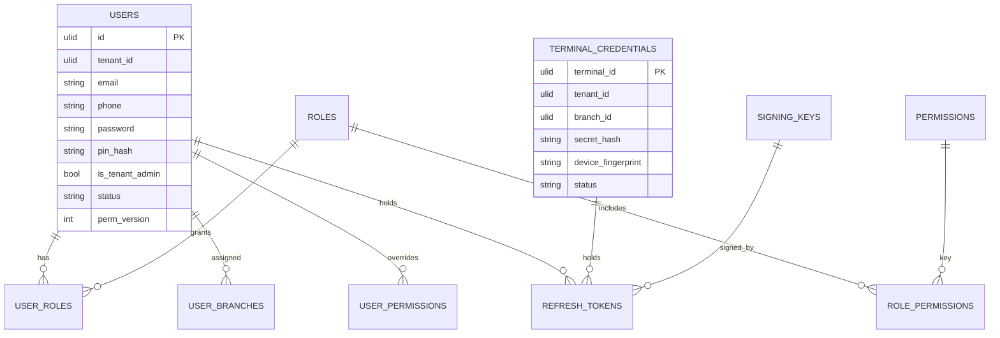
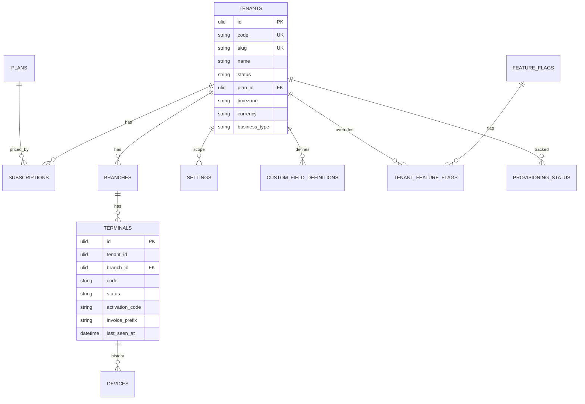
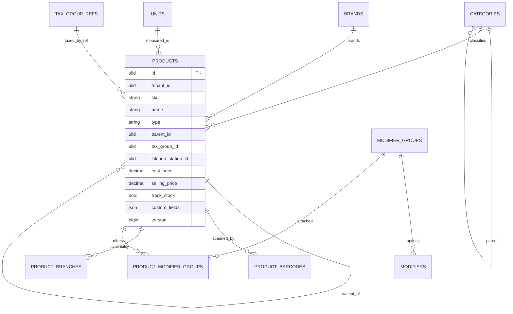
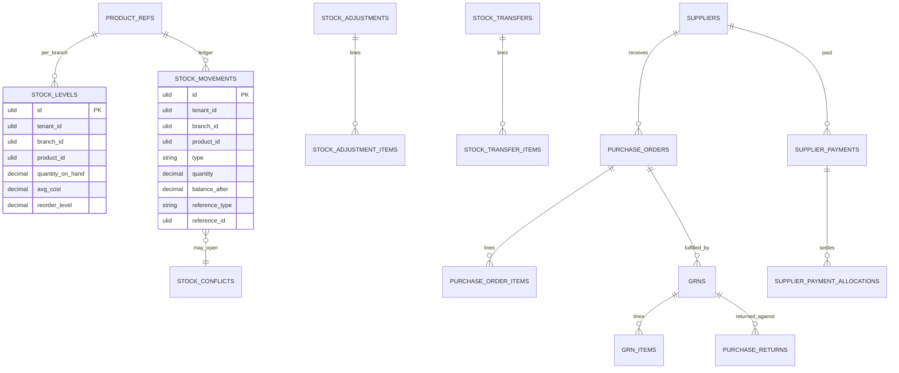
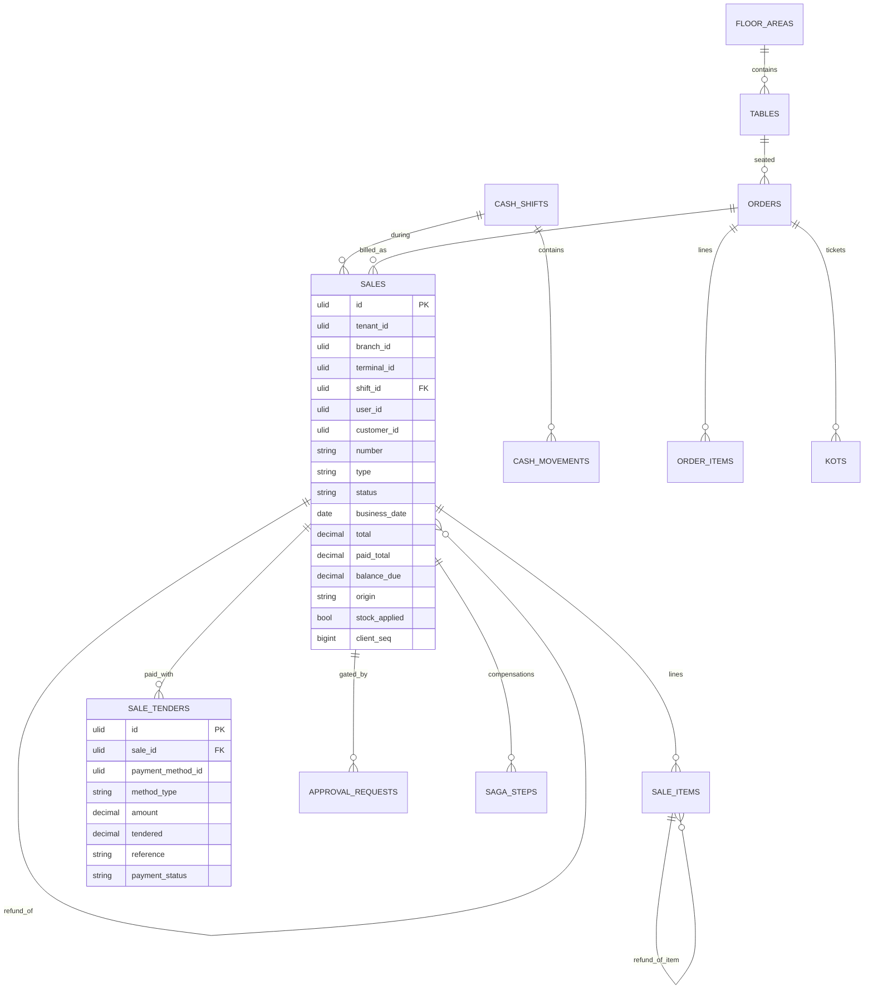
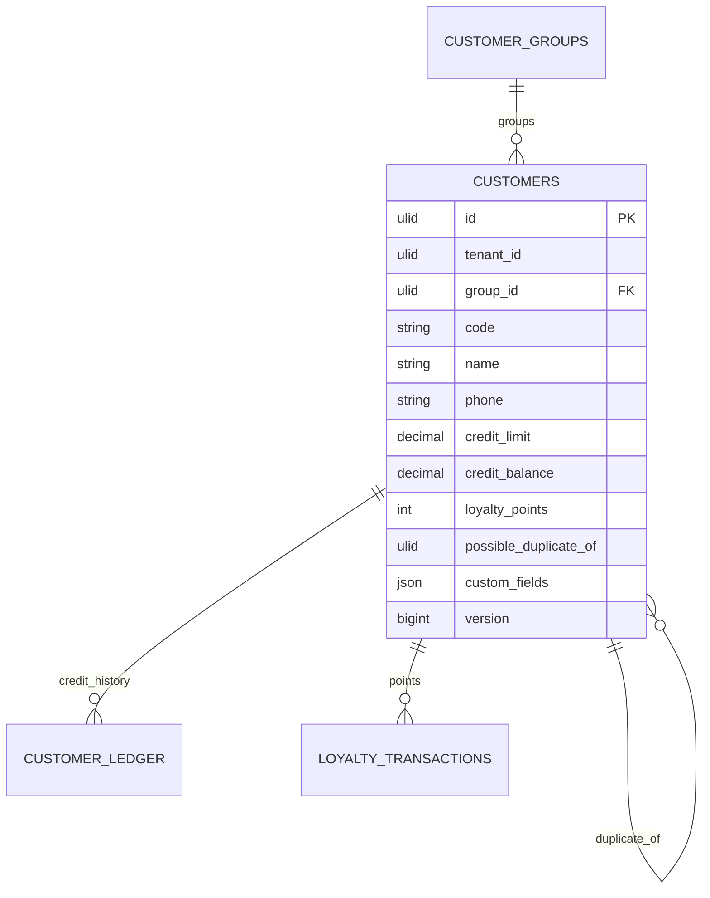
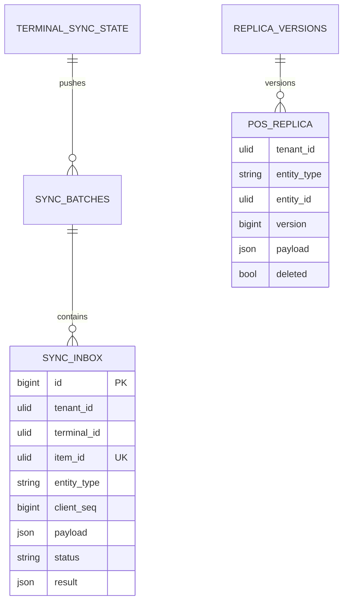
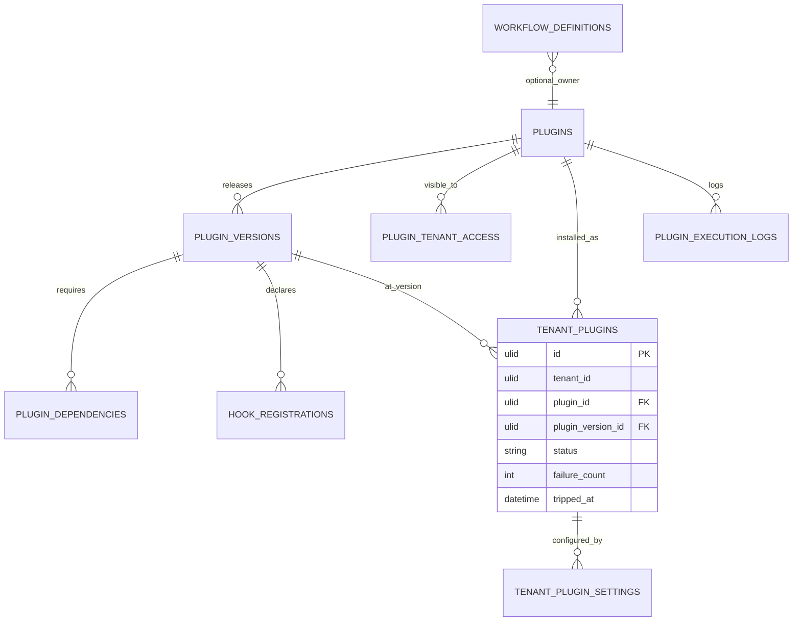

# FlexiPOS — Database Structure (database-per-service)

| | |
|---|---|
| Status | **DRAFT v0.3** — companion to [architecture.md](architecture.md) §6, §8, §9, §12 |
| Date | 2026-09-28 |
| Engine | MySQL 8.4 LTS (Docker dev, VPS, cloud). XAMPP mode uses MariaDB 10.4 with the compatibility notes in §8. InnoDB, `utf8mb4_0900_ai_ci`; id columns `ascii_bin` |
| Change log | v0.3: one schema and one DB user per service; cross-service foreign keys removed; projections, outbox/inbox, idempotency and saga tables added; reporting read models; plugin schema. v0.1 tables kept where unchanged |

Contents: 1 Conventions · 2 Ownership map · 3 Cross-service reference rules · 4 Schemas per service (ERDs + tables) · 5 Standard tables in every schema · 6 Index and partition strategy · 7 Write paths (online sale saga, offline sale) · 8 Migrations, users and grants, XAMPP notes

---

## 1. Conventions

### 1.1 Column sets (tags used below)

| Tag | Columns | Notes |
|---|---|---|
| `[ID]` | `id CHAR(26) PK` | ULID; generated on the POS for offline entities, on the server otherwise |
| `[TENANT]` | `tenant_id CHAR(26) NOT NULL` | on every table in every service schema; first column of composite indexes |
| `[TS]` | `created_at DATETIME(3)`, `updated_at DATETIME(3)` | UTC |
| `[SOFT]` | `deleted_at DATETIME(3) NULL` | soft delete |
| `[BY]` | `created_by CHAR(26) NULL`, `updated_by CHAR(26) NULL` | user id, plain column (identity owns users) |
| `[CF]` | `custom_fields JSON NULL` | validated against the tenant service's definitions (projection) |
| `[SYNC]` | `origin ENUM('online','offline')`, `terminal_id CHAR(26) NULL`, `device_id CHAR(26) NULL`, `client_seq BIGINT NULL`, `client_created_at DATETIME(3) NULL`, `sync_status ENUM('synced','conflict','review')`, `synced_at DATETIME(3) NULL` | entities the POS creates offline |
| `[REF:x]` | `x_id CHAR(26)` indexed, **no foreign key** | reference to an entity owned by another service |

### 1.2 Types

Money `DECIMAL(18,4)` · quantity `DECIMAL(18,4)` · rate `DECIMAL(9,4)` · codes `VARCHAR(50)` · names `VARCHAR(150)` · enumerations `VARCHAR(30)` with application enums (shown as `enum(...)`) · `JSON` with application schemas · business dates `DATE` in the branch timezone.

### 1.3 Rules

- Foreign keys **only inside a schema** (`RESTRICT` for financial rows, `CASCADE` for pure children). Across services: `[REF:x]` columns and snapshots.
- Every unique key starts with `tenant_id`.
- Financial rows are immutable after posting; corrections are new rows.
- Plugin tables live in `pos_plugin` and are prefixed `plg_<plugin>_`.
- Every schema has the standard tables of §5.

---

## 2. Ownership map

```text
MySQL instance (one in Phase 0; any schema can move to its own instance later)
├── pos_identity      user svc_identity      users, roles, permissions, tokens, terminal credentials, login history
├── pos_tenant        user svc_tenant        tenants, plans, subscriptions, branches, terminals, devices, settings, custom-field definitions
├── pos_catalog       user svc_catalog       products, variants, barcodes, categories, brands, units, modifiers
├── pos_pricing       user svc_pricing       taxes, tax groups, price lists, assignments, discounts
├── pos_inventory     user svc_inventory     stock levels, ledger, adjustments, transfers, conflicts, purchasing
├── pos_sales         user svc_sales         sales, items, tenders, shifts, approvals, saga steps, restaurant
├── pos_payment       user svc_payment       payment methods, payments, gateway transactions
├── pos_customer      user svc_customer      customers, groups, ledger, loyalty
├── pos_sync          user svc_sync          inbox, batches, POS replica, terminal sync state
├── pos_notification  user svc_notification  templates, deliveries, in-app notifications, webhooks
├── pos_reporting     user svc_reporting     facts, dimensions, daily summaries, audit read model, exports
├── pos_plugin        user svc_plugin        registry, versions, tenant plugins, settings, hook registrations, workflows, plg_* tables
└── pos_print         user svc_print         printers, routes, kitchen stations, templates, print jobs, agent heartbeats
```

Each user has `ALL PRIVILEGES` on its own schema and nothing else. A migration user per schema (same grants) is used by `svc:migrate`. `platform:init-databases` creates schemas and users from `.env`.

---

## 3. Cross-service reference rules

| Need | Pattern | Example |
|---|---|---|
| Reproduce a document exactly | **snapshot** columns on the document | `sale_items.product_name`, `unit_price`, `tax_breakdown`; `sales.customer_name` |
| Validate or display a foreign id repeatedly | **projection table** fed by events, rebuildable from the owner's snapshot endpoint | `inventory.product_refs`, `catalog.tax_group_refs`, every schema's `tenant_refs` |
| Authoritative check at write time | **contract call** | `sales → inventory.reserveAndDecrement`, `sales → customer.creditCheck` |
| Reporting across domains | **read models** in `pos_reporting` | `sales_facts` joined to `product_dims` |
| POS needs everything offline | **`pos_sync.pos_replica`** | one document per POS entity |

Projections carry `source_version` and `synced_at`; a nightly job compares counts with the owner and rebuilds on drift.

---

## 4. Schemas per service

### 4.1 `pos_identity` (identity service)



| Table | Columns / notes |
|---|---|
| platform_users | `[ID]` `[TS]` `[SOFT]`, name, email (unique), password, role enum(super_admin, support, billing), two_factor_secret (encrypted), status, last_login_at |
| users | `[ID]` `[TENANT]` `[TS]` `[SOFT]` `[CF]` `[BY]`, employee_code, name, email (unique per tenant, nullable), phone, password (Argon2id, nullable), pin_hash (Argon2id, nullable), is_tenant_admin, status enum(active, inactive, locked), locale, avatar_path, failed_attempts, locked_until, last_login_at, perm_version INT (bumped on any role change; becomes `perm_hash` in tokens). Index (tenant_id, email), (tenant_id, phone) |
| permissions | key VARCHAR(80) PK, module VARCHAR(50), plugin_name VARCHAR(100) NULL, description, is_branch_scoped BOOL. Core rows seeded; plugin rows from `plugin.permissions_registered` |
| roles | `[ID]` `[TENANT]` `[TS]`, key (unique per tenant), name, description, is_system, plugin_name NULL |
| role_permissions | role_id FK, permission_key FK; PK (role_id, permission_key) |
| user_roles | `[ID]` `[TENANT]`, user_id FK, role_id FK, branch_id `[REF:branch]` NULL (null = tenant-wide); unique (tenant_id, user_id, role_id, branch_id) |
| user_branches | user_id FK, branch_id `[REF:branch]`, is_default; PK (user_id, branch_id) |
| user_permissions | user_id FK, permission_key FK, branch_id NULL, allowed BOOL; PK (user_id, permission_key, branch_id) |
| terminal_credentials | terminal_id `[REF:terminal]` PK, tenant_id, branch_id, secret_hash, device_fingerprint CHAR(64), device_id, status enum(active, revoked), activated_at, revoked_at, revoked_by |
| refresh_tokens | `[ID]` `[TENANT]`, principal_type enum(user, terminal, platform_user), principal_id, token_hash CHAR(64) unique, family_id (rotation chain), expires_at, used_at, revoked_at, ip VARBINARY(16), user_agent. Index (principal_type, principal_id) |
| signing_keys | kid VARCHAR(40) PK, algorithm, public_key TEXT, private_key_ref VARCHAR(255) (path or KMS ref), status enum(active, retiring, retired), created_at, retired_at |
| service_clients | name VARCHAR(50) PK (`sales`, `inventory`, …), secret_hash, allowed_audiences JSON, status |
| login_history | id BIGINT AUTO, tenant_id NULL, principal_type, principal_id, email, success, failure_reason, ip, user_agent, device_id, created_at. Index (tenant_id, created_at), (email, created_at) |
| projections | `tenant_refs`, `branch_refs`, `terminal_refs` (terminal_id, tenant_id, branch_id, code, status) |

Note: with users of all tenants in one schema, login by e-mail resolves the tenant directly; if identity is ever sharded, add a `user_directory` (email → tenant, shard) table.

### 4.2 `pos_tenant` (tenant service)



| Table | Columns / notes |
|---|---|
| tenants | `[ID]` `[TS]` `[SOFT]`, code VARCHAR(30) unique, slug VARCHAR(63) unique, name, legal_name, status enum(trial, active, suspended, closed), plan_id FK, country, timezone, currency, locale, business_type enum(retail, restaurant, both), settings JSON, trial_ends_at, activated_at, suspended_at |
| plans | `[ID]` `[TS]`, code unique, name, price, billing_cycle enum(monthly, yearly), limits JSON, features JSON, is_active |
| subscriptions | `[ID]` `[TS]`, tenant_id FK, plan_id FK, status enum(trial, active, past_due, cancelled), starts_at, ends_at, trial_ends_at, cancelled_at, external_ref. Index (tenant_id, status) |
| feature_flags / tenant_feature_flags | key PK, description, default_enabled · tenant_id FK, flag_key FK, enabled; PK (tenant_id, flag_key) |
| branches | `[ID]` `[TENANT]` `[TS]` `[SOFT]` `[BY]`, code VARCHAR(10) (unique per tenant), name, address JSON, phone, email, timezone, currency, tax_registration_no, business_type, is_active |
| terminals | `[ID]` `[TENANT]` `[TS]` `[SOFT]`, branch_id FK, code VARCHAR(10) (unique per branch), name, status enum(pending, active, inactive, revoked), activation_code, activation_expires_at, current_device_id, invoice_prefix VARCHAR(20), last_seen_at, last_sync_at, offline_since, app_version, agent_version, settings JSON |
| devices | `[ID]` `[TENANT]` `[TS]`, terminal_id FK, fingerprint CHAR(64), platform, browser, os, registered_at, last_seen_at, revoked_at, revoked_by |
| settings | `[ID]` `[TENANT]` `[TS]`, scope_type enum(tenant, branch, terminal, user), scope_id NULL, key VARCHAR(120), value JSON, updated_by; unique (tenant_id, scope_type, scope_id, key) |
| settings_registry | key PK, service VARCHAR(30), type, default_value JSON, validation JSON, sync_to_pos BOOL, plugin_name NULL (declared by services and plugins at boot/registration) |
| custom_field_definitions | `[ID]` `[TENANT]` `[TS]` `[SOFT]`, entity_type enum(product, customer, sale, supplier, purchase_order, order), key, label, type enum(text, number, date, boolean, dropdown, multi_select, currency, barcode), options JSON, is_required, default_value JSON, validation JSON, is_indexed, show_in_pos, sort_order, plugin_name NULL; unique (tenant_id, entity_type, key) |
| provisioning_status | tenant_id FK, service VARCHAR(30), status enum(pending, done, failed), attempts, updated_at; PK (tenant_id, service) |
| core_releases | version PK, deployed_at, git_sha, min_client_version, notes |
| projections | `user_counts` (tenant_id, users, active_terminals — for plan limits, from identity events) |

### 4.3 `pos_catalog` (catalog service)



| Table | Columns / notes |
|---|---|
| categories | `[ID]` `[TENANT]` `[TS]` `[SOFT]`, parent_id FK NULL, code, name, image_path, sort_order, kitchen_station_id `[REF:kitchen_station]` NULL, color, is_active, version BIGINT; unique (tenant_id, code) |
| brands / units | brands: `[ID]` `[TENANT]` `[TS]` `[SOFT]`, name, logo_path · units: `[ID]` `[TENANT]` `[TS]`, code, name, precision, base_unit_id FK NULL, factor DECIMAL(18,6) |
| products | `[ID]` `[TENANT]` `[TS]` `[SOFT]` `[BY]` `[CF]`, type enum(simple, variant_parent, variant, service, combo), parent_id FK NULL, sku (unique per tenant), name, short_name VARCHAR(40), description, category_id FK, brand_id FK NULL, unit_id FK, tax_group_id `[REF:tax_group]`, kitchen_station_id `[REF:kitchen_station]` NULL, cost_price, selling_price, min_selling_price, track_stock, is_sellable, is_purchasable, is_active, allow_price_override, allow_discount, variant_options JSON, variant_values JSON, combo_items JSON, image_path, sort_order, version BIGINT. Indexes (tenant_id, category_id), (tenant_id, name), (tenant_id, is_active, is_sellable), (tenant_id, parent_id), FULLTEXT (name, short_name, sku) |
| product_barcodes | `[ID]` `[TENANT]`, product_id FK, barcode VARCHAR(64), unit_id FK NULL, quantity DECIMAL DEFAULT 1, is_primary; unique (tenant_id, barcode) |
| product_branches | product_id FK, branch_id `[REF:branch]`, is_available, selling_price NULL (branch override), bin_location, `[TS]`; PK (product_id, branch_id) + tenant_id. Reorder levels moved to `pos_inventory.stock_levels` |
| modifier_groups / modifiers / product_modifier_groups | as v0.1 (name, min/max select, required · name, price_delta, kitchen_note, sort · links) |
| projections | `tax_group_refs` (id, code, name, is_inclusive), `kitchen_station_refs` (id, branch_id, name, type), `custom_field_defs` (entity_type=product rows) |

### 4.4 `pos_pricing` (pricing service)

| Table | Columns / notes |
|---|---|
| taxes | `[ID]` `[TENANT]` `[TS]` `[SOFT]`, code, name, rate DECIMAL(9,4), type enum(percentage, fixed), is_compound, applies_to enum(sale, purchase, both), is_active, version |
| tax_groups / tax_group_taxes | `[ID]` `[TENANT]` `[TS]`, code, name, is_inclusive, is_default, version · tax_group_id FK, tax_id FK, sequence; PK (tax_group_id, tax_id) |
| price_lists | `[ID]` `[TENANT]` `[TS]` `[SOFT]`, code, name, type enum(standard, customer_group, promotion), currency, priority, starts_at, ends_at, is_active, version |
| price_list_items | `[ID]` `[TENANT]`, price_list_id FK, product_id `[REF:product]`, min_qty DEFAULT 1, price; unique (price_list_id, product_id, min_qty) |
| price_list_assignments | `[ID]` `[TENANT]`, price_list_id FK, scope_type enum(branch, customer_group), scope_id `[REF]`, priority; unique (tenant_id, scope_type, scope_id, price_list_id) |
| discounts | `[ID]` `[TENANT]` `[TS]` `[SOFT]`, code, name, type enum(percentage, fixed), value, scope enum(item, bill), applies_to JSON, min_amount, max_amount, requires_approval, approval_threshold, starts_at, ends_at, usage_limit, used_count, is_active, version |
| projections | `product_refs` (id, sku, name, category_id, is_active), `customer_group_refs` (id, name) |

Resolution order implemented by `pricing.quote` and mirrored in the POS engine: customer-group list → active promotion lists by priority → branch list → `product_branches.selling_price` → `products.selling_price`.

### 4.5 `pos_inventory` (inventory service, includes purchasing)



| Table | Columns / notes |
|---|---|
| stock_levels | `[ID]` `[TENANT]` `[TS]`, branch_id `[REF:branch]`, product_id `[REF:product]`, quantity_on_hand, quantity_reserved, avg_cost, reorder_level, reorder_qty, last_movement_at; unique (tenant_id, branch_id, product_id). Updated only inside the same transaction as a movement (`SELECT … FOR UPDATE`) |
| **stock_movements** (append-only) | `[ID]` `[TENANT]` `[SYNC]`, branch_id, product_id, type enum(opening, sale, sale_refund, sale_void, grn, grn_return, purchase_return, adjustment, transfer_out, transfer_in, wastage, production, correction, reservation_release), quantity (signed), unit_cost, balance_after, reference_type VARCHAR(40), reference_id CHAR(26), user_id, notes, created_at. Indexes (tenant_id, branch_id, product_id, created_at), (tenant_id, reference_type, reference_id) **unique per (reference_type, reference_id, product_id, type)** = idempotency for reserve-and-decrement, (tenant_id, created_at). Partition by month |
| stock_adjustments / _items | as v0.1: number, type enum(count, adjustment, opening, wastage), reason, status, posted_at · product_id, system_qty, counted_qty, difference, unit_cost |
| stock_transfers / _items | as v0.1: number, from/to branch, status, sent/received · qty_sent, qty_received, variance_reason |
| stock_conflicts | `[ID]` `[TENANT]` `[TS]`, branch_id, product_id, sale_id `[REF:sale]`, terminal_id, movement_id FK, expected_qty, resulting_qty, status enum(open, resolved, ignored), resolution, resolved_by, resolved_at, notes. Index (tenant_id, branch_id, status) |
| suppliers | `[ID]` `[TENANT]` `[TS]` `[SOFT]` `[CF]` `[BY]`, code, name, contact_name, phone, email, address JSON, tax_no, payment_terms_days, credit_limit, balance, is_active |
| purchase_orders / _items | as v0.1 (status lifecycle, totals, `[CF]`) · product_id `[REF:product]`, quantity, received_quantity, unit_cost, tax_id `[REF:tax]` NULL, tax_amount, line_total |
| grns / grn_items | as v0.1; posting writes `grn` movements and updates `avg_cost` |
| purchase_returns / _items | as v0.1; type enum(grn_return, purchase_return); original GRN never modified |
| supplier_payments / _allocations | as v0.1 |
| number_sequences | `[ID]` `[TENANT]`, branch_id NULL, document_type enum(purchase_order, grn, purchase_return, stock_adjustment, stock_transfer), prefix, next_number, padding, reset_period, last_reset_at; unique (tenant_id, branch_id, document_type) |
| projections | `product_refs` (id, sku, name, unit_code, track_stock, cost_price, category_id, is_active, version), `custom_field_defs` (supplier, purchase_order) |

### 4.6 `pos_sales` (sales service, includes restaurant)



#### sales
| Column | Type | Notes |
|---|---|---|
| `[ID]` `[TENANT]` `[TS]` `[SYNC]` `[CF]` | | id generated on the terminal |
| branch_id, terminal_id, user_id | `[REF]` | cashier = user_id |
| shift_id | FK cash_shifts NULL | |
| customer_id | `[REF:customer]` NULL | plus snapshot `customer_name`, `customer_phone` |
| order_id | FK orders NULL | restaurant bill |
| number | VARCHAR(30) | unique (tenant_id, number) |
| type | enum(sale, refund) | refunds are separate rows |
| reference_sale_id | FK sales NULL | |
| status | enum(draft, held, pending_payment, completed, voided, refunded, partially_refunded, failed) | `pending_payment` only during gateway authorisation |
| business_date, business_date_source | DATE, enum(client, server, clamped) | |
| price_list_id | `[REF:price_list]` NULL | |
| subtotal, discount_total, tax_total, service_charge, rounding, total, paid_total, change_due, balance_due | DECIMAL(18,4) | |
| currency | CHAR(3) | |
| bill_discount_id, bill_discount_value, discount_reason | `[REF:discount]`, DECIMAL, VARCHAR | |
| approval_request_id | FK NULL | |
| stock_applied | BOOL | true when inventory decremented synchronously (online) |
| credit_checked | BOOL | |
| notes, voided_by, void_reason, voided_at, completed_at, receipt_print_count | | |
Indexes: (tenant_id, branch_id, business_date), (tenant_id, customer_id, completed_at), (tenant_id, terminal_id, client_seq), (tenant_id, status), (tenant_id, shift_id). Partition by month on `completed_at` from stage 1.

#### sale_items
`[ID]` `[TENANT]`, sale_id FK CASCADE, product_id `[REF:product]`, product_name, sku, unit_code (snapshots), quantity, unit_price, list_price, unit_cost, discount_id `[REF]` NULL, discount_amount, tax_group_id `[REF]`, tax_amount, tax_breakdown JSON, line_total, kitchen_station_id `[REF]` NULL, modifiers JSON, notes, refunded_quantity, refund_of_item_id FK NULL, price_overridden_by, sort_order. Indexes (sale_id), (tenant_id, product_id).

#### sale_tenders (tender snapshot owned by sales; payment lifecycle owned by payment)
`[ID]` `[TENANT]`, sale_id FK CASCADE, payment_method_id `[REF:payment_method]`, method_code, method_type enum(cash, card, digital, credit, voucher, bank, other) (snapshots), amount (signed), tendered, change_given, reference VARCHAR(100), gateway_auth_id `[REF]` NULL, payment_status enum(pending, recorded, failed, refunded) (updated from `payment.recorded/failed`), paid_at. Index (tenant_id, sale_id), (tenant_id, method_type, paid_at).

| Table | Columns / notes |
|---|---|
| cash_shifts / cash_movements | as v0.1 (`[SYNC]`, opening/expected/counted cash, totals_by_method JSON) · type enum(cash_in, cash_out, float, drop), amount, reason |
| approval_requests | `[ID]` `[TENANT]` `[TS]` `[SYNC]`, branch_id, terminal_id, type enum(discount, refund, void, price_override, credit_limit, custom), reference_type, reference_id, requested_by, payload JSON, status enum(pending, approved, rejected, expired), decided_by, decided_at, decision_method enum(pin_local, remote), reason, plugin_name NULL |
| saga_steps | `[ID]` `[TENANT]`, saga enum(online_sale, refund), sale_id FK, step enum(inventory_reserve, inventory_release, payment_authorize, payment_void, payment_capture, payment_refund), status enum(pending, done, failed, compensated), attempts, last_error, next_retry_at, `[TS]`. Index (status, next_retry_at) |
| terminal_numbering | terminal_id `[REF]` PK, tenant_id, prefix, last_seq BIGINT, updated_at (server mirror; reuse rejected) |
| number_sequences | order and refund numbers (same shape as inventory's) |
| floor_areas / tables | as v0.1; tables.current_order_id FK NULL, status, position JSON, version |
| orders | `[ID]` `[TENANT]` `[TS]` `[SYNC]`, branch_id, table_id FK NULL, number, order_type enum(dine_in, takeaway, delivery), status enum(open, in_kitchen, ready, billed, closed, cancelled, merged), waiter_id, covers, customer_id `[REF]` NULL, opened_at, closed_at, merged_into_order_id FK NULL, split_group, notes |
| order_items (append-only) | `[ID]` `[TENANT]` `[SYNC]`, order_id FK, product_id `[REF]`, product_name, quantity, unit_price, modifiers JSON, notes, status enum(pending, sent, preparing, ready, served, voided), kitchen_station_id `[REF]`, kot_id FK NULL, course, seat_no, added_by, added_at, voided_by, void_reason, voided_at |
| kots | `[ID]` `[TENANT]` `[TS]` `[SYNC]`, branch_id, order_id FK, type enum(kot, bot), number, kitchen_station_id `[REF]`, status enum(created, printed, failed, acknowledged, reprinted), items_snapshot JSON, printed_at, print_job_id `[REF]` NULL |
| projections | `payment_method_refs` (id, code, type, is_active, allows_change, opens_drawer), `hook_registry` (tenant_id, point, has_before, has_filter, has_override, updated_at), `custom_field_defs` (sale) |

Split bill: several `sales` with the same `order_id` and `split_group`. Merge: source order `merged`, new `order_items` referencing `source_item_id` in `modifiers.meta`, originals voided with reason `merged`.

### 4.7 `pos_payment` (payment service)

| Table | Columns / notes |
|---|---|
| payment_methods | `[ID]` `[TENANT]` `[TS]` `[SOFT]`, code, name, type enum(cash, card, digital, credit, voucher, bank, other), is_active, opens_drawer, requires_reference, allows_change, allows_refund, rounding_rule, gateway VARCHAR(50) NULL, settings JSON, sort_order, version; unique (tenant_id, code) |
| payments | `[ID]` `[TENANT]` `[TS]` `[SYNC]`, sale_id `[REF:sale]` NULL, customer_id `[REF]` NULL, branch_id, terminal_id, shift_id `[REF]`, user_id, payment_method_id FK, type enum(sale, refund, credit_settlement, deposit), amount (signed), tendered, change_given, currency, reference, status enum(completed, pending, failed, reversed), gateway, gateway_transaction_id FK NULL, paid_at. Indexes (tenant_id, sale_id), (tenant_id, shift_id, payment_method_id), (tenant_id, customer_id). The `id` equals the POS tender ULID, so recording from `sale.completed` is idempotent |
| gateway_configs | `[ID]` `[TENANT]` `[TS]`, gateway VARCHAR(50), branch_id NULL, credentials TEXT (encrypted), settings JSON, is_active; unique (tenant_id, gateway, branch_id) |
| gateway_transactions | `[ID]` `[TENANT]` `[TS]`, gateway, type enum(authorize, capture, void, refund), sale_id `[REF]`, amount, currency, external_ref, status, request JSON (masked), response JSON (masked), idempotency_key; index (tenant_id, sale_id) |
| settlements (later) | batch reconciliation per gateway/day |

### 4.8 `pos_customer` (customer service)



| Table | Columns / notes |
|---|---|
| customer_groups | `[ID]` `[TENANT]` `[TS]` `[SOFT]`, name, discount_percent, credit_allowed, default_credit_limit, is_default, version (price-list link lives in `pos_pricing.price_list_assignments`) |
| customers | `[ID]` `[TENANT]` `[TS]` `[SOFT]` `[SYNC]` `[CF]` `[BY]`, group_id FK NULL, code, name, phone, email, address JSON, dob, gender, tax_no, credit_allowed, credit_limit, credit_balance, loyalty_points, notes, status enum(active, blocked), possible_duplicate_of FK NULL, merged_into_id FK NULL, client_updated_at, version. Indexes (tenant_id, phone), (tenant_id, email), (tenant_id, name), unique (tenant_id, code) where code not null |
| customer_ledger (append-only) | `[ID]` `[TENANT]`, customer_id FK, branch_id, type enum(credit_sale, payment, refund, adjustment, opening), reference_type, reference_id `[REF]`, debit, credit, balance_after, user_id, notes, created_at; unique (tenant_id, reference_type, reference_id, type) for idempotent consumption |
| loyalty_transactions | `[ID]` `[TENANT]` `[SYNC]`, customer_id FK, sale_id `[REF]` NULL, type enum(earn, redeem, adjust, expire), points (signed), balance_after, rule_ref, expires_at, user_id, created_at; unique (tenant_id, sale_id, type) where sale_id not null |
| projections | `custom_field_defs` (customer) |

### 4.9 `pos_sync` (sync service)



| Table | Columns / notes |
|---|---|
| sync_batches | `[ID]` `[TENANT]`, terminal_id, device_id, item_count, accepted, rejected, conflicts, waiting, received_at, processed_at, status |
| **sync_inbox** | id BIGINT AUTO PK, tenant_id, branch_id, terminal_id, device_id, batch_id FK, item_id CHAR(26) **unique (tenant_id, item_id)**, entity_type enum(sale, order, order_item, kot, cash_shift, cash_movement, approval_request, customer, loyalty_transaction), client_seq, client_created_at, received_at, processed_at, payload JSON, status enum(accepted, duplicate, rejected, conflict, waiting_dependency, failed), result JSON, error_code, error_detail, depends_on_item_id NULL, attempts. Indexes (tenant_id, terminal_id, client_seq), (tenant_id, status, received_at). Partition by month; payload nulled after 90 days |
| pos_replica | tenant_id, entity_type VARCHAR(40), entity_id CHAR(26), version BIGINT, branch_id NULL (branch-specific docs), payload JSON, deleted BOOL, source_event_id, updated_at; PK (tenant_id, entity_type, entity_id); index (tenant_id, version), (tenant_id, branch_id, version) |
| replica_versions | tenant_id PK, last_version BIGINT (per-tenant monotonic counter, incremented under lock when a replica document changes) |
| terminal_sync_state | terminal_id `[REF]`, tenant_id, entity_type, last_pulled_version, last_pushed_client_seq, last_full_sync_at, last_pull_at, last_push_at, pending_count, rejected_count; PK (terminal_id, entity_type) |

Replica entity types: product, category, modifier_group, unit, brand, tax, tax_group, price_list (+items), discount, customer, customer_group, payment_method, setting (effective per branch/terminal), printer, printer_route, kitchen_station, print_template, pos_user (PIN hash + permissions), enabled_plugin, stock_snapshot (advisory).

### 4.10 `pos_notification` (notification service)

| Table | Columns / notes |
|---|---|
| notification_templates | `[ID]` `[TENANT]` `[TS]`, key, channel enum(email, sms, in_app, whatsapp, webhook), locale, subject, body, is_active, plugin_name NULL; unique (tenant_id, key, channel, locale) |
| channel_configs | `[ID]` `[TENANT]` `[TS]`, channel, provider VARCHAR(50), credentials TEXT (encrypted), settings JSON, is_active |
| notifications (in-app) | `[ID]` `[TENANT]` `[TS]`, recipient_user_id `[REF]`, type, title, body, data JSON, read_at |
| deliveries | id BIGINT AUTO, tenant_id, channel, template_key, recipient, provider, status enum(queued, sent, failed, bounced), provider_ref, error, source_event_id, created_at, sent_at. Index (tenant_id, created_at), (status, created_at) |
| webhook_endpoints / webhook_deliveries | `[ID]` `[TENANT]`, url, secret (encrypted), events JSON, is_active · endpoint_id FK, event_id, status, attempts, response_code, created_at |

### 4.11 `pos_reporting` (reporting service, read models)

| Table | Columns / notes |
|---|---|
| sales_facts | sale_id PK, tenant_id, branch_id, terminal_id, cashier_id, customer_id, customer_group_id, business_date, completed_at, type, status, origin, subtotal, discount_total, tax_total, total, cost_total, profit, tender_summary JSON, source_event_id. Indexes (tenant_id, business_date), (tenant_id, branch_id, business_date), (tenant_id, customer_id) |
| sale_item_facts | id PK, sale_id, tenant_id, branch_id, business_date, product_id, category_id, brand_id, quantity, net_amount, tax_amount, cost_amount, discount_amount |
| tender_facts | tender_id PK, sale_id, tenant_id, branch_id, business_date, shift_id, method_type, method_code, amount |
| stock_movement_facts | movement_id PK, tenant_id, branch_id, product_id, type, quantity, unit_cost, balance_after, created_at |
| purchase_facts | grn_id PK, tenant_id, branch_id, supplier_id, received_date, total, tax_total |
| customer_facts | customer_id PK, tenant_id, first_sale_at, last_sale_at, sales_count, lifetime_value, credit_balance, loyalty_points |
| daily_summaries | `[ID]` `[TENANT]`, branch_id, terminal_id NULL, business_date, sales_count, refunds_count, gross, discounts, tax, net, cost, profit, by_payment_method JSON, by_category JSON, by_cashier JSON, rebuilt_at; unique (tenant_id, branch_id, terminal_id, business_date) |
| audit_facts | id BIGINT AUTO, tenant_id, service, actor_type, actor_id, action, subject_type, subject_id, before JSON, after JSON, request_id, occurred_at. Index (tenant_id, occurred_at), (tenant_id, subject_type, subject_id) |
| dimensions | `product_dims`, `category_dims`, `branch_dims`, `user_dims`, `supplier_dims`, `payment_method_dims` (id, tenant_id, current attributes, version) |
| report_definitions | key PK, name, service_or_plugin, params_schema JSON, permission_key, is_active |
| report_exports | `[ID]` `[TENANT]` `[TS]`, user_id, report_key, params JSON, format enum(csv, xlsx, pdf), status, file_path, expires_at |
| rebuild_jobs | id, tenant_id NULL, model, from_date, to_date, status, progress (replay from owners' snapshot endpoints or the outbox) |

### 4.12 `pos_plugin` (plugin service and Plugin Runtime)



| Table | Columns / notes |
|---|---|
| plugins | `[ID]` `[TS]` `[SOFT]`, name unique, display_name, type enum(module, integration, theme, report), author, description, visibility enum(official, private, third_party), status enum(uploaded, validated, installed, enabled, disabled, uninstalled, failed), latest_version_id, signature_key_id |
| plugin_versions | `[ID]` `[TS]`, plugin_id FK, version, core_constraint, manifest JSON, package_path, checksum, signature, status enum(available, deprecated, yanked), released_at; unique (plugin_id, version) |
| plugin_dependencies | plugin_version_id FK, depends_on_plugin, constraint; PK |
| hook_registrations | `[ID]`, plugin_version_id FK, point VARCHAR(60), mode enum(before, after, filter, override), priority, handler_class, timeout_ms NULL; unique (plugin_version_id, point, mode, handler_class) |
| plugin_tenant_access | plugin_id FK, tenant_id, granted_by, `[TS]`; PK |
| tenant_plugins | `[ID]` `[TS]`, tenant_id, plugin_id FK, plugin_version_id FK, status enum(enabled, disabled, updating, error), installed_at, enabled_at, disabled_at, installed_by, failure_count, tripped_at; unique (tenant_id, plugin_id) |
| tenant_plugin_settings | tenant_id, plugin_id, key, value TEXT (encrypted when secret), is_secret, updated_by, `[TS]`; PK (tenant_id, plugin_id, key) |
| plugin_migrations | plugin_id, migration, batch, ran_at; PK (plugin_id, migration) (one schema, so no per-shard tracking until sharded) |
| plugin_execution_logs | id BIGINT AUTO, plugin_id, tenant_id, point, mode, duration_ms, status enum(ok, veto, error, timeout), error, request_id, created_at. Partition by month, 30-day retention |
| workflow_definitions | `[ID]` `[TENANT]` `[TS]` `[SOFT]` `[BY]`, name, trigger_point, conditions JSON, steps JSON, branch_ids JSON NULL, is_active, priority, plugin_name NULL, version |
| plg_<plugin>_* | plugin-owned tables, always with `tenant_id`; e.g. `plg_loyalty_rules`, `plg_loyalty_accounts` (customer_id `[REF]`), `plg_loyalty_transactions`, `plg_loyalty_tiers`, `plg_commission_rates`, `plg_commission_entries` |

### 4.13 `pos_print` (print management service)

| Table | Columns / notes |
|---|---|
| kitchen_stations | `[ID]` `[TENANT]` `[TS]`, branch_id NULL, code, name, type enum(kitchen, bar), is_active, version |
| printers | `[ID]` `[TENANT]` `[TS]` `[SOFT]`, branch_id, terminal_id `[REF]` NULL (agent host), name, type enum(receipt, kitchen, bar, label, a4), connection enum(usb, network, bluetooth, os_driver), address, model, language enum(escpos, zpl, pdf), paper_width_mm, chars_per_line, status enum(online, offline, error, unknown), last_seen_at, last_error, settings JSON, version; unique (tenant_id, branch_id, name) |
| printer_routes | `[ID]` `[TENANT]` `[TS]`, branch_id, terminal_id NULL, document_type enum(receipt, kot, bot, label, report, drawer), kitchen_station_id FK NULL, printer_id FK, copies, is_active, priority, version; unique (tenant_id, branch_id, terminal_id, document_type, kitchen_station_id) |
| print_templates | `[ID]` `[TENANT]` `[TS]` `[SOFT]` `[BY]`, branch_id NULL, type enum(receipt, kot, bot, label, invoice_a4, shift_report), name, engine enum(handlebars), content MEDIUMTEXT, version INT, is_default, plugin_name NULL, preview_data JSON; unique (tenant_id, branch_id, type, name) |
| print_jobs | `[ID]` `[TENANT]` `[TS]`, branch_id, terminal_id, printer_id FK NULL, document_type, reference_type, reference_id `[REF]`, template_id FK NULL, status enum(queued, sent, printed, failed, cancelled), attempts, last_error, payload_hash, payload JSON NULL (relay jobs only), printed_at, source_event_id. Index (tenant_id, branch_id, status, created_at). Retention 30 days |
| agent_heartbeats | terminal_id `[REF]` PK, tenant_id, agent_version, os, printers JSON (status per printer), queue_depth, last_error, received_at |
| projections | `terminal_refs` |

---

## 5. Standard tables in every schema

| Table | Columns | Purpose |
|---|---|---|
| outbox_events | `[ID]`, type VARCHAR(80), version SMALLINT, tenant_id, branch_id NULL, aggregate_type, aggregate_id, payload JSON, occurred_at DATETIME(3), correlation_id, causation_id, actor JSON, status enum(pending, published, failed), published_at, attempts. Index (status, occurred_at), (tenant_id, aggregate_type, aggregate_id). Partition by month, 90-day retention then archive | transactional outbox; the relay publishes to `evt.<service>` |
| inbox_events | event_id CHAR(26) PK, type, producer, received_at, processed_at, status enum(processing, done, failed), error. 7-day retention | idempotent consumption |
| idempotency_keys | tenant_id, key VARCHAR(80), request_hash CHAR(64), response_code SMALLINT, response_body JSON, created_at; PK (tenant_id, key). 24-hour retention | public POST idempotency |
| tenant_refs | tenant_id PK, code, status, timezone, currency, locale, business_type, source_version, synced_at | local tenant validation (not in `pos_tenant`) |
| branch_refs | branch_id PK, tenant_id, code, name, timezone, currency, status, source_version, synced_at | branch validation and business dates |
| audit_logs | id BIGINT AUTO, tenant_id, branch_id NULL, actor_type enum(user, terminal, service, plugin, platform_user), actor_id, action VARCHAR(80), subject_type, subject_id, before JSON, after JSON, ip, user_agent, request_id, created_at. Index (tenant_id, created_at), (tenant_id, subject_type, subject_id). Partition by month | service-local audit; also published as `audit.recorded` for the reporting read model |
| migrations | Laravel standard, per schema | |

---

## 6. Index and partition strategy

- Composite indexes lead with `tenant_id`, then the hottest filter (`branch_id`, `business_date`, `status`), then the sort column.
- Sync dimensions: `(tenant_id, terminal_id, client_seq)` on `sales`, `orders`, `cash_shifts`, `sync_inbox`; `(tenant_id, version)` on `pos_replica`; `(tenant_id, sync_status)` on `sales`, `customers`.
- Hot lookups: `product_barcodes(tenant_id, barcode)`, `products FULLTEXT`, `customers(tenant_id, phone)`, `sales(tenant_id, number)`, `refresh_tokens(token_hash)`, `stock_levels(tenant_id, branch_id, product_id)`.
- Idempotency uniques: `stock_movements(reference_type, reference_id, product_id, type)`, `customer_ledger(tenant_id, reference_type, reference_id, type)`, `payments.id = tender ULID`, `sync_inbox(tenant_id, item_id)`, `inbox_events(event_id)`.
- Partition by month (RANGE on the date column): `stock_movements`, `sync_inbox`, `outbox_events`, `audit_logs`, `plugin_execution_logs`, `deliveries`; `sales`, `sale_items`, `sale_tenders`, `payments` and the reporting facts from stage 1.
- Archival: monthly job exports partitions past retention to object storage and drops them.
- Row estimates at target (500 tenants, 300 k sales/day): `sales` ≈ 110 M/year, `sale_items` ≈ 400 M/year, `stock_movements` ≈ 400 M/year, `outbox_events` ≈ 900 M/year before retention. Reporting facts duplicate sales volume by design (read models).

---

## 7. Write paths

### 7.1 Online sale (saga S1)

```text
pos_sales      idempotency_keys check (sale ULID)
pos_customer   [sync call, credit sales only]  read customers.credit_limit/credit_balance → allow/deny
pos_inventory  [sync call]  BEGIN; SELECT stock_levels FOR UPDATE; insert stock_movements(type=sale, reference=sale) ×N (unique = idempotent);
               update stock_levels; insert outbox inventory.stock.updated ×N; COMMIT   → 200, or 409 with insufficient lines
pos_payment    [sync call, gateway tenders only]  gateway_transactions(authorize), payments(pending)
pos_sales      BEGIN; insert sales(stock_applied=true), sale_items ×N, sale_tenders ×M, saga_steps(done);
               insert outbox sales.sale.completed{origin: online}; insert idempotency_keys; COMMIT → 201
async          payment: payments(completed) by tender ULID, capture gateway auth
               customer: customer_ledger (credit), loyalty_transactions (earn)
               reporting: sales_facts, sale_item_facts, tender_facts, daily_summaries
               notification: e-receipt if requested · print: relay job if configured · plugin: AFTER hooks
compensation   on failure after the inventory call: saga_steps(inventory_release) → stock_movements(type=reservation_release)
```

### 7.2 Offline sale (batch S3)

```text
pos_sync       sync_batches; sync_inbox rows (unique item_id) ordered by client_seq
pos_sales      [contract] recordOffline: insert sales(stock_applied=false), sale_items, sale_tenders; outbox sales.sale.completed{origin: offline}
pos_sync       inbox status accepted|duplicate|rejected|conflict|waiting_dependency; ack to POS
async          inventory: on sale.completed{offline} insert stock_movements + update stock_levels; if resulting < 0 → stock_conflicts + outbox stock.conflict_detected
               payment, customer, reporting, notification, print, plugin as above
```

---

## 8. Migrations, users and grants, XAMPP notes

- Each service owns `database/migrations`; `php artisan svc:migrate <service>|--all` runs them on that service's connection. Expand/contract only.
- `platform:init-databases` (idempotent) creates schemas and users from `.env` (`DB_<SERVICE>_DATABASE/USERNAME/PASSWORD`) and applies `GRANT ALL ON pos_<service>.* TO svc_<service>`; it refuses to run with a root user in production.
- Seeders per service: system roles (identity), default settings and registry (tenant), default tax group and payment methods (pricing, payment), default templates and routes (print), report definitions (reporting), `TwoTenantFixture` (testing package) across all schemas.
- Schema drift check in CI: `schema:dump` per service compared with the committed dump.
- **XAMPP / MariaDB 10.4 mode**: 13 schemas on the local MariaDB created by `infra/scripts/xampp-dev.ps1`; JSON columns are `LONGTEXT` with JSON functions (works); no `utf8mb4_0900_ai_ci` (script substitutes `utf8mb4_unicode_ci`); functional indexes are unavailable, so indexed custom fields use stored generated columns (supported); `CHECK` constraints supported; partitioning supported. CI runs MySQL 8.4, so any divergence fails there before reaching the VPS.
